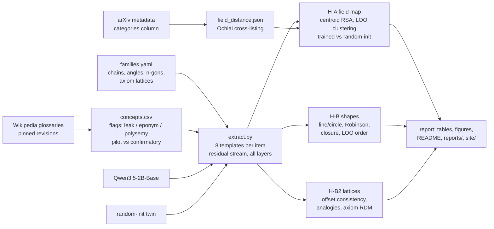

# Geometry of representations of mathematics in LLMs

**Do LLMs organize mathematics geometrically, the way they put days of the week on a circle?**

[Engels et al. (2024)](https://arxiv.org/abs/2405.14860) found that LLMs represent days of the week and months on *circles*, and use those circles to do modular arithmetic. Other work has found:
- a "math/code lobe" among sparse-autoencoder features ([Li et al. 2024](https://arxiv.org/abs/2410.19750));
- a 3D spiral for the periodic table in Llama ([Lei & Cooper 2025](https://arxiv.org/abs/2502.10871));
- a helix for numbers ([Kantamneni & Tegmark 2025](https://arxiv.org/abs/2502.00873)).

As far as our literature search found, nobody has asked the same question of **abstract mathematics itself**. This repo asks it in three parts:

1. **Map of fields (H-A).** Do concepts from algebraic topology, number theory, probability, … form a map whose distances track how related the fields are? Relatedness is measured from arXiv cross-listing statistics.
2. **Shape families (H-B).** Do ordered mathematical families form the shapes theory predicts?
   - Chains of class inclusions should be 1D ordered arcs ([Karkada et al. 2026](https://arxiv.org/abs/2602.15029)), e.g. rng ⊃ ring ⊃ integral domain ⊃ UFD ⊃ PID ⊃ field, or T0 ⊃ T1 ⊃ Hausdorff ⊃ … ⊃ Hilbert.
   - Angles 0°–330° should be a circle.
   - n-gons should follow the number line.
3. **Axiom lattices (H-B2).** Each algebraic structure is a vector of axioms: magma, quasigroup, loop, semigroup, monoid, group, abelian group, racks and quandles, Lie groups. Does adding an axiom correspond to a consistent direction, so that monoid − semigroup ≈ loop − quasigroup? This is the parallelogram "crystal" geometry of [Li et al. 2024](https://arxiv.org/abs/2410.19750), applied to axioms.

**Methodology highlights:**
- **Preregistration first.** [`docs/prereg.md`](docs/prereg.md) was frozen and git-tagged (`prereg-v1`) before any activation was extracted.
- **Random-init twins.** Every model is compared with a *random-init twin*: the same architecture and tokenizer with no learning. The twin tells us how much "geometry" comes from word form alone. [Golechha et al. (ICLR 2025)](https://www.greaterwrong.com/posts/eczwWrmX5XNEo7JsS/intricacies-of-feature-geometry-in-large-language-models) showed this kind of control is needed.
- **Paired tests.** We simulated partial regression on distance matrices and found it inflates false positives, from 15–22% up to 53% at α = .05. So the primary tests are **paired trained-vs-random-init contrasts with concept bootstrap CIs**.
- **Leakage control.** Concept names that reveal their field ("topological space"), eponyms (Hausdorff, Banach) and everyday polysemous words ("mean", "walk") are flagged and kept out of the primary set.
- **Small-family overfitting.** With n ≤ 13 items in ≥1,536 dimensions, a supervised fit can impose any order. Shape statistics are therefore unsupervised or leave-one-out, and are tested against permutation nulls, random-init twins and random concept lists.

**Status.** The MVP runs on [`Qwen/Qwen3.5-2B-Base`](https://huggingface.co/Qwen/Qwen3.5-2B-Base), which has official [Qwen-Scope](https://huggingface.co/Qwen/SAE-Res-Qwen3.5-2B-Base-W32K-L0_50) sparse autoencoders. The other models are robustness runs:
- Qwen3.5-0.8B, for scale;
- Gemma-4-E2B, a second model family;
- Qwen2.5-1.5B vs Qwen2.5-Math-1.5B, a math-training ablation: the same base, plus 1T math tokens ([Qwen2.5-Math report](https://arxiv.org/abs/2409.12122), Fig. 2).

## Results

<!-- RESULTS:START -->
*Auto-generated from `results/mvp/` by `run.py report`. Full tables: [`reports/mvp_results.md`](reports/mvp_results.md).*

**H-A1 field map.**

| Model | Concept set | n concepts / fields | ρ_field trained (perm p) [95% CI] | ρ random-init | ρ layer-0 | Δ trained − random-init [95% CI] | LOO field acc trained / random / layer-0 (chance) | split-half reliability |
|---|---|---|---|---|---|---|---|---|
| qwen3.5-2b | math_primary | 398 / 17 | 0.387 (p=<0.0001) [0.262, 0.420] | -0.118 | 0.024 | +0.506 [0.277, 0.576] | 0.472 / 0.090 / 0.279 (0.059) | 0.999 |
| qwen3.5-2b | math_all | 526 / 17 | 0.426 (p=<0.0001) [0.303, 0.448] | -0.035 | 0.115 | +0.461 [0.231, 0.548] | 0.485 / 0.108 / 0.308 (0.059) | 0.999 |

**Clustering specificity.**

| Model | Domain | n / fields | LOO acc trained [CI] | random-init | layer-0 | chance | Δ trained − random-init [CI] |
|---|---|---|---|---|---|---|---|
| qwen3.5-2b | math | 398 / 17 | 0.472 [0.427, 0.520] | 0.090 | 0.279 | 0.059 | +0.382 [0.329, 0.435] |
| qwen3.5-2b | control | 97 / 4 | 0.814 [0.732, 0.887] | 0.268 | 0.474 | 0.250 | +0.546 [0.423, 0.660] |

**H-B shape families.**

| Family | Expected | Model | line ρ | circle ρ | closure (d first-last / adjacent) | closure_far† (null 5%) | Robinson (p) | PCA order \|ρ\| (p) | LOO order ρ (p) |
|---|---|---|---|---|---|---|---|---|---|
| days | circle | qwen3.5-2b | 0.78 | 0.65 | 1.19 | 0.99 (0.76) | 0.77 (0.0010) | 0.54 (0.2284) | -0.14 (0.0731) |
| days | circle | qwen3.5-2b__random | -0.04 | -0.07 | 0.99 | 1.02 (0.96) | 0.34 (0.5002) | 0.18 (0.7106) | -0.93 (0.1993) |
| months | circle | qwen3.5-2b | 0.79 | 0.70 | 1.23 | 0.96 (0.76) | 0.66 (0.0005) | 0.55 (0.0730) | 0.77 (0.0066) |
| months | circle | qwen3.5-2b__random | -0.10 | -0.06 | 0.99 | 0.97 (0.94) | 0.30 (0.6962) | 0.32 (0.3048) | -0.78 (0.6013) |
| ring_chain | line | qwen3.5-2b | 0.48 | 0.38 | 1.63 | 1.04 (0.63) | 0.52 (0.0105) | 0.46 (0.1619) | 0.65 (0.0133) |
| ring_chain | line | qwen3.5-2b__random | -0.03 | -0.01 | 1.17 | 1.84 (0.53) | 0.30 (0.6667) | 0.50 (0.1234) | -0.45 (0.2292) |
| space_chain | line | qwen3.5-2b | 0.67 | 0.40 | 1.79 | 1.42 (0.57) | 0.65 (0.0005) | 0.83 (0.0025) | 0.87 (0.0033) |
| space_chain | line | qwen3.5-2b__random | -0.04 | 0.03 | 0.66 | 0.99 (0.54) | 0.33 (0.4993) | 0.56 (0.0770) | -0.41 (0.2625) |
| number_systems | line | qwen3.5-2b | 0.77 | 0.36 | 1.67 | 1.66 (0.56) | 0.74 (0.0045) | 0.96 (0.0020) | 0.71 (0.0066) |
| number_systems | line | qwen3.5-2b__random | 0.11 | 0.16 | 1.01 | 1.01 (0.93) | 0.26 (0.7856) | 0.39 (0.3773) | -0.82 (0.3887) |
| ngons | number_reference | qwen3.5-2b | 0.56 | 0.28 | 1.94 | 1.06 (0.54) | 0.64 (0.0010) | 0.87 (0.0030) | 0.90 (0.0033) |
| ngons | number_reference | qwen3.5-2b__random | 0.42 | 0.14 | 1.65 | 1.76 (0.57) | 0.42 (0.1159) | 0.19 (0.6007) | -0.89 (0.9236) |
| dimensions | number_reference | qwen3.5-2b | 0.66 | 0.37 | 2.17 | 1.02 (0.31) | 0.75 (0.0005) | 0.95 (0.0010) | 0.72 (0.0033) |
| dimensions | number_reference | qwen3.5-2b__random | -0.17 | -0.15 | 1.01 | 1.01 (0.93) | 0.32 (0.6117) | 0.00 (1.0000) | -0.75 (0.6578) |
| angles | circle | qwen3.5-2b | 0.56 | 0.29 | 2.11 | 1.01 (0.39) | 0.65 (0.0005) | 0.90 (0.0005) | 0.76 (0.0033) |
| angles | circle | qwen3.5-2b__random | -0.01 | 0.22 | 0.80 | 1.01 (0.77) | 0.26 (0.8581) | 0.08 (0.8076) | -0.49 (0.3754) |

**H-B2 axiom lattices.**

| Lattice | Model | axiom-RDM β (p) | lexical β | offset consistency per axiom: obs / null95 (p) | analogy top-1 (chance) | mean rank (chance) |
|---|---|---|---|---|---|---|
| group_like | qwen3.5-2b | +0.492 (0.0002) | +0.236 | associative: 0.43/0.23 (0.0035); identity: 0.24/0.22 (0.0425); divisible: 0.29/0.22 (0.0275); commutative: 0.53/0.20 (0.0010) | 0.56 (0.10) | 2.5 (5.5) |
| self_distributive | qwen3.5-2b | +0.123 (0.3393) | -0.446 | invertible: 0.48/0.78 (0.2039); idempotent: 0.17/0.78 (0.4268) | 1.00 (0.50) | 1.0 (1.5) |
| gender control | qwen3.5-2b | — | — | gender: 0.28/0.09 | king:queen rank 1 | — |
| group_like | qwen3.5-2b__random | +0.302 (0.0010) | -0.403 | associative: 0.02/0.16 (0.3678); identity: 0.04/0.16 (0.3068); divisible: 0.01/0.16 (0.4338); commutative: 0.01/0.14 (0.4048) | 0.31 (0.10) | 3.6 (5.5) |
| self_distributive | qwen3.5-2b__random | +0.316 (0.1284) | -0.275 | invertible: -0.01/0.56 (0.5207); idempotent: 0.01/0.56 (0.4493) | 1.00 (0.50) | 1.0 (1.5) |
| gender control | qwen3.5-2b__random | — | — | gender: 0.00/0.07 | king:queen rank 15 | — |


<!-- RESULTS:END -->

## How it works



Running the pipeline:

1. **`concepts`.** Downloads each Wikipedia glossary at a pinned revision. Extracts glossary terms, cleans and flags them, keeps ≤30 primary concepts per field, and writes `data/concepts.csv` with a 20% pilot / 80% confirmatory split.
2. **`arxiv`.** Streams only the `categories` column of the arXiv metadata snapshot (about 3M papers). Computes how often papers in two fields are cross-listed, and writes `data/field_distance.json`.
3. **`extract`.** For the trained model and its random-init twin, runs every concept through 8 templates that end with the concept, e.g. "In mathematics, the notion of *principal ideal domain*". It stores the residual stream at the concept's last token, and the mean over its tokens, at every layer: `artifacts/acts/<model>/*.npz`. Every prompt and the model's greedy next token are logged to `logs/*_prompts.jsonl`.
4. **`map`, `shapes`, `lattice`.** Compute the preregistered statistics at relative depth 0.5 plus full layer curves, and write `results/<config>/*.json`.
5. **`report`.** Regenerates every table and figure from the results JSON: README results block, `reports/`, `site/`.

## Install and run

Requirements: Windows/Linux, Python 3.12 via [uv](https://docs.astral.sh/uv/), and an NVIDIA GPU with ≥ 8 GB of memory. CUDA 13 wheels are configured in `pyproject.toml`, following the [uv PyTorch guide](https://docs.astral.sh/uv/guides/integration/pytorch/).

```bash
git clone https://github.com/BurnyCoder/geometry-of-representations-of-mathematics-in-llms
```

```bash
cd geometry-of-representations-of-mathematics-in-llms && uv sync
```

```bash
cp .env.example .env
```

Edit `.env` to set `HF_HOME` and `MATHGEOM_ARTIFACTS` to a drive with about 20 GB free.

```bash
uv run pytest
```

```bash
uv run python run.py all --config configs/mvp.yaml
```

You can also run a single phase: `uv run python run.py extract --config configs/mvp.yaml`.

## Repository layout

| Path | What it holds |
|---|---|
| `run.py` | Single entry point that calls the named phases |
| `src/mathgeom/data/` | Glossary fetching and parsing, arXiv field distances, leakage flags, concept table |
| `src/mathgeom/prompts/templates.py` | Field-neutral, field-revealing, family and no-domain templates |
| `src/mathgeom/models/load.py` | Trained and random-init model loading (HF transformers v5) |
| `src/mathgeom/extract.py` | Residual-stream extraction with full prompt logging |
| `src/mathgeom/geometry/` | Preprocessing (centering, all-but-the-top), RDMs, shape statistics, offset/analogy statistics |
| `src/mathgeom/stats/` | RDM regression with Freedman–Lane permutation, bootstrap |
| `src/mathgeom/analyses/` | H-A field map, H-B shapes, H-B2 lattices |
| `configs/` | `fields.yaml` (field ↔ glossary ↔ arXiv mapping), `families.yaml` (ground-truth orders and axiom bits with sources), run configs |
| `docs/` | `prereg.md`, `deviations.md` |
| `tests/` | Synthetic-structure recovery, type-I calibration, leakage, extraction-equivalence tests |

## Technologies

PyTorch 2.14 (CUDA 13), Hugging Face `transformers` 5.x, NumPy/SciPy/scikit-learn, pandas, BeautifulSoup and the MediaWiki API, pyarrow and `huggingface_hub` (arXiv metadata), wordfreq, matplotlib and plotly.

## Related work this builds on

- Engels et al. 2024, *Not All Language Model Features Are (One-Dimensionally) Linear*, [arXiv:2405.14860](https://arxiv.org/abs/2405.14860): circular day/month features.
- Li, Michaud, Baek, Engels, Sun, Tegmark 2024, *The Geometry of Concepts*, [arXiv:2410.19750](https://arxiv.org/abs/2410.19750): SAE feature crystals and a math/code lobe.
- Karkada et al. 2026, *Symmetry in language statistics shapes the geometry of model representations*, [arXiv:2602.15029](https://arxiv.org/abs/2602.15029).
- Park et al. 2024, *The Geometry of Categorical and Hierarchical Concepts in LLMs*, [arXiv:2406.01506](https://arxiv.org/abs/2406.01506), and the critique by Golechha et al. (ICLR 2025).
- Tiblias et al. 2025, *Shape Happens* (SMDS), [arXiv:2510.01025](https://arxiv.org/abs/2510.01025).
- Lei & Cooper 2025, periodic-table spiral, [arXiv:2502.10871](https://arxiv.org/abs/2502.10871).
- Kantamneni & Tegmark 2025, *Language Models Use Trigonometry to Do Addition*, [arXiv:2502.00873](https://arxiv.org/abs/2502.00873).
- Mu & Viswanath 2018, *All-but-the-Top*, [arXiv:1702.01417](https://arxiv.org/abs/1702.01417).
- Guillot & Rousset 2013, *Dismantling the Mantel tests*, [doi:10.1111/2041-210X.12018](https://doi.org/10.1111/2041-210X.12018).
- Freedman & Lane 1983, and Anderson & Legendre 1999, [doi:10.1080/00949659908811970](https://doi.org/10.1080/00949659908811970): permutation tests for partial regression.

## Data licences

- Wikipedia text: CC BY-SA 4.0.
- arXiv metadata snapshot: CC0.
- Models: Apache-2.0.
- Qwen-Scope SAEs: Qwen licence, research use.
