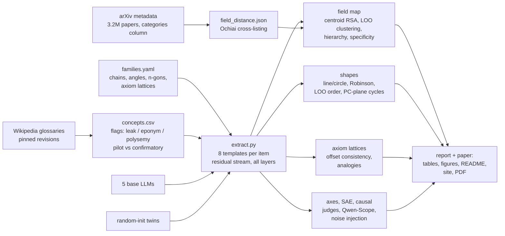

# Geometry of representations of mathematics in LLMs

**Do LLMs organize mathematics geometrically, the way they put days of the week on a circle?**

[Engels et al. (2024)](https://arxiv.org/abs/2405.14860) found that LLMs represent days of the week and months on *circles*. Others found:
- a "math/code lobe" among sparse-autoencoder features ([Li et al. 2024](https://arxiv.org/abs/2410.19750));
- a 3D spiral for the periodic table ([Lei & Cooper 2025](https://arxiv.org/abs/2502.10871));
- a helix for numbers ([Kantamneni & Tegmark 2025](https://arxiv.org/abs/2502.00873)).

As far as our literature search found, nobody had asked this of **abstract mathematics itself**. This repo does, with a preregistered study of five open base models.

**Links:**
- 📄 Paper: [`paper/paper.pdf`](paper/paper.pdf)
- 🧭 Interactive explorer: <https://burnycoder.github.io/geometry-of-representations-of-mathematics-in-llms/>
- 📝 Plain-language summary: [`reports/summary.md`](reports/summary.md)
- 🔒 Preregistration: [`docs/prereg.md`](docs/prereg.md), frozen as git tag `prereg-v1` before any activation was extracted
- 🤗 Data and activations: [dataset](https://huggingface.co/datasets/BurnyCoder/geometry-of-mathematics-in-llms) · [collection](https://huggingface.co/collections/BurnyCoder/geometry-of-mathematics-in-llms-6ae31ee0d9b29a69547607cc)


**At a glance.** Blue is a trained model; grey is its random-init twin (same architecture and tokenizer, no learning).
- **A:** in all five models, field centroids track how often mathematicians cross-list papers between fields; the twins do not.
- **B:** the confirmatory model's map. Grey edges join each field to its two nearest arXiv neighbours; most stay short.
- **C:** days of the week close into a circle (the positive control).
- **D:** angles do not, falsifying our preregistered prediction: 330° sits far from 0°.
- **E:** "adding an axiom" moves a structure in a consistent direction, unlike in the twins. Diamonds show the value with the word-length (token-count) direction removed.

★ marks the preregistered confirmatory model.

<p align="center"></p>

*Days and months in the top-2 principal-component plane of Qwen3.5-2B, layer by layer. Explore every model, layer and family in the [interactive explorer](https://burnycoder.github.io/geometry-of-representations-of-mathematics-in-llms/).*

## Highlights

**Positive results.** Each model is compared with its random-init twin: the same architecture and tokenizer, with no learning.
- **Math fields form a map.** Field centroids from 17 fields correlate with how often mathematicians cross-list papers between those fields on arXiv. This holds in all five models (Qwen3.5-2B/0.8B, Qwen2.5-1.5B, Qwen2.5-Math-1.5B, Gemma-4-E2B), and every random-init twin is near zero or below. The map is stronger than in fastText word vectors, and about as strong as in a dedicated text-embedding model (Qwen3-Embedding).
- **Class-inclusion chains are ordered**, e.g. rng ⊃ ring ⊃ integral domain ⊃ … ⊃ field, and T0 ⊃ T1 ⊃ Hausdorff ⊃ … ⊃ Hilbert. This replicates in all five models.
- **Axioms act as directions.** In the lattice magma → semigroup → monoid → group → abelian group, "add associativity" and "add commutativity" are consistent vectors: same-axiom differences are parallel. They survive multiple-comparison correction and replicate in all five models. The twins show much weaker offsets or none; Gemma's twin has weak lexical offsets for two axioms. "Add identity" and "add divisibility" point the same way but more weakly.
- **Lie groups sit between "group" and "smooth manifold".** The analogies topological group − group ≈ topological space − set, and Lie group − topological group ≈ smooth manifold − topological space, hold in all five models (exploratory). The twins put "group" nearest to "Lie group" because of the shared word, and except for Gemma's twin they place "smooth manifold" far away.
- **Concrete ↔ abstract is the top principal axis** of math-concept space in Qwen3.5-2B; pure ↔ applied is the second. Abstraction is rated by three LLM judges from other model families.

**Negative and null results:**
- **Angles are not a circle.** "330 degrees" sits next to "300 degrees", not next to "0 degrees", in all five models. Their geometry tracks the bare numerals. This falsifies one of our preregistered predictions.
- **The map is not a clean hierarchy (H-A2).** Under the preregistered measure (cophenetic correlation with a five-branch super-tree), the trained models beat shuffled trees but not their random-init twins. They are also no more tree-like than a Gaussian cloud with the same spectrum.
- **A trillion tokens of math pretraining did not sharpen the map.** Qwen2.5-Math vs its base shows no detectable difference (H-A3).
- **The map is not special to mathematics.** Biology, chemistry, geology and astronomy topics cluster at least as strongly once the number of fields is matched.
- **The causal test was inconclusive.** Noise in the chain subspace barely hurt task accuracy beyond random-subspace noise.
- **The positive control (days and months as circles) failed our preregistered full-space criterion.** It replicates only with a post-hoc 2-D principal-component test, the way Engels et al. visualize it. Both outcomes are reported.

**Methods finding.** Before touching LLM data, we simulated partial regression on distance matrices. When the nuisance matrix is only a proxy of a confounder, it rejects true nulls far too often. That is why every primary test here is a paired contrast against a random-init twin, with concept-bootstrap CIs.

## Results

<!-- RESULTS:START -->
*This block is auto-generated by `python run.py paper` from `results/*/*.json`. Full tables: [`reports/mvp_results.md`](reports/mvp_results.md), [`reports/robustness_results.md`](reports/robustness_results.md), [`reports/gemma_results.md`](reports/gemma_results.md). Summary for non-specialists: [`reports/summary.md`](reports/summary.md). Paper: [`paper/paper.pdf`](paper/paper.pdf). Interactive explorer: <https://burnycoder.github.io/geometry-of-representations-of-mathematics-in-llms/>.*

### Scorecard: every test in every model

| Test | Qwen3.5-2B | Qwen3.5-0.8B | Qwen2.5-1.5B | Qwen2.5-Math-1.5B | Gemma-4-E2B |
|---|---|---|---|---|---|
| Field map tracks arXiv beyond the twin (H-A1; Δρ CI) | ● 0.39 | ● 0.37 | ● 0.41 | ● 0.39 | ● 0.44 |
| Field map is a hierarchy beyond the twin (H-A2; cophenetic Δ CI) | ○ 0.24 | ○ 0.25 | ○ 0.24 | ○ 0.11 | ○ 0.23 |
| Days form a cycle (positive control; post-hoc PC plane) | ● 1.00 | ● 1.00 | ● 1.00 | ● 1.00 | ● 1.00 |
| Ring chain ordered (Robinson; > twin) | ● 0.52 | ● 0.50 | ● 0.54 | ● 0.56 | ● 0.50 |
| Space chain ordered (Robinson; > twin) | ● 0.65 | ● 0.64 | ● 0.71 | ● 0.68 | ● 0.57 |
| Ring / space order beyond frequency | ● / ● | ● / ● | ● / ● | ● / ● | ○ / ○ |
| Angles form a circle (closure < 2 and circle ρ > line ρ) | ✗ 2.11 | ✗ 2.59 | ✗ 2.15 | ✗ 1.84 | ✗ 2.03 |
| Axiom direction: associative (offset consistency; Holm) | ● 0.43 | ● 0.47 | ● 0.38 | ● 0.35 | ● 0.56 |
| Axiom direction: identity (offset consistency; Holm) | ◐ 0.24 | ○ 0.22 | ◐ 0.27 | ● 0.27 | ○ 0.19 |
| Axiom direction: divisible (offset consistency; Holm) | ◐ 0.29 | ◐ 0.26 | ◐ 0.25 | ● 0.30 | ● 0.35 |
| Axiom direction: commutative (offset consistency; Holm) | ● 0.53 | ● 0.57 | ● 0.41 | ● 0.45 | ● 0.74 |
| Lie / topological / algebraic groups as parallelograms | ● 0.40 | ● 0.46 | ● 0.41 | ● 0.41 | ● 0.48 |

● significant (Holm-adjusted for the axiom tests; 95% CI excludes 0 for Δ tests) · ◐ raw p < .05 only · ○ not significant · ✗ pre-registered prediction falsified. Numbers: the statistic for the trained model.

*Interactive version, with hover details and filters: [scorecard](https://burnycoder.github.io/geometry-of-representations-of-mathematics-in-llms/#fig-scorecard).*

**Headline: every model vs its random-init twin, at the preregistered layer (relative depth 0.5).**

The columns are:
- **Field ρ:** Spearman correlation between the field-centroid RDM and arXiv cross-listing distance.
- **LOO acc:** leave-one-out field accuracy over 17 fields (chance ≈ 0.06).
- **Axiom offsets:** the mean cosine of same-axiom difference vectors in the group-like lattice (the random-pair null is ≈ 0).

| Model | Field ρ trained | Field ρ twin | Δ 95% CI | LOO acc trained / twin | Ring-chain Robinson (twin) | Assoc. / identity / divisible / commutative offsets (twin: commutative) | Angles closure (circle < 2) |
|---|---|---|---|---|---|---|---|
| Qwen3.5-2B (confirmatory) | 0.387 | -0.118 | [0.28, 0.58] | 0.47 / 0.09 | 0.52 (0.30) | 0.43 / 0.24 / 0.29 / 0.53 (0.01) | 2.11 |
| Qwen3.5-0.8B | 0.369 | -0.182 | [0.30, 0.59] | 0.43 / 0.16 | 0.50 (0.42) | 0.47 / 0.22 / 0.26 / 0.57 (0.02) | 2.59 |
| Qwen2.5-1.5B | 0.406 | -0.093 | [0.32, 0.57] | 0.57 / 0.22 | 0.54 (0.35) | 0.38 / 0.27 / 0.25 / 0.41 (0.16) | 2.15 |
| Qwen2.5-Math-1.5B | 0.390 | -0.087 | [0.30, 0.54] | 0.59 / 0.21 | 0.56 (0.41) | 0.35 / 0.27 / 0.30 / 0.45 (0.15) | 1.84 |
| Gemma-4-E2B | 0.436 | -0.021 | [0.29, 0.60] | 0.42 / 0.20 | 0.50 (0.28) | 0.56 / 0.19 / 0.35 / 0.74 (0.02) | 2.03 |

**Math-training ablation (H-A3).** Field ρ is 0.390 for Qwen2.5-Math vs 0.406 for its base. The paired Δ 95% CI is [-0.059, 0.017]: no detectable effect.

**Abstraction axis (H-A4, Qwen3.5-2B).** After partialling out frequency and token count:
- PC1 correlates with LLM-judge abstraction at ρ = 0.49 (twin 0.06).
- PC2 correlates with pure/applied at ρ = -0.41.
- The judges' ratings agree with an external, non-LLM measure, the import depth of each concept's definition in [Mathlib](https://github.com/leanprover-community/mathlib4): ρ = 0.37, 95% CI [0.07, 0.62]. Only 39 of 655 concepts could be matched, so this validation is weak.

**Methods check.** Partial RDM regression rejects a true null 52% of the time when the nuisance is a noisy proxy of a confounder. That is why the primary tests are paired twin contrasts.

### Figures

Each figure states what it shows, what to notice, and its main caveat. Pictures are unsupervised projections (PCA or MDS) of the same activations the statistics use, and every number is read from the results files. The pictures come from the preregistered confirmatory model, Qwen3.5-2B; the [interactive explorer](https://burnycoder.github.io/geometry-of-representations-of-mathematics-in-llms/) shows all five models, every layer, and the twin.

#### Effect sizes for every confirmatory and added test


- **What you see:** each line is a 95% bootstrap CI, one per model or comparison. Blue means the CI excludes 0.
- **What to notice:**
  - The field map beats the random-init twin in all five models.
  - It beats fastText but not Qwen3-Embedding.
  - Math pretraining (H-A3) and the hierarchy test (H-A2) are nulls.
- **Caveat:** these CIs are unadjusted; the Holm decisions are in the scorecard. [Interactive](https://burnycoder.github.io/geometry-of-representations-of-mathematics-in-llms/#fig-forest).

#### The map of mathematics


- **What you see:** 17 fields laid out by metric MDS for three distance matrices: arXiv cross-listing (ground truth), the trained model's field centroids, and the random-init twin's. Grey edges join each field to its 2 nearest arXiv neighbours, and they are drawn in every panel.
- **What to notice:** in the trained model most of these edges stay short, so algebraic fields sit together and the applied fields (orange) sit together. In the twin the edges cross the whole map.
  - Trained: ρ = 0.39.
  - Twin: ρ = -0.12.
- **Caveat:**
  - ρ is computed on the full distance matrices, not on these 2-D pictures. Alignment (rotation and reflection) is for display only.
  - ρ ≈ 0.4 is a moderate correlation, and the picture shows that: several edges are long even in the trained model.
- [Interactive, with a layer slider](https://burnycoder.github.io/geometry-of-representations-of-mathematics-in-llms/#fig-map).


- **What you see:** the same three distance matrices, colour = rank of each distance within its matrix (Spearman compares ranks). Rows are in one fixed order, grouped by the five super-tree branches.
- **What to notice:** the trained matrix partly reproduces the arXiv matrix's light algebra block and dark applied rows; the twin's matrix has no such structure.
- **Caveat:** a fixed row order is essential; re-clustering each matrix separately would create blocks out of noise. [Interactive, with linked hover](https://burnycoder.github.io/geometry-of-representations-of-mathematics-in-llms/#fig-rdm).


- **What you see:** ρ with arXiv at every layer, per model. The horizontal line is the 95th percentile of the max-over-layers permutation null. The vertical line marks the preregistered layer.
- **What to notice:**
  - The four Qwen models clear the null at every layer.
  - Gemma clears it at most depths but dips below it in two stretches.
  - Every twin stays at or below zero.
- **Caveat:** only the preregistered layer is a confirmatory test; any "best layer" is post-hoc. [Interactive](https://burnycoder.github.io/geometry-of-representations-of-mathematics-in-llms/#fig-depth).

#### Shapes: circles for days and months, lines for chains, no circle for angles


- **What you see:** the top-2 principal-component plane of each family; colour runs light → dark along the true order, and the grey path joins consecutive items.
- **What to notice:** days and months close into cycles in the trained model (cycle score 1.00 and 1.00) and not in the twin. For angles, the orange edge is the closure the preregistration predicted (330° next to 0°); in the model it spans the whole plot.
- **Caveat:** days and months are the positive control, and the PC-plane cycle score is post-hoc. [Interactive, every family and layer](https://burnycoder.github.io/geometry-of-representations-of-mathematics-in-llms/#fig-families).


- **What you see:** the same days and months planes through every layer, each frame rotated onto the preregistered layer's plane.
- **What to notice:** both cycles are present from the first layers and hold at almost every depth, breaking mainly at the final layer; the twin never forms one.
- **Caveat:** the cycle score is post-hoc and unadjusted per layer. Static version at fixed depths: [`circle_depth_qwen3.5-2b.png`](reports/figures/circle_depth_qwen3.5-2b.png).


- **What you see:** the preregistered prediction (left), what the model does (middle), and the bare numbers 0–330 (right).
- **What to notice:** the angles' geometry matches the numbers' (ρ = 0.84). The model encodes "330 degrees" by its numeral, not by its angle, which falsifies our prediction.
- **Caveat:** this is one prompt format at this model scale; larger models may differ. [Interactive](https://burnycoder.github.io/geometry-of-representations-of-mathematics-in-llms/#fig-families).


- **What you see:** the class-inclusion chains in the PC plane, trained (top) and twin (bottom), with the Robinson score below each panel.
- **What to notice:** the ring and space chains run as ordered paths and stay ordered after word frequency and token count are removed. In the twin they collapse to a tangle.
- **Caveat:** two twins also order the ring chain beyond frequency, so word form ("… domain") carries part of that order. [Interactive](https://burnycoder.github.io/geometry-of-representations-of-mathematics-in-llms/#fig-families).

#### Axioms as directions


- **What you see:** left, the ideal geometry, where each axiom is one fixed step. Each other panel is the same unsupervised PCA plane, highlighting the pairs that differ only in one axiom.
- **What to notice:** in the trained model the highlighted arrows point roughly the same way; in the twin they point everywhere.
- **Caveat:** a 2-D picture can hide or exaggerate parallelism; the next figure shows the full-dimensional evidence. [Interactive, with an analogy playground](https://burnycoder.github.io/geometry-of-representations-of-mathematics-in-llms/#fig-lattice).


- **What you see:** the cosine between every pair of single-axiom difference vectors, grouped by axiom.
- **What to notice:** bright red diagonal blocks mean "adding this axiom" is a consistent direction. They are clear for associativity and commutativity, and weaker for identity and divisibility. The dot plot on the right shows that the offsets survive removing the token-count direction.
- **Caveat:** hatched cells are cross-axiom pairs that share a structure; their cosine is about ±0.5 even for random vectors, so they carry no evidence. [Interactive](https://burnycoder.github.io/geometry-of-representations-of-mathematics-in-llms/#fig-cosines).


- **What you see:** left, how parallel the three parallelograms are (for example, Lie group − topological group vs smooth manifold − topological space) in every model and twin. Right, where "group" and "smooth manifold" rank among the neighbours of "Lie group".
- **What to notice:** every trained model clears the null (Qwen3.5-2B: 0.40). Trained models place "Lie group" near both parents. The twins put "group" nearest, and except for Gemma's twin place "smooth manifold" far away.
- **Caveat:** exploratory, and the twins' closeness to "group" is purely lexical (shared token). [Interactive](https://burnycoder.github.io/geometry-of-representations-of-mathematics-in-llms/#fig-groups).

#### Concrete ↔ abstract


- **What you see:** the 398 primary concepts on their first two principal components (after frequency and token count are removed), coloured by judge abstraction (left) and pure/applied (middle). Right: judge ratings vs the Mathlib import depth of each concept's definition.
- **What to notice:** PC1 runs from concrete to abstract (ρ = 0.49, twin 0.06), and PC2 from pure to applied. The judges' ratings rise with Mathlib depth.
- **Caveat:** ratings come from LLM judges, and only 39 concepts could be matched to Mathlib. [Interactive](https://burnycoder.github.io/geometry-of-representations-of-mathematics-in-llms/#fig-abstraction).

<!-- RESULTS:END -->

## How it works



**Pipeline phases** (`python run.py <phase> --config configs/<cfg>.yaml`):

| Phase | What it does | Output |
|---|---|---|
| `calibration` | Simulates the type-I error and power of distance-matrix tests (why we use twin contrasts) | `results/<cfg>/calibration.json` |
| `concepts` | Fetches each Wikipedia glossary at a pinned revision, cleans the terms, flags field leaks, eponyms and polysemous words, keeps ≤ 30 primary concepts per field, and makes a 20/80 pilot/confirmatory split | `data/concepts.csv` |
| `arxiv` | Streams the `categories` column of the arXiv metadata and computes field-to-field cross-listing distances | `data/field_distance.json` |
| `extract` | Runs every item through 8 templates for the trained model and its random-init twin. Stores the residual stream at the concept's last token (and the token mean) for every layer, and logs every prompt plus the greedy next token | `artifacts/acts/<model>/*.npz`, `logs/*_prompts.jsonl` |
| `map`, `shapes`, `lattice` | Preregistered statistics at relative depth 0.5, plus layer curves | `results/<cfg>/*.json` |
| `posthoc` | Labelled post-hoc analyses: all-but-the-top sweep, PC-plane cycles, matched clustering | `results/<cfg>/posthoc.json` |
| `judges`, `mathlib`, `axes` | LLM-judge abstraction ratings; their validation against Mathlib import depth; principal axes vs abstraction and pure/applied | `data/judge_ratings.csv`, `data/mathlib_depth.csv`, `results/<cfg>/{judges,mathlib,axes}.json` |
| `causal`, `sae`, `compare` | Gated noise-injection test; Qwen-Scope SAE codes; paired model contrast (H-A3) | `results/<cfg>/*.json` |
| `report` | Tables, figures and explorer data for one config | `reports/<cfg>_results.md`, `reports/figures/`, `site/data.json` |
| `paper` | README results block, `reports/summary.md`, `paper/paper.md` and PDF, with every number resolved from the results JSON | |

**Configs.**
- `mvp` (confirmatory): Qwen3.5-2B-Base, plus the judges, causal and SAE phases.
- `robustness`: Qwen3.5-0.8B, Qwen2.5-1.5B, Qwen2.5-Math-1.5B.
- `gemma`: Gemma-4-E2B. Its 2.35B-parameter per-layer-embedding table stays in CPU RAM.

## Install and run

Requirements: Python 3.12 through [uv](https://docs.astral.sh/uv/); an NVIDIA GPU with ≥ 8 GB, using CUDA 13 wheels per the [uv PyTorch guide](https://docs.astral.sh/uv/guides/integration/pytorch/); about 30 GB of disk for models and activations; pandoc with xelatex for the PDF.

```bash
git clone https://github.com/BurnyCoder/geometry-of-representations-of-mathematics-in-llms
```

```bash
cd geometry-of-representations-of-mathematics-in-llms && uv sync
```

```bash
cp .env.example .env
```

Then set `HF_HOME` and `MATHGEOM_ARTIFACTS` in `.env` to a drive with space.

```bash
uv run pytest
```

```bash
uv run python run.py all --config configs/mvp.yaml
```

Repeat with `configs/robustness.yaml` and `configs/gemma.yaml`, then build the README block, summary and paper:

```bash
uv run python run.py paper --config configs/mvp.yaml
```

To preview the explorable article locally (it fetches `site/data/*.json`, so it needs a web server rather than a file URL):

```bash
uv run python -m http.server 8791 --directory site
```

**Runtime** on an RTX 5070 Laptop (8 GB):
- Extraction: about 35 minutes per model pair for Qwen3.5 (hybrid linear attention falls back to the PyTorch implementation), about 15 minutes for Qwen2.5, about 35 minutes for Gemma.
- Analysis: about 1 hour per config, dominated by the shape negative control.

## Repository layout

| Path | Contents |
|---|---|
| `run.py` | Single entry point that calls named phases |
| `src/mathgeom/data/` | Glossary fetching/parsing, arXiv field distances, leakage flags, concept table, LLM judges |
| `src/mathgeom/prompts/templates.py` | Field-neutral, field-revealing, family and no-domain templates |
| `src/mathgeom/models/load.py` | Trained and random-init loading (transformers 5.x), Gemma PLE-on-CPU placement |
| `src/mathgeom/extract.py` | Residual-stream extraction with prompt logging |
| `src/mathgeom/geometry/` | Centering, all-but-the-top, RDMs; shape statistics; offset/analogy statistics |
| `src/mathgeom/stats/` | Freedman–Lane RDM regression and bootstrap |
| `src/mathgeom/analyses/` | Field map, shapes, lattices, causal test, SAE, calibration simulations |
| `src/mathgeom/report/` | Tables (`render.py`), the visual system (`style.py`: palette checked for colour-vision deficiency), shared figure data (`figdata.py`: unsupervised projections, exact low-dimensional lattice coordinates), static figures (`figures/`), the explorer export (`site.py`), and the paper/summary/README builder (`paper.py`; placeholders resolved from results) |
| `configs/` | `fields.yaml` (field ↔ glossary ↔ arXiv ↔ branch), `families.yaml` (ground truth with sources), run configs |
| `docs/` | `prereg.md`, `deviations.md` (every post-hoc change), `data_card.md`, `figures.md` (figure catalogue, visual system, integrity rules, site data) |
| `reports/` | Per-config results (generated), `summary.md` (generated), `experiments.md` (learnings: what was tried and why) |
| `paper/` | `template.md`, the generated `paper.md` and `paper.pdf` |
| `site/` | Explorable article (`index.html`, `app.js`, `style.css`) reading `site/data/*.json`; deployed to GitHub Pages |
| `tests/` | Synthetic shape recovery, type-I calibration, leakage, extraction equivalence |

## Technologies

PyTorch 2.14 (CUDA 13), Hugging Face `transformers` 5.x and `huggingface_hub`, NumPy/SciPy/scikit-learn/statsmodels, pandas/pyarrow, BeautifulSoup with the MediaWiki API, wordfreq, matplotlib with adjustText (label placement), Plotly.js (explorable article), pandoc and xelatex (paper), uv, GitHub Actions/Pages.

## Related work this builds on

- Engels et al. 2024, *Not All Language Model Features Are (One-Dimensionally) Linear*, [arXiv:2405.14860](https://arxiv.org/abs/2405.14860).
- Li et al. 2024, *The Geometry of Concepts*, [arXiv:2410.19750](https://arxiv.org/abs/2410.19750).
- Karkada et al. 2026, *Symmetry in language statistics shapes the geometry of model representations*, [arXiv:2602.15029](https://arxiv.org/abs/2602.15029).
- Park et al. 2024, [arXiv:2406.01506](https://arxiv.org/abs/2406.01506), and the critique by Golechha et al. (ICLR 2025).
- Tiblias et al. 2025, *Hypothesis-Driven Feature Manifold Analysis in LLMs via Supervised Multi-Dimensional Scaling* (SMDS; v1 title "Shape Happens"), [arXiv:2510.01025](https://arxiv.org/abs/2510.01025).
- Lei & Cooper 2025, [arXiv:2502.10871](https://arxiv.org/abs/2502.10871).
- Kantamneni & Tegmark 2025, [arXiv:2502.00873](https://arxiv.org/abs/2502.00873).
- Mu & Viswanath 2018, *All-but-the-Top*, [arXiv:1702.01417](https://arxiv.org/abs/1702.01417).
- Guillot & Rousset 2013, [doi:10.1111/2041-210X.12018](https://doi.org/10.1111/2041-210X.12018).
- Anderson & Legendre 1999, [doi:10.1080/00949659908811936](https://doi.org/10.1080/00949659908811936).
- Qwen2.5-Math report, [arXiv:2409.12122](https://arxiv.org/abs/2409.12122).
- Qwen-Scope, [arXiv:2605.11887](https://arxiv.org/abs/2605.11887).

## Data and licences

- Wikipedia text: CC BY-SA 4.0.
- arXiv metadata snapshot: CC0.
- Models: Apache-2.0.
- Qwen-Scope SAEs: Qwen licence, research use.
- Judge models: Apache-2.0 / MIT.
- Mathlib4 (judge validation; only names, docs maps and import headers are read): Apache-2.0.

The dataset card is in [`docs/data_card.md`](docs/data_card.md).
