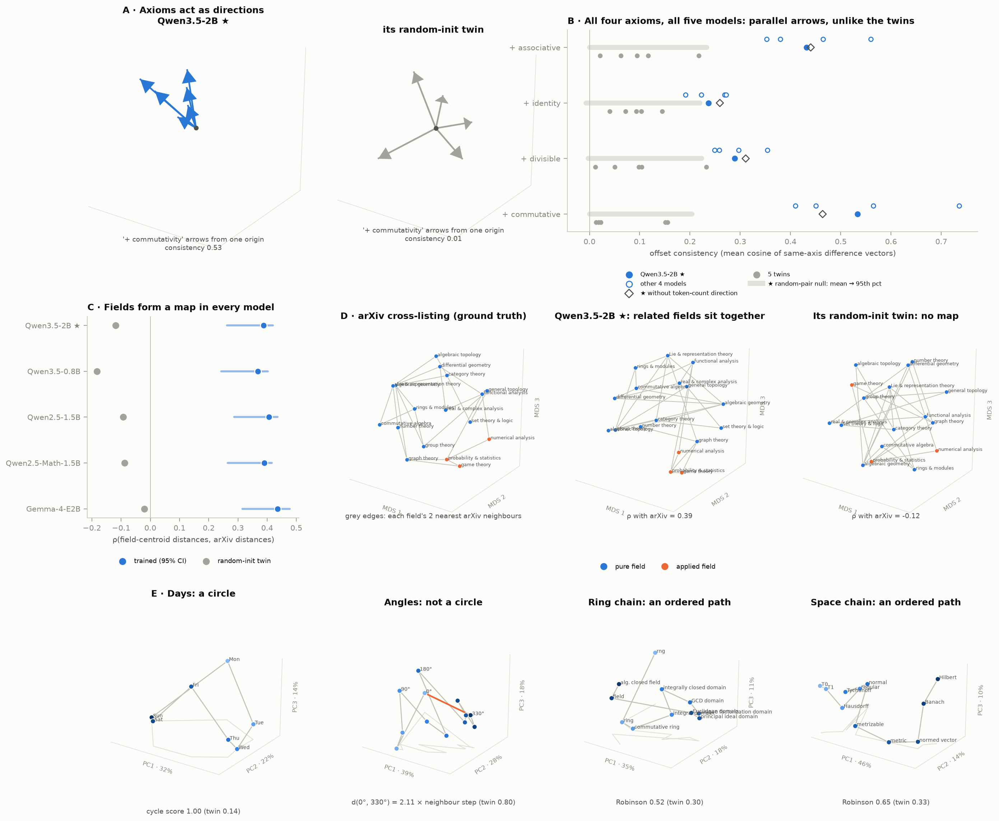
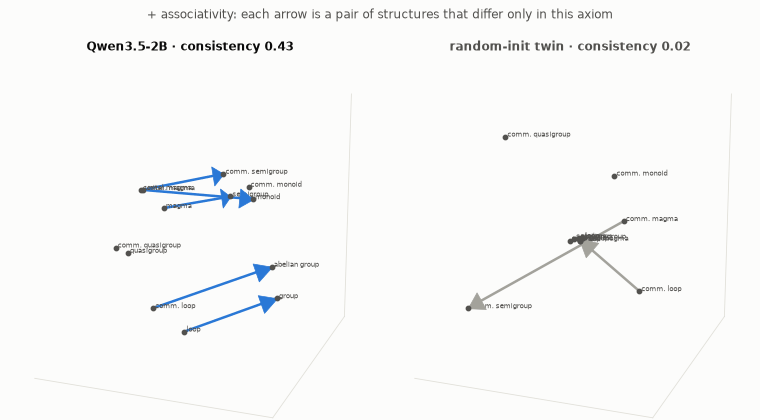
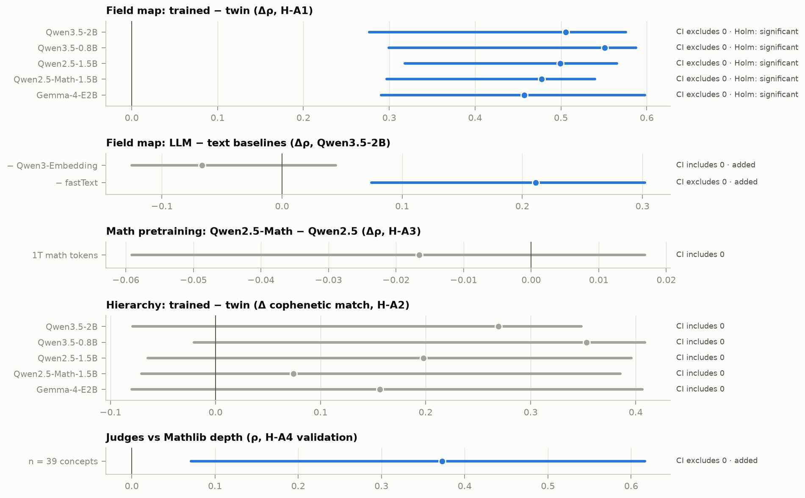
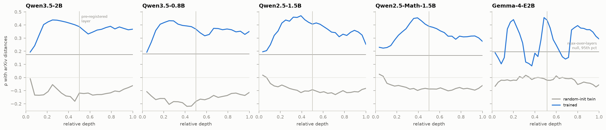
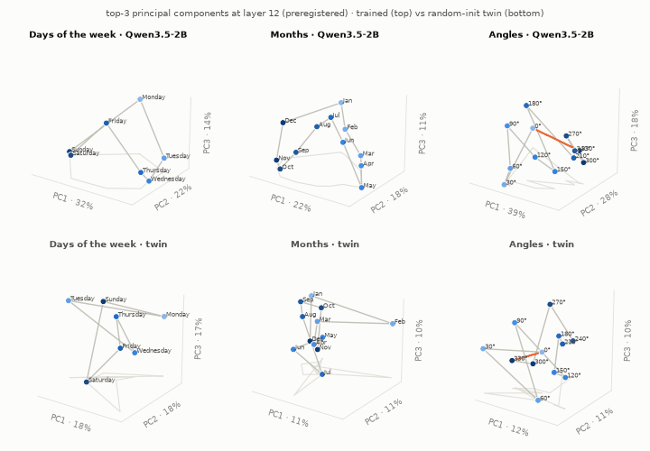
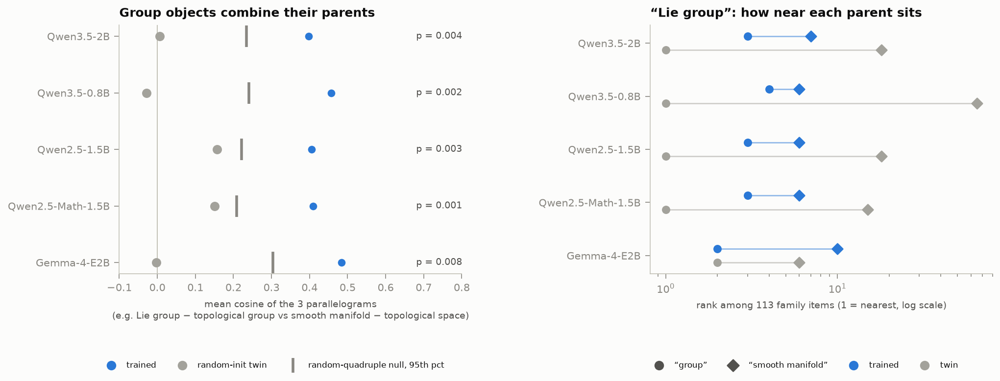
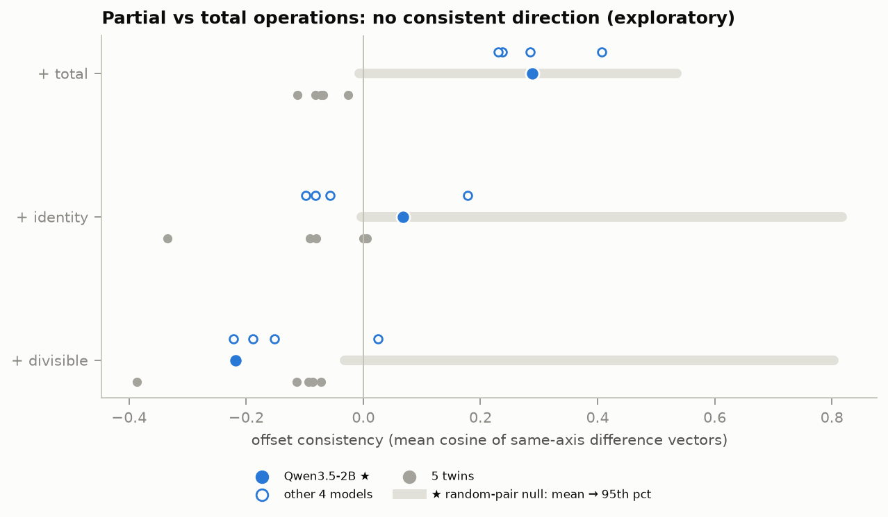
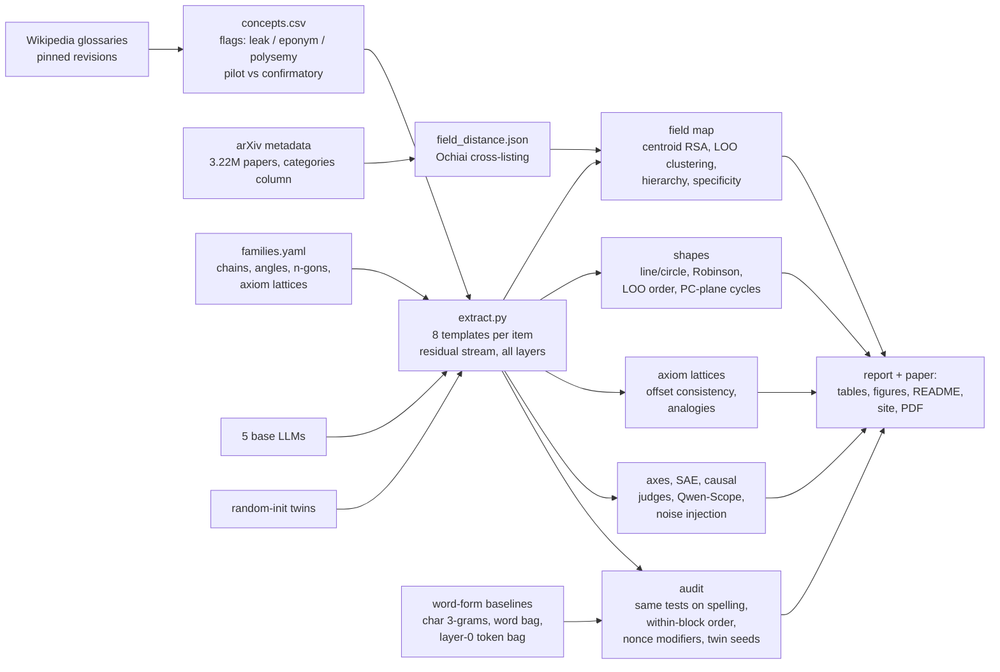

# Geometry of representations of mathematics in LLMs

**Do LLMs organize mathematics geometrically, the way they put days of the week on a circle?**

[Engels et al. (2024)](https://arxiv.org/abs/2405.14860) found that LLMs represent days of the week and months on *circles*. Others found:
- a "math/code lobe" among sparse-autoencoder features ([Li et al. 2024](https://arxiv.org/abs/2410.19750));
- a 3D spiral for the periodic table ([Lei & Cooper 2025](https://arxiv.org/abs/2502.10871));
- a helix for numbers ([Kantamneni & Tegmark 2025](https://arxiv.org/abs/2502.00873)).

As far as our literature search found, nobody had asked this of **abstract mathematics itself** in LLM residual streams (the closest earlier work embedded arXiv math terms with static word embeddings: [Berlioz 2021](https://arxiv.org/abs/2109.02801)). This repo does, with a preregistered study of five open base models.

**Links:**
- 📄 Paper: [`paper/paper.pdf`](paper/paper.pdf)
- 🧭 Interactive explorer, with rotatable 3-D views (top principal components, 3-D MDS), a layer slider and a trained ↔ twin morph: <https://burnycoder.github.io/geometry-of-representations-of-mathematics-in-llms/>
- 📝 Plain-language summary: [`reports/summary.md`](reports/summary.md)
- 🔒 Preregistration: [`docs/prereg.md`](docs/prereg.md), frozen as git tag `prereg-v1` before any activation was extracted. Two later post-hoc analyses were written down and committed before they ran (no tag): [`reports/prereg_addendum_3d.md`](reports/prereg_addendum_3d.md) and the independent audit's [`reports/prereg_addendum_lexical.md`](reports/prereg_addendum_lexical.md)
- 🔍 Independent audit (word-form controls, twin seeds, test precision): [`reports/audit_lexical.md`](reports/audit_lexical.md)
- 🤗 Data and activations: [dataset](https://huggingface.co/datasets/BurnyCoder/geometry-of-mathematics-in-llms) · [collection](https://huggingface.co/collections/BurnyCoder/geometry-of-mathematics-in-llms-6ae31ee0d9b29a69547607cc)



**At a glance.** Blue is a trained model; grey is its random-init twin (same architecture and tokenizer, no learning); orange × and dark-grey + are word-form baselines built from the names alone, without context (× the names' character 3-grams, i.e. spelling; + the model's own input embeddings summed over each name's tokens, i.e. learned token meanings). ★ marks the preregistered confirmatory model.
- **Top row, the map of mathematics:**
  - *Left:* in all five models, field centroids track how often mathematicians cross-list papers between fields (ρ with arXiv); the twins and the character 3-grams do not, and the token embeddings (+) track it only weakly.
  - *Right:* the map itself in 3-D (metric MDS), for arXiv (ground truth), the confirmatory model and its twin. Grey edges join each field to its two nearest arXiv neighbours. They mostly stay short in the trained model and cross the twin's map.
- **Middle row, axiom offsets:**
  - *Left:* every pair of structures that differs only in commutativity (e.g. monoid → commutative monoid, group → abelian group) is drawn as an arrow from one common origin, in the top-3 principal components. The trained model's arrows point roughly one way; the twin's point every way. The note compares X → wooden X, a real word that is irrelevant to algebra.
  - *Right:* offset consistency (how parallel the same-axiom arrows are in the full space) for all four axioms in every model and twin, against the random-pair null; diamonds remove the token-count direction. The orange × is the names' spelling alone, with no model, and it is about as parallel: most of the offset geometry is word form ([audit](reports/audit_lexical.md)).
- **Bottom row, shapes** (the confirmatory model in its top-3 principal components; the twin's value in brackets):
  - *Days of the week* close into a circle (the positive control; in this model, not in every model).
  - *The space chain* lies along an ordered path, also within its blocks; *the ring chain* is grouped by its head nouns (rng | ring | … domain | field), and its six "… domain" items are not ordered among themselves.
  - *Angles* do not form a circle, falsifying our preregistered prediction: 330° sits far from 0° and the angles follow the number line. The twin's closure ratio is small because its points have no order, and that is enough to pass the preregistered "closure < 2" rule, which turned out not to be specific (see [the angles results](#shapes-circles-for-days-and-months-lines-for-chains-no-circle-for-angles)).

The results are ordered by how well they survive the independent audit's word-form controls; the field map (H-A1) was also the primary preregistered hypothesis, and every test keeps its preregistered status.

<!-- TOP:START -->
*This block is auto-generated by `python run.py paper` from `results/*/*.json`.*

### Axiom offsets, in one animation

<p align="center"></p>

- **What you see:** the 13 group-like structures (magma, unital magma, quasigroup, loop, semigroup, monoid, group, and the commutative versions of all but the unital magma) in the top-3 principal components of Qwen3.5-2B (left) and of its random-init twin (right), at the preregistered layer. One axiom at a time, every pair of structures that differ only in that axiom becomes an arrow, for example monoid → commutative monoid and group → abelian group for commutativity. The arrows then slide to one common origin, so you can see whether they point the same way.
- **What to notice:** in the trained model the commutativity arrows form one bundle. Their offset consistency, the mean cosine between the 6 difference vectors in the full residual stream, is 0.53. The twin's is 0.01, and random pairs of the same structures exceed 0.20 only 5% of the time. Associativity behaves the same way (0.43, twin 0.02). Identity (0.24) and divisibility (0.29) form looser bundles.
- **But mostly word form (audit):** five of the six arrows add the literal word "commutative", and the same six heads with a made-up modifier, X → zorbic X, give 0.68. Character 3-grams of the names, with no model, give 0.62 for commutativity and 0.32 for associativity. What survives the word-form controls is an associativity direction (all 5 models) and a "commutative" direction that also predicts abelian group − group, which shares no word with it (all 5 models).
- **Caveat:** three principal components can hide or exaggerate parallelism, so the statistic is computed in the full space, never from this picture. In Qwen3.5-2B only associativity and commutativity survive Holm correction; identity and divisibility are significant before correction only (the scorecard below has every model). Step-by-step static explainer: [`axioms_explainer_qwen3.5-2b.png`](reports/figures/axioms_explainer_qwen3.5-2b.png). [Interactive: how the test works](https://burnycoder.github.io/geometry-of-representations-of-mathematics-in-llms/#fig-axiom-how), and [the lattice in 3-D](https://burnycoder.github.io/geometry-of-representations-of-mathematics-in-llms/#fig-lattice).

### Scorecard: every test in every model

| Test | Status | Qwen3.5-2B | Qwen3.5-0.8B | Qwen2.5-1.5B | Qwen2.5-Math-1.5B | Gemma-4-E2B |
|---|---|---|---|---|---|---|
| Field map tracks arXiv beyond the twin (H-A1; Mantel p and Δρ CI) | pre-registered, confirmatory | ● 0.39 | ● 0.37 | ● 0.41 | ● 0.39 | ● 0.44 |
| Field map beyond word form (Δρ vs char-3-grams, word bag, layer-0 token bag; CIs > 0) | post-hoc, audit addendum | ● +0.14 | ● +0.07 | ● +0.15 | ● +0.12 | ● +0.14 |
| Field map is a hierarchy beyond the twin (H-A2; cophenetic Δ CI) | pre-registered | ○ 0.24 | ○ 0.25 | ○ 0.24 | ○ 0.11 | ○ 0.23 |
| Space chain ordered (Robinson and LOO order; Holm; > twin) | pre-registered, confirmatory | ● 0.65 | ● 0.64 | ● 0.71 | ● 0.68 | ● 0.57 |
| Space chain ordered within both topical blocks (exact p) | post-hoc, audit addendum | ● / ● | ○ / ● | ○ / ● | ○ / ● | ○ / ● |
| Ring chain ordered (Robinson and LOO order; Holm; > twin) | pre-registered, confirmatory | ● 0.52 | ○ 0.50 | ● 0.54 | ● 0.56 | ○ 0.50 |
| Ring chain ordered within the six “… domain” items (exact p) | post-hoc, audit addendum | ○ 0.40 | ○ 0.40 | ○ 0.45 | ● 0.65 | ○ 0.10 |
| Ring / space order beyond frequency | added by plan audit | ● / ● | ● / ● | ● / ● | ● / ● | ○ / ○ |
| Axiom direction: associative (offset consistency; Holm) | pre-registered, confirmatory | ● 0.43 | ● 0.47 | ● 0.38 | ● 0.35 | ● 0.56 |
| Axiom direction: identity (offset consistency; Holm) | pre-registered, confirmatory | ◐ 0.24 | ○ 0.22 | ◐ 0.27 | ◐ 0.27 | ○ 0.19 |
| Axiom direction: divisible (offset consistency; Holm) | pre-registered, confirmatory | ◐ 0.29 | ◐ 0.26 | ◐ 0.25 | ◐ 0.30 | ◐ 0.35 |
| Axiom direction: commutative (offset consistency; Holm) | pre-registered, confirmatory | ● 0.53 | ● 0.57 | ● 0.41 | ● 0.45 | ● 0.74 |
| Axiom offsets beyond word form (assoc / ident / div / comm) | post-hoc, audit addendum | ● / ○ / ○ / ○ | ● / ○ / ○ / ○ | ● / ○ / ○ / ○ | ● / ○ / ○ / ○ | ● / ○ / ● / ○ |
| Commutative direction predicts abelian group − group (held out) | post-hoc, audit addendum | ● 0.60 | ● 0.54 | ● 0.51 | ● 0.55 | ● 0.73 |
| “commutative X” more consistent than “wooden X” and “zorbic X” | post-hoc, audit addendum | ○ 0.56 vs 0.68 | ○ 0.62 vs 0.65 | ○ 0.45 vs 0.57 | ○ 0.49 vs 0.61 | ● 0.79 vs 0.72 |
| Lie / topological / algebraic groups as parallelograms | pre-registered, exploratory | ● 0.40 | ● 0.46 | ● 0.41 | ● 0.41 | ● 0.48 |
| Group objects beyond word form (cos above every lexical baseline) | post-hoc, audit addendum | ○ 0.40 vs 0.68 | ○ 0.46 vs 0.69 | ○ 0.41 vs 0.68 | ○ 0.41 vs 0.67 | ○ 0.48 vs 0.61 |
| Days form a cycle (positive control; PC plane) | positive control; post-hoc statistic | ● 1.00 | ● 1.00 | ● 1.00 | ● 1.00 | ● 1.00 |
| Angles form a circle (closure < 2 and circle ρ > line ρ) | pre-registered, confirmatory | ✗ 2.11 | ✗ 2.59 | ✗ 2.15 | ✗ 1.84 | ✗ 2.03 |
| Angles: closed cycle in any top-5 PC plane (addendum rule) | post-hoc, pre-specified addendum | ○ 0.33 | ○ 0.33 | ○ 0.17 | ○ 0.25 | ○ 0.42 |
| Days / months: a loop that closes in some top-5 PC plane (p < .05, unadjusted) | post-hoc, descriptive | ● 1.00 / ● 0.50 | ○ 0.57 / ○ 0.33 | ● 1.00 / ○ 0.33 | ● 1.00 / ● 0.58 | ○ 0.43 / ● 0.50 |

● significant: Holm-adjusted over the 8 pre-registered confirmatory tests for the axiom and chain rows (the falsified angles rule counted with p = 1), with the trained value above the twin's; for Δ tests the 95% CI lies entirely above 0 (H-A1 also needs Mantel p < .05); for every other row p < .05, unadjusted · ◐ raw p < .05 but not Holm-significant (axiom and chain rows) · ○ not significant · ✗ pre-registered prediction falsified (the angles rule is met by all 5 twins, so it is not specific). Chains: p = max(Robinson p, LOO order p), the pre-registered conjunction. Numbers: the statistic for the trained model. Audit rows (post-hoc, reports/prereg_addendum_lexical.md): field map = lowest lower CI bound of Δρ against the three lexical baselines; ring chain = Robinson score within the “… domain” items; held-out pair = cosine of abelian group − group with the “commutative” direction; modifier and group-object rows = trained value vs the highest control; ● = the addendum's decision rule is met.

*Interactive version, with hover details and filters: [scorecard](https://burnycoder.github.io/geometry-of-representations-of-mathematics-in-llms/#fig-scorecard).*

## Highlights

*Every "n of 5" count below is computed from the results files (fact placeholders in `reports/readme_top_template.md`).*

**Positive results.** Each model is compared with its random-init twin (same architecture and tokenizer, no learning) and, since the [independent audit](reports/audit_lexical.md), with three baselines built from the names alone, without context: their spelling (character 3-grams, a bag of words) and the model's own context-free token embeddings.
- **Math fields form a map.** Field centroids from 17 fields correlate with how often mathematicians cross-list papers between those fields on arXiv. This was the primary preregistered hypothesis (H-A1). It holds beyond the twin in all 5 models, every random-init twin is near zero or below, and it exceeds all three name-only baselines in all 5 models (Qwen3.5-2B: ρ = 0.39; the names' character 3-grams: 0.10, not significant; the context-free token embeddings: 0.16 to 0.22, a weak map significant in all 5 models). In Qwen3.5-2B, the only model run against the fastText and text-embedding baselines, the map is stronger than in fastText word vectors and about as strong as in a dedicated text-embedding model ([Qwen3-Embedding-0.6B](https://huggingface.co/Qwen/Qwen3-Embedding-0.6B)).
- **The space chain is ordered**: T0 ⊃ T1 ⊃ Hausdorff ⊃ … ⊃ Banach ⊃ Hilbert space. The full preregistered test (Robinson score and leave-one-out order, Holm-corrected, above the twin) holds in all 5 models; spelling baselines do not order it, and it stays ordered within its metric block (metrizable … Hilbert) in all 5 models.
- **Axiom offsets beyond word form, suggestive only.** An associativity direction exceeds every word-form baseline in all 5 models, and the "commutative" direction predicts abelian group − group in all 5 models.
  - *How the test works:* for each axiom, take every pair of structures that differ only in that axiom, subtract their representations, and measure how parallel these difference vectors are (mean pairwise cosine in the full residual stream) against random pairs of the same structures. Step-by-step figure: [`axioms_explainer_qwen3.5-2b.png`](reports/figures/axioms_explainer_qwen3.5-2b.png).
- **Concrete ↔ abstract is the top principal axis** of math-concept space in Qwen3.5-2B; pure ↔ applied is the second. Abstraction is rated by three LLM judges from other model families.

**Negative and null results:**
- **Most of the axiom geometry is word form (audit).** Difference vectors between structures that differ in one axiom are more parallel than random pairs (Holm-significant for associativity in all 5 models and commutativity in all 5 models), but the names' character 3-grams alone pass the same test for all four axioms, and adding an irrelevant real word (X → wooden X) or a made-up one (X → zorbic X) is about as consistent as X → commutative X; "commutative" is the most consistent of the three in 1 of 5 models (Gemma-4-E2B). Identity's offset comes from two pairs of pairs that repeat the same head-noun change with and without "commutative".
- **The ring chain's order is not established beyond its head nouns (audit).** It passes the preregistered test in 3 of 5 models (all but Qwen3.5-0.8B and Gemma-4-E2B), but its names end in contiguous blocks of head nouns (rng | ring | … domain | field), clusters of head nouns without any order pass the same test in up to 55% of simulations, and the six "… domain" items are ordered among themselves in 1 of 5 models (Qwen2.5-Math-1.5B).
- **Lie groups and other group objects: word form (audit).** The analogies topological group − group ≈ topological space − set and Lie group − topological group ≈ smooth manifold − topological space clear their null in all 5 models, but the names' character 3-grams are more parallel than the models (models above every word-form baseline: none of the 5 models).
- **Angles are not a circle.** In all 5 models, "330 degrees" is farther from "0 degrees" than neighbouring angles are from each other (closure ratio 1.84–2.59), and the angles are ordered like a line (line ρ 0.43 to 0.62; twins -0.01 to 0.25). This falsifies one of our preregistered predictions. Numbers lie on a generalized helix whose periodic parts need not show in the first two principal components ([Kantamneni & Tegmark 2025](https://arxiv.org/abs/2502.00873)), so we also looked in all 10 planes of the top 5 components. That test was post-hoc, but specified in writing and committed before it ran ([addendum](reports/prereg_addendum_3d.md)). Models with a significant closed cycle of angles there: none of the 5 models.
- **The map is not a clean hierarchy (H-A2).** Under the preregistered measure (cophenetic correlation with a five-branch super-tree), the trained models beat shuffled trees in 4 of 5 models (all but Qwen2.5-Math-1.5B), but beat their random-init twins in none of the 5 models. By cophenetic correlation, a model is more tree-like than a Gaussian cloud with the same spectrum in none of the 5 models; relative Gromov δ, a second tree measure, does call 4 of 5 models (all but Gemma-4-E2B) more tree-like than that cloud, but by δ, all 5 twins are more tree-like still (0.06 to 0.09 vs 0.23 to 0.29), so δ gives no support beyond the twin.
- **Over a trillion tokens of math pretraining did not sharpen the map.** Qwen2.5-Math vs its base ([Qwen2.5-Math report](https://arxiv.org/abs/2409.12122)) shows no detectable difference (H-A3).
- **Specificity to mathematics is untested.** Biology, chemistry, geology and astronomy topics cluster by field more strongly than most random sets of four math fields, in all 5 models. But these controls are whole sciences, not sub-fields, so the comparison confounds domain with granularity and cannot show that the map is unspecific to mathematics (audit).
- **The causal test was inconclusive.** The ring chain failed the accuracy gate. For the space chain, noise in the chain subspace hurt accuracy only slightly more than random-subspace noise, and only at the larger noise scales.
- **The positive control (days and months as circles) failed our preregistered full-space criterion, and replicates only partly with post-hoc tests.**
  - The full-space criterion fails because line ρ exceeds circle ρ for days in all 5 models and for months in all 5 models.
  - In the top-2 principal-component plane, where [Engels et al.](https://arxiv.org/abs/2405.14860) show their raw-activation circles, days go round in perfect order in all 5 models and months in 3 of 5 models (all but Qwen3.5-0.8B and Gemma-4-E2B). But that score also rewards an open arc.
  - Counting only loops that close in their plane (the same addendum), days close in the top-2 plane in 3 of 5 models (all but Qwen3.5-0.8B and Gemma-4-E2B). Months close in a lower plane (PC2–PC3 or PC4–PC5; p < .05 each, unadjusted) in 3 of 5 models (all but Qwen3.5-0.8B and Qwen2.5-1.5B).
  - A closed months loop also appears in 1 of 5 twins (that of Qwen2.5-1.5B), so this test is not fully specific. All outcomes are reported.

**Methods findings.** Before touching LLM data, we simulated partial regression on distance matrices. When the nuisance matrix is only a proxy of a confounder, it rejects true nulls far too often. That is why the field-map tests are paired contrasts with concept-bootstrap CIs: H-A1 and H-A2 against the random-init twin, H-A3 between Qwen2.5-Math and its base model. The audit then showed that a random-init twin does not control for word form, because it can scramble even exact word composition (strongly in the Qwen3.5 twins): studies of concept geometry need name-only baselines too.

<!-- TOP:END -->

## Results

<!-- RESULTS:START -->
*This block is auto-generated by `python run.py paper` from `results/*/*.json`. Full tables: [`reports/mvp_results.md`](reports/mvp_results.md), [`reports/robustness_results.md`](reports/robustness_results.md), [`reports/gemma_results.md`](reports/gemma_results.md). Summary for non-specialists: [`reports/summary.md`](reports/summary.md). Paper: [`paper/paper.pdf`](paper/paper.pdf). Interactive explorer: <https://burnycoder.github.io/geometry-of-representations-of-mathematics-in-llms/>.*

The scorecard of every test in every model is [at the top of this README](#scorecard-every-test-in-every-model). Results are shown in the order of how well they survive the [independent audit](reports/audit_lexical.md)'s word-form controls: the field map (H-A1, the primary preregistered hypothesis) first, then shapes, then axiom offsets. Every test keeps its preregistered status.

**Headline: every model vs its random-init twin, at the preregistered layer (relative depth 0.5).**

The columns are:
- **Axiom offsets:** the mean cosine of same-axiom difference vectors in the group-like lattice (the random-pair null's 95th percentile is 0.19 to 0.26 across axioms and models; the scorecard has the significance).
- **Field ρ:** Spearman correlation between the field-centroid RDM and arXiv cross-listing distance.
- **Field ρ, word form:** the same statistic on the names' character 3-grams / on the model's own input embeddings summed over each name's tokens (audit; no context; the second carries token meaning).
- **LOO acc:** leave-one-out field accuracy over 17 fields (chance 0.06).

| Model | Assoc. / identity / divisible / commutative offsets (twin: commutative) | Field ρ trained | Field ρ twin | Field ρ, word form | Δ 95% CI | LOO acc trained / twin | Ring-chain Robinson (twin) | Angles closure (circle < 2) |
|---|---|---|---|---|---|---|---|---|
| Qwen3.5-2B (confirmatory) | 0.43 / 0.24 / 0.29 / 0.53 (0.01) | 0.387 | -0.118 | 0.10 / 0.16 | [0.28, 0.58] | 0.47 / 0.09 | 0.52 (0.30) | 2.11 |
| Qwen3.5-0.8B | 0.47 / 0.22 / 0.26 / 0.57 (0.02) | 0.369 | -0.182 | 0.10 / 0.22 | [0.30, 0.59] | 0.43 / 0.16 | 0.50 (0.42) | 2.59 |
| Qwen2.5-1.5B | 0.38 / 0.27 / 0.25 / 0.41 (0.16) | 0.406 | -0.093 | 0.10 / 0.18 | [0.32, 0.57] | 0.57 / 0.22 | 0.54 (0.35) | 2.15 |
| Qwen2.5-Math-1.5B | 0.35 / 0.27 / 0.30 / 0.45 (0.15) | 0.390 | -0.087 | 0.10 / 0.20 | [0.30, 0.54] | 0.59 / 0.21 | 0.56 (0.41) | 1.84 |
| Gemma-4-E2B | 0.56 / 0.19 / 0.35 / 0.74 (0.02) | 0.436 | -0.021 | 0.10 / 0.21 | [0.29, 0.60] | 0.42 / 0.20 | 0.50 (0.28) | 2.03 |

**Math-training ablation (H-A3).** Field ρ is 0.390 for Qwen2.5-Math vs 0.406 for its base. The paired Δ 95% CI is [-0.059, 0.017]: no detectable effect.

**Abstraction axis (H-A4, Qwen3.5-2B).** After partialling out frequency and token count:
- PC1 correlates with LLM-judge abstraction at ρ = 0.49 (twin 0.06).
- PC2 correlates with pure/applied at ρ = -0.41.
- The judges' ratings agree with an external, non-LLM measure, the import depth of each concept's definition in [Mathlib](https://github.com/leanprover-community/mathlib4): ρ = 0.37, 95% CI [0.07, 0.62]. Only 39 of 655 concepts could be matched, so this validation is weak.

**Methods check.** In 200 simulations, partial RDM regression rejected a true null 52.5% of the time when the nuisance was a noisy proxy of a confounder. That is why the field-map tests are paired contrasts with the twin.

**Independent audit (post-hoc; [report](reports/audit_lexical.md), [addendum](reports/prereg_addendum_lexical.md) committed before it ran).** The random-init twin was meant to measure what the spelling of a name alone produces, but it can scramble even exact word composition: in the Qwen3.5-2B twin, magma → semigroup and commutative magma → commutative semigroup have difference vectors with cosine 0.04 (trained 0.86; a bag of words gives 1; how much each twin keeps: Qwen3.5-2B 0.04 to 0.07; Qwen3.5-0.8B 0.12 to 0.20; Qwen2.5-1.5B 0.31 to 0.41; Qwen2.5-Math-1.5B 0.30 to 0.39; Gemma-4-E2B 0.77 to 0.81). So every test was rerun on three baselines built from the names alone (character 3-grams, a bag of words, the model's context-free token embeddings), with the same statistic and type of null (the baselines' leave-one-out null has 300 permutations; chain tests skip the bag of words):
- **Field map: holds.** It exceeds all three baselines in all 5 models. Spelling alone gives no significant map; the context-free token embeddings give a weak one (ρ 0.16 to 0.22).
- **Space chain: holds.** Spelling does not order it, and it is ordered within its metric block (metrizable … Hilbert space) in all 5 models and within its separation-axiom block in 1 of 5 models (Qwen3.5-2B).
- **Ring chain: not established beyond its head nouns.** Clusters of head nouns (rng | ring | … domain | field) with no order pass the preregistered chain test in up to 55% of simulations; the six "… domain" items are ordered among themselves in 1 of 5 models (Qwen2.5-Math-1.5B).
- **Axiom offsets: mostly word form.** The names' character 3-grams alone pass the same test for all four axioms, and "X → wooden X" or "X → zorbic X" is about as consistent as "X → commutative X"; "commutative" is the most consistent of the three in 1 of 5 models (Gemma-4-E2B). Beyond word form: associativity in all 5 models; the "commutative" direction predicts abelian group − group, which shares no word with it, in all 5 models.
- **Group objects: word form.** The parallelograms clear their null in all 5 models, but they share "topological" or "algebraic" on both sides; models above every word-form baseline: none of the 5 models.
- **Precision:** Holm now covers all 8 preregistered tests, the trained models' and twins' leave-one-out order nulls have 10,000 permutations, BCa intervals correct the downward bootstrap bias of the field ρ, and four extra random seeds show the spread of the confirmatory model's twin.

### Figures

Each figure states what it shows, what to notice, and its main caveat. Pictures are unsupervised projections (PCA or MDS) of the same activations the statistics use. Every statistic and every "n of 5" count in this block is computed from the results files by `run.py paper`. The pictures come from the preregistered confirmatory model, Qwen3.5-2B; the [interactive explorer](https://burnycoder.github.io/geometry-of-representations-of-mathematics-in-llms/) shows all five models, every layer, and the twin. Where both exist, the 3-D view comes first and the 2-D view after it.

#### Effect sizes for every confirmatory and added test



- **What you see:** each line is a 95% bootstrap CI, one per model or comparison. Blue means the CI excludes 0.
- **What to notice:**
  - The field map beats the random-init twin in all 5 models and the names' character 3-grams (audit) in all 5 models.
  - In Qwen3.5-2B, the only model run against baselines, it beats fastText but not Qwen3-Embedding.
  - Math pretraining (H-A3) and the hierarchy test (H-A2) are nulls.
- **Caveat:** these CIs are unadjusted; the Holm decisions are in the scorecard. The Judges-vs-Mathlib line is a plain bootstrap of one correlation, not a paired contrast. [Interactive](https://burnycoder.github.io/geometry-of-representations-of-mathematics-in-llms/#fig-forest).

#### The map of mathematics


- **What you see:** 17 fields laid out by metric MDS for three distance matrices: arXiv cross-listing (ground truth), the trained model's field centroids, and the random-init twin's. Grey edges join each field to its 2 nearest arXiv neighbours, and they are drawn in every panel.
- **What to notice:** in the trained model most of these edges stay short, so algebraic fields sit together and the applied fields (orange) sit together. In the twin the edges cross the whole map.
  - Trained: ρ = 0.39.
  - Twin: ρ = -0.12.
- **Caveat:**
  - ρ is computed on the full distance matrices, not on these 2-D pictures. Alignment (rotation and reflection) is for display only.
  - ρ ≈ 0.4 is a moderate correlation, and the picture shows that: several edges are long even in the trained model.
- [Interactive, with a layer slider and 3-D MDS](https://burnycoder.github.io/geometry-of-representations-of-mathematics-in-llms/#fig-map).


- **What you see:** the same three distance matrices, colour = rank of each distance within its matrix (Spearman compares ranks). Rows are in one fixed order, grouped by the five super-tree branches (geometry & topology, algebra & number theory, foundations & discrete, analysis, applied).
- **What to notice:** the trained matrix partly reproduces the arXiv matrix's light algebra block and dark applied rows; the twin's matrix has no such structure.
- **Caveat:** a fixed row order is essential; re-clustering each matrix separately would create blocks out of noise. [Interactive, with linked hover](https://burnycoder.github.io/geometry-of-representations-of-mathematics-in-llms/#fig-rdm).



- **What you see:** ρ with arXiv at every layer, per model. The horizontal line is the 95th percentile of the max-over-layers permutation null. The vertical line marks the preregistered layer.
- **What to notice:**
  - 4 of 5 models (all but Gemma-4-E2B) clear the null at every layer.
  - Gemma is at or below it in 3 stretches (layers 1–4, 11–15, 23–25 of 35).
  - Every twin stays near or below zero (highest twin value at any layer: +0.025).
- **Caveat:** only the preregistered layer is a confirmatory test; any "best layer" is post-hoc. [Interactive](https://burnycoder.github.io/geometry-of-representations-of-mathematics-in-llms/#fig-depth).

#### Shapes: circles for days and months, lines for chains, no circle for angles

**In 3-D.**

<p align="center"></p>

- **What you see:** days, months and angles in their top-3 principal components at the preregistered layer, rotating once. Trained model on top, random-init twin below. Each axis is that model's own PC and is labelled with its share of variance; proportions are true.
- **What to notice:** with a third axis the angles still run as an open path, 330° far from 0°. Their PC1–3 hold 85% of their variance (PC3 alone 18%), against 33% in the twin. The days' loop is visible from every side (PC1–3: 69%).
- **Caveat:** a rotating picture is not a test. Numbers lie on a generalized helix whose periodic parts (periods 2, 5, 10 and 100) need not show in PC1–2 ([Kantamneni & Tegmark 2025](https://arxiv.org/abs/2502.00873)), so we tested every plane of the top-5 PCs for a loop that closes (tables below). The test is post-hoc, and was pre-specified in an [addendum](reports/prereg_addendum_3d.md) before it ran. [Interactive 3-D, with a choice of axes](https://burnycoder.github.io/geometry-of-representations-of-mathematics-in-llms/#fig-families).


- **What you see:** the same three families from one fixed camera, trained model (top) and twin (bottom). Below each panel: the share of variance in PC1–3, and the best plane among PC1–5 in which the loop closes, with its score and permutation p.
- **What to notice:** days and months each close in some plane of the top-5 PCs (p = 0.031 and 0.022, unadjusted); the angles have no significant closed cycle in any of them (best score 0.33, p = 0.34). The twin's points do not follow the order.
- **Caveat:** one camera angle can make an edge, such as the angles' orange 330° → 0° edge, look shorter or longer than it is; the turntable above shows every side, and the closure ratio in the headline table is measured in the full space. Static versions exist for every model (`families3d_<model>.png`). [Interactive 3-D](https://burnycoder.github.io/geometry-of-representations-of-mathematics-in-llms/#fig-families).

**The pre-specified decision rule for "angles have a circular component beyond PC1–2"** requires all four conditions at the preregistered layer. Score: the best closed-cycle score over the 10 planes of PC1–5. p: a permutation p of that maximum.

| Model | Angles: best closed plane | p (max over planes) | 1. Holm across models | 2. not PC1–PC2 | 3. > twin | 4. numerals do not cycle | Accepted |
|---|---|---|---|---|---|---|---|
| Qwen3.5-2B | 0.33 · PC3–PC5 | 0.3447 | no | yes | no | yes | **no** |
| Qwen3.5-0.8B | 0.33 · PC3–PC5 | 0.3327 | no | yes | no | yes | **no** |
| Qwen2.5-1.5B | 0.17 · PC2–PC3 | 0.9890 | no | yes | no | yes | **no** |
| Qwen2.5-Math-1.5B | 0.25 · PC2–PC3 | 0.8472 | no | yes | no | yes | **no** |
| Gemma-4-E2B | 0.42 · PC2–PC4 | 0.0839 | no | yes | yes | yes | **no** |

**No model meets the rule**, so "angles are not a circle" stands, now for every plane of the top 5 principal components too.

For days and months, every model:

| Family | qwen3.5-2b | qwen3.5-0.8b | qwen2.5-1.5b | qwen2.5-math-1.5b | gemma-4-e2b |
|---|---|---|---|---|---|
| days | 1.00 · PC1–PC2 · p=0.0310 (twin 0.29) | 0.57 · PC2–PC4 · p=0.6224 (twin 0.57) | 1.00 · PC1–PC2 · p=0.0310 (twin 0.57) | 1.00 · PC1–PC2 · p=0.0270 (twin 0.57) | 0.43 · PC1–PC4 · p=0.8472 (twin 0.29) |
| months | 0.50 · PC2–PC3 · p=0.0220 (twin 0.25) | 0.33 · PC2–PC3 · p=0.3826 (twin 0.25) | 0.33 · PC2–PC3 · p=0.3976 (twin 0.58) | 0.58 · PC2–PC3 · p=0.0040 (twin 0.25) | 0.50 · PC4–PC5 · p=0.0200 (twin 0.42) |
| angles | 0.33 · PC3–PC5 · p=0.3447 (twin 0.33) | 0.33 · PC3–PC5 · p=0.3327 (twin 0.33) | 0.17 · PC2–PC3 · p=0.9890 (twin 0.17) | 0.25 · PC2–PC3 · p=0.8472 (twin 0.42) | 0.42 · PC2–PC4 · p=0.0839 (twin 0.17) |
| digits_0_330 | 0.33 · PC2–PC3 · p=0.3287 (twin 0.33) | 0.17 · PC2–PC3 · p=0.9950 (twin 0.25) | 0.25 · PC2–PC3 · p=0.7912 (twin 0.25) | 0.17 · PC2–PC4 · p=0.9910 (twin 0.25) | 0.33 · PC2–PC5 · p=0.3287 (twin 0.25) |

- **Days:** close in the top-2 plane in 3 of 5 models (all but Qwen3.5-0.8B and Gemma-4-E2B).
- **Months:** close in a lower plane (PC2–PC3 or PC4–PC5) in 3 of 5 models (all but Qwen3.5-0.8B and Qwen2.5-1.5B).
- **Twin:** a closed months loop also appears in 1 of 5 twins (that of Qwen2.5-1.5B). A model without learning can occasionally produce one, so these p-values (unadjusted, one per cell) are descriptive.
- **Power:** with the closure rule the test is conservative ([amendment 2 of the addendum](reports/prereg_addendum_3d.md)), so it can miss weak cycles.


- **What you see:** the class-inclusion chains and the other ordered families in their top-3 principal components, trained (top) and twin (bottom), with the path drawn in true order and its shadow on the floor as a depth cue.
- **What to notice:** the ring and space chains run as paths from general to special. PC1–3 hold 65% and 70% of their variance (twin 63% and 70%), so the 3-D view shows about as much of each chain in both models; the difference is the order, which the twin lacks (its Robinson scores are near chance).
- **Caveat:** the order statistics (Robinson score, frequency control) are computed in the full space and printed under the 2-D version below. [Interactive 3-D](https://burnycoder.github.io/geometry-of-representations-of-mathematics-in-llms/#fig-families).

**In the top-2 plane.**


- **What you see:** the top-2 principal-component plane of each family; colour runs light → dark along the true order, and the grey path joins consecutive items.
- **What to notice:** days and months go round in their true order in the trained model (cycle score 1.00 and 1.00), and not in the twin. Across models, days score 1 in all 5 models and months in 3 of 5 models (all but Qwen3.5-0.8B and Gemma-4-E2B). For angles, the orange edge is the closure the preregistration predicted (330° next to 0°); in the model it spans the whole plot.
- **Caveat:**
  - Days and months are the positive control, and the PC-plane cycle score is post-hoc.
  - The cycle score also gives 1 to an open arc. In this plane the days' loop closes, but the months' Dec → Jan step is 3.0× a neighbour step, so here they form an open arc. The closed-cycle test above checks this in every plane.
  - [Interactive, every family and layer](https://burnycoder.github.io/geometry-of-representations-of-mathematics-in-llms/#fig-families).

<p align="center"></p>

- **What you see:** the positive control, layer by layer: days and months in the top-2 principal-component plane of Qwen3.5-2B (top row) and of its random-init twin (bottom row), one frame per layer. Each frame is rotated onto the preregistered layer's plane, so the picture does not flip between frames.
- **What to notice:** in the trained model both families keep their cyclic order at almost every depth (days: cycle score 1.00 at the preregistered layer) and break mainly at the final layer (days 0.57, months 0.25). The twin's points stay tangled at every layer (days 0.14 at the preregistered layer).
- **Caveat:** the PC-plane cycle score is post-hoc and unadjusted per layer, and it also rewards an open arc (see the closed-cycle test above). Days and months are the positive control, not a finding about mathematics. Static version at fixed depths: [`circle_depth_qwen3.5-2b.png`](reports/figures/circle_depth_qwen3.5-2b.png). [Interactive, every model, family and layer](https://burnycoder.github.io/geometry-of-representations-of-mathematics-in-llms/#fig-families).


- **What you see:** the preregistered prediction, what the model does, the bare numbers 0–330, and the random-init twin as a control.
- **What to notice:** the angles are ordered like the numbers (line ρ 0.56 vs circle ρ 0.29; twin line ρ -0.01), so "330 degrees" sits by its numeral, far from "0 degrees", which falsifies our prediction. The angles' distances also match the bare numbers' (ρ = 0.84), but the twins match them too (0.22 to 0.85), because the prompts contain the numerals.
- **Caveat:**
  - The preregistered circle rule is *met* by all 5 twins (Qwen3.5-2B twin: closure 0.80): without line order their closure ratio is near 1, and their circle-template ρ (0.15 to 0.46, p ≤ 0.0085) beats a near-zero line ρ. The informative result is the trained models' line-like order, not the failed rule.
  - This is one prompt format at this model scale. [Interactive](https://burnycoder.github.io/geometry-of-representations-of-mathematics-in-llms/#fig-families).


- **What you see:** the class-inclusion chains in the PC plane, trained (top) and twin (bottom), with the Robinson score below each panel.
- **What to notice:** in Qwen3.5-2B the ring and space chains run as ordered paths; in the twin they collapse to a tangle. Across models, the pre-registered test (Robinson and leave-one-out order, Holm, above the twin) holds for the ring chain in 3 of 5 models (all but Qwen3.5-0.8B and Gemma-4-E2B) and for the space chain in all 5 models. The order survives removing word frequency and token count in 4 of 5 models (all but Gemma-4-E2B) (ring) and 4 of 5 models (all but Gemma-4-E2B) (space).
- **Caveat:** the ring chain's names end in four head nouns that form contiguous blocks of its order (rng | ring | … domain | field), and head-noun clusters with no order pass the preregistered test in up to 55% of simulations (audit). Within the six "… domain" items the order is significant in 1 of 5 models (Qwen2.5-Math-1.5B), so the ring chain's order is not established beyond its head nouns. The space chain is ordered within its metric block in all 5 models. [Interactive](https://burnycoder.github.io/geometry-of-representations-of-mathematics-in-llms/#fig-families).

#### Axiom offsets: consistent, but mostly word form


- **What you see:** how the test works, in four steps on real data.
  1. Each structure is a set of axioms, so the 13 group-like structures sit on the corners of a lattice.
  2. Every pair of structures that differ only in commutativity becomes an arrow in the model's top-3 principal components.
  3. The same arrows, moved to one common origin, in the model and in its random-init twin.
  4. A compass for every axiom, measured in the full residual stream: the angle between each arrow and the mean direction of the other arrows of the same axiom. The model is drawn above the dashed line and the twin below it; 0° means "the same way" and 90° means "unrelated".
- **What to notice:** the model's commutativity arrows point one way and the twin's do not: offset consistency 0.53 vs 0.01, with the random-pair null's 95th percentile at 0.20. On the compass, the model's arrows sit well below 90° for associativity and commutativity, and less clearly for identity and divisibility; the twin's sit near 90° for every axiom. But the bundle is not specific to the axiom: X → wooden X gives 0.59 and X → zorbic X 0.68 for the same six heads, against 0.56 for X → commutative X.
- **Caveat:** steps 2 and 3 are pictures in 3 dimensions; the statistic (the mean cosine between the difference vectors) and the compass come from the full space. The compass shows each arrow against the leave-one-out mean of its axiom, a visual aid that is not itself a test. [Interactive, step by step](https://burnycoder.github.io/geometry-of-representations-of-mathematics-in-llms/#fig-axiom-how).


- **What you see:** the 13 structures in their top-3 principal components, with true proportions and one fixed camera for every model. One facet per axiom: the 3-D arrows (blue; grey in the twin) are the pairs that differ only in that axiom.
- **What to notice:** the trained model's arrows stay roughly parallel in 3-D, while the twin's point every way. PC1–3 hold 70% of the 13 structures' variance (twin 52%).
- **Caveat:** a 3-D view can still hide or exaggerate parallelism; the cosine matrix below is the evidence. On the site you can rotate it, choose any 3 of the top-5 PCs, and see the analogy query b − a + c placed exactly. [Interactive 3-D](https://burnycoder.github.io/geometry-of-representations-of-mathematics-in-llms/#fig-lattice).


- **What you see:** the same facets in 2-D. Left, the ideal geometry, where each axiom is one fixed step. Each other panel is the same unsupervised PCA plane, highlighting the pairs that differ only in one axiom.
- **What to notice:** in the trained model the highlighted arrows point roughly the same way; in the twin they point everywhere.
- **Caveat:** a 2-D picture can hide or exaggerate parallelism even more than the 3-D view; the next figure shows the full-dimensional evidence. [Interactive, with an analogy playground](https://burnycoder.github.io/geometry-of-representations-of-mathematics-in-llms/#fig-lattice).


- **What you see:** the cosine between every pair of single-axiom difference vectors, grouped by axiom.
- **What to notice:** bright red diagonal blocks mean "adding this axiom" is a consistent direction. They are clear for associativity and commutativity, and weaker for identity and divisibility. The dot plot on the right shows that the offsets survive removing the token-count direction, and that the names' character 3-grams (×), with no model at all, are about as parallel: associativity exceeds every word-form baseline with its lexically disjoint pairs passing the null in all 5 models (divisibility in 1 of 5 models (Gemma-4-E2B), identity in none of the 5 models, commutativity in none of the 5 models). Identity's bundle comes from two pairs of pairs that repeat the same head-noun change with and without "commutative" (cosine 0.83 to 0.91); its other cosines average 0.03 to 0.13.
- **Caveat:** hatched cells are cross-axiom pairs that share a structure; their cosine is about ±0.5 even for random vectors, so they carry no evidence. [Interactive](https://burnycoder.github.io/geometry-of-representations-of-mathematics-in-llms/#fig-cosines).



- **What you see:** left, how parallel the three parallelograms are (for example, Lie group − topological group vs smooth manifold − topological space) in every model and twin. Right, where "group" and "smooth manifold" rank among the neighbours of "Lie group".
- **What to notice:** the parallelograms clear the null in all 5 models (Qwen3.5-2B: 0.40), but the names' character 3-grams (×) are more parallel (0.61): every parallelogram shares "topological" or "algebraic" on both sides. Trained models place "Lie group" near both parents ("smooth manifold" ranks 6–10). The twins rank "group" 1–2 and "smooth manifold" 6–65; Gemma is the exception, whose twin ranks "smooth manifold" 6, closer than its trained model (10).
- **Caveat:** exploratory. Each row marks the trained model's null (dark tick) and the twin's own null (small grey tick); 2 of 5 twins (those of Qwen2.5-1.5B and Qwen2.5-Math-1.5B) also clear theirs, with p = 0.035 and 0.041. The twins' closeness to "group" is lexical (shared token). [Interactive](https://burnycoder.github.io/geometry-of-representations-of-mathematics-in-llms/#fig-groups).



- **What you see:** a negative result. Offset consistency for the partial-operation lattice (semigroupoid, small category, groupoid vs semigroup, monoid, group) in all models and twins, against the random-pair null.
- **What to notice:** models with an axis that clears the null: none of the 5 models (Qwen3.5-2B, "total" operation: 0.29, null 95th percentile 0.54).
- **Caveat:** with 6 items and 2–3 pairs per axis, this test has little power; "no evidence" is not evidence of absence. [Interactive](https://burnycoder.github.io/geometry-of-representations-of-mathematics-in-llms/#fig-partial).

#### Concrete ↔ abstract


- **What you see:** the 398 primary concepts on their first two principal components (after frequency and token count are removed), coloured by judge abstraction (left) and pure/applied (middle). Right: judge ratings vs the Mathlib import depth of each concept's definition.
- **What to notice:** PC1 runs from concrete to abstract (ρ = 0.49, twin 0.06), and PC2 from pure to applied. The judges' ratings rise with Mathlib depth.
- **Caveat:** ratings come from LLM judges, and only 39 concepts could be matched to Mathlib. [Interactive](https://burnycoder.github.io/geometry-of-representations-of-mathematics-in-llms/#fig-abstraction).

<!-- RESULTS:END -->

## How it works



**Pipeline phases** (`python run.py <phase> --config configs/<cfg>.yaml`):

| Phase | What it does | Output |
|---|---|---|
| `calibration` | Simulates the type-I error and power of distance-matrix tests (why we use twin contrasts) | `results/<cfg>/calibration.json` |
| `concepts` | Fetches each Wikipedia glossary at a pinned revision, cleans the terms, flags field leaks, eponyms and polysemous words, keeps ≤ 30 primary concepts per field, and draws a random ≈ 20% pilot split (each concept with probability 0.2); the rest is confirmatory | `data/concepts.csv` |
| `arxiv` | Streams the `categories` column of the arXiv metadata and computes field-to-field cross-listing distances | `data/field_distance.json` |
| `extract` | Runs every item through 8 templates for the trained model and its random-init twin. Stores the residual stream at the concept's last token (and the token mean) for every layer, and logs every prompt plus the greedy next token | `artifacts/acts/<model>/*.npz`, `logs/*_prompts.jsonl` |
| `map`, `shapes`, `lattice` | Preregistered statistics at relative depth 0.5, plus layer curves | `results/<cfg>/*.json` |
| `posthoc` | Labelled post-hoc analyses: all-but-the-top sweep, PC-plane cycles, closed cycles over the top-5 PC planes, matched clustering | `results/<cfg>/posthoc.json` |
| `hierarchy`, `structures`, `chainfreq` | H-A2 cophenetic tree test; group objects and axiom transfer; chain order beyond word frequency and token count | `results/<cfg>/{hierarchy,structures,chain_frequency}.json` |
| `baselines`, `smds` | fastText / Qwen3-Embedding / infini-gram baselines for the field map; supervised-MDS fits of the families (confirmatory model only) | `results/mvp/{baselines,smds}.json` |
| `judges`, `mathlib`, `axes` | LLM-judge abstraction ratings; their validation against Mathlib import depth; principal axes vs abstraction and pure/applied | `data/judge_ratings.csv`, `data/mathlib_depth.csv`, `results/<cfg>/{judges,mathlib,axes}.json` |
| `causal`, `sae`, `compare` | Gated noise-injection test; Qwen-Scope SAE codes; paired model contrast (H-A3) | `results/<cfg>/*.json` |
| `lexical` | Independent audit (post-hoc, [addendum](reports/prereg_addendum_lexical.md)): every field-map, chain and lattice test rerun on word-form baselines (character 3-grams, word bag, layer-0 token bag; the word bag is skipped for chains, whose one-word items give it a constant RDM); duplicated vs disjoint axiom pairs; a held-out abelian-group test; nonce modifiers; exact within-block chain order; a block-only simulation; BCa intervals | `results/<cfg>/lexical.json` |
| `twins` | Independent audit: the confirmatory model's twin statistics over 5 random-init seeds (`configs/twin_seeds.yaml`) | `results/twin_seeds/twins.json` |
| `report` | Tables, per-model figures and explorer data for one config | `reports/<cfg>_results.md`, `reports/figures/`, `site/data/{index,<model>}.json` |
| `paper` | Cross-model figures (hero, depth curves, forest), the README blocks (axiom GIF, scorecard, highlights, results), `reports/summary.md`, `reports/audit_lexical.md`, `paper/paper.md` and PDF, with every number and count resolved from the results JSON | `README.md`, `reports/summary.md`, `reports/audit_lexical.md`, `paper/` |

**Configs.**
- `mvp` (confirmatory): Qwen3.5-2B-Base, plus the judges, causal and SAE phases.
- `robustness`: Qwen3.5-0.8B, Qwen2.5-1.5B, Qwen2.5-Math-1.5B.
- `gemma`: Gemma-4-E2B. Its 2.35B-parameter per-layer-embedding table (262,144 tokens × 256 × 35 layers, from the [model config](https://huggingface.co/google/gemma-4-E2B/blob/main/config.json)) stays in CPU RAM.
- `mvp_variants`: Qwen3.5-2B with the exploratory template variants (field-revealing concept templates, no-domain family templates); results in `results/mvp_variants/`, figures in `reports/figures/mvp_variants/`.
- `twin_seeds` (audit): four extra random-init twins of Qwen3.5-2B (seeds 1–4); run `extract` and `twins` only.

## Install and run

Requirements: Python 3.12 through [uv](https://docs.astral.sh/uv/); an NVIDIA GPU with ≥ 8 GB, using CUDA 13 wheels per the [uv PyTorch guide](https://docs.astral.sh/uv/guides/integration/pytorch/); about 50 GB of disk (measured: 43 GB of model weights, of which the three judge models are 19 GB, plus 6 GB of activations); pandoc with xelatex for the PDF.

```bash
git clone https://github.com/BurnyCoder/geometry-of-representations-of-mathematics-in-llms
```

```bash
cd geometry-of-representations-of-mathematics-in-llms && uv sync
```

```bash
cp .env.example .env
```

Then set `HF_HOME` and `MATHGEOM_ARTIFACTS` in `.env` to a drive with space.

```bash
uv run pytest
```

```bash
uv run python run.py all --config configs/mvp.yaml
```

`all` runs every phase, including the judges, causal test, SAE, baselines (which need the fastText `wiki-news-300d-1M` vectors) and SMDS, which only the confirmatory config uses. For the other configs, run only the phases they use, in this order (these are the phases behind the shipped `results/`):

```bash
for p in extract map hierarchy shapes chainfreq lattice structures posthoc compare lexical report; do uv run python run.py $p --config configs/robustness.yaml; done
```

```bash
for p in extract map hierarchy shapes chainfreq lattice structures posthoc lexical report; do uv run python run.py $p --config configs/gemma.yaml; done
```

```bash
for p in extract map shapes chainfreq lattice structures posthoc lexical report; do uv run python run.py $p --config configs/mvp_variants.yaml; done
```

```bash
for p in extract twins; do uv run python run.py $p --config configs/twin_seeds.yaml; done
```

The `mvp_variants` config is optional. Then build the generated README blocks (axiom GIF, scorecard and highlights at the top, results below), summary and paper:

```bash
uv run python run.py paper --config configs/mvp.yaml
```

To preview the explorable article locally (it fetches `site/data/*.json`, so it needs a web server rather than a file URL):

```bash
uv run python -m http.server 8791 --directory site
```

**Runtime** on an RTX 5070 Laptop (8 GB), measured from the timestamps in `logs/`:
- Extraction of a model and its twin, field-neutral and family conditions (`logs/*_extract.log`, first model load to last save): about 38 minutes for Qwen3.5-2B (its two exploratory template conditions took another 46 minutes) and 35 minutes for Qwen3.5-0.8B, both slowed because Qwen3.5's hybrid linear-attention layers run transformers' PyTorch `torch_chunk_gated_delta_rule` (neither the `fla` nor the `kernels` package is installed, so no fused kernel is used); about 17 minutes for each Qwen2.5 model; about 35 minutes for Gemma.
- Analysis: the `shapes` phase, with its 10,000-permutation leave-one-out nulls, is the longest, about 23 minutes per model and its twin (`logs/*_shapes.log`); every other phase takes minutes.

## Repository layout

| Path | Contents |
|---|---|
| `run.py` | Single entry point that calls named phases |
| `src/mathgeom/data/` | Glossary fetching/parsing, arXiv field distances, leakage flags, concept table, LLM judges, Mathlib import depth |
| `src/mathgeom/prompts/templates.py` | Field-neutral, field-revealing, family and no-domain templates |
| `src/mathgeom/models/load.py` | Trained and random-init loading (transformers 5.x), Gemma PLE-on-CPU placement |
| `src/mathgeom/extract.py` | Residual-stream extraction with prompt logging |
| `src/mathgeom/geometry/` | Centering, all-but-the-top, RDMs; shape statistics; offset/analogy statistics |
| `src/mathgeom/stats/` | Freedman–Lane RDM regression and BCa intervals (the stratified paired concept bootstrap is in `analyses/map_fields.py`) |
| `src/mathgeom/analyses/` | Field map, hierarchy, shapes, lattices, text baselines, SMDS fits, causal test, SAE, calibration simulations, the audit's word-form baselines (`lexical.py`) |
| `src/mathgeom/report/` | Tables (`render.py`), the visual system (`style.py`: palette checked for colour-vision deficiency), shared figure data (`figdata.py`: unsupervised projections, exact low-dimensional lattice coordinates), static figures (`figures/`), the explorer export (`site.py`), the audit's tables and decision rules (`audit.py`), and the paper/summary/README builder (`paper.py`; placeholders resolved from results) |
| `configs/` | `fields.yaml` (field ↔ glossary ↔ arXiv ↔ branch), `families.yaml` (ground truth with sources), run configs |
| `docs/` | `prereg.md`, `deviations.md` (every post-hoc change), `data_card.md`, `figures.md` (figure catalogue, visual system, integrity rules, site data) |
| `reports/` | Per-config results (generated), `summary.md` and `audit_lexical.md` (generated), the two post-hoc addenda (`prereg_addendum_*.md`), `experiments.md` (learnings: what was tried and why) |
| `paper/` | `template.md`, the generated `paper.md` and `paper.pdf` |
| `site/` | Explorable article (`index.html`, `app.js`, `style.css`) reading `site/data/*.json`, with interactive 3-D views; deployed to GitHub Pages |
| `tests/` | Synthetic shape recovery, type-I calibration, leakage, extraction equivalence, report decision rules (pre-registered chain and Holm rules), the audit's word-form baselines and checks (kernel ridge = sklearn `Ridge`, exact block-order p, held-out-pair null, BCa), generated-docs and site consistency |

## Technologies

PyTorch 2.14 (CUDA 13), Hugging Face `transformers` 5.x, `accelerate` and `huggingface_hub`, NumPy/SciPy/scikit-learn/statsmodels, pandas/pyarrow, [`smds`](https://github.com/UKPLab/supervised-multidimensional-scaling) (supervised MDS), BeautifulSoup with the MediaWiki API, wordfreq, the [infini-gram API](https://infini-gram.readthedocs.io/en/latest/api.html), matplotlib with adjustText (label placement), Plotly.js 2.35 (explorable article), pandoc and xelatex (paper), uv, GitHub Actions/Pages. Exact versions are pinned in `uv.lock`.

## Related work this builds on

- Engels et al. 2024, *Not All Language Model Features Are One-Dimensionally Linear* (ICLR 2025), [arXiv:2405.14860](https://arxiv.org/abs/2405.14860).
- Li et al. 2024, *The Geometry of Concepts*, [arXiv:2410.19750](https://arxiv.org/abs/2410.19750).
- Karkada et al. 2026, *Symmetry in language statistics shapes the geometry of model representations*, [arXiv:2602.15029](https://arxiv.org/abs/2602.15029).
- Park et al. 2024, *The Geometry of Categorical and Hierarchical Concepts in Large Language Models*, [arXiv:2406.01506](https://arxiv.org/abs/2406.01506), and the critique by Golechha et al., *Intricacies of Feature Geometry in Large Language Models* (ICLR 2025 blog track, [iclr.cc/virtual/2025/poster/31349](https://iclr.cc/virtual/2025/poster/31349)), which motivates the random-init twin.
- Tiblias et al. 2025, *Hypothesis-Driven Feature Manifold Analysis in LLMs via Supervised Multi-Dimensional Scaling* (SMDS; v1 title "Shape Happens"), [arXiv:2510.01025](https://arxiv.org/abs/2510.01025).
- Lei & Cooper 2025, *Layerwise Recall and the Geometry of Interwoven Knowledge in LLMs*, [arXiv:2502.10871](https://arxiv.org/abs/2502.10871).
- Kantamneni & Tegmark 2025, *Language Models Use Trigonometry to Do Addition*, [arXiv:2502.00873](https://arxiv.org/abs/2502.00873).
- Gurnee & Tegmark 2023, *Language Models Represent Space and Time*, [arXiv:2310.02207](https://arxiv.org/abs/2310.02207); Modell et al. 2025, *The Origins of Representation Manifolds in Large Language Models*, [arXiv:2505.18235](https://arxiv.org/abs/2505.18235).
- Kvinge et al. 2025, *Probing the Limits of Mathematical World Models in LLMs* (ICML 2025 workshop poster, [icml.cc/virtual/2025/49128](https://icml.cc/virtual/2025/49128)).
- Berlioz 2021, *ArGoT: A Glossary of Terms extracted from the arXiv*, [arXiv:2109.02801](https://arxiv.org/abs/2109.02801): static word embeddings of arXiv math terms, the closest earlier work on the geometry of mathematical concepts.
- Mu, Bhat & Viswanath 2018, *All-but-the-Top* (ICLR 2018), [arXiv:1702.01417](https://arxiv.org/abs/1702.01417).
- Statistics used throughout: the Mantel test (Mantel 1967, [PMID 6018555](https://pubmed.ncbi.nlm.nih.gov/6018555/)), representational similarity analysis (Kriegeskorte et al. 2008, [doi:10.3389/neuro.06.004.2008](https://doi.org/10.3389/neuro.06.004.2008)), the Robinson order score (Robinson 1951, [doi:10.2307/276978](https://doi.org/10.2307/276978)), the Ochiai coefficient (Ochiai 1957, [doi:10.2331/suisan.22.526](https://doi.org/10.2331/suisan.22.526)), Holm correction (Holm 1979, [JSTOR 4615733](https://www.jstor.org/stable/4615733)) and BCa intervals (Efron 1987, [doi:10.1080/01621459.1987.10478410](https://doi.org/10.1080/01621459.1987.10478410)).
- Guillot & Rousset 2013, *Dismantling the Mantel tests*, [doi:10.1111/2041-210X.12018](https://doi.org/10.1111/2041-210X.12018).
- Anderson & Legendre 1999, *An empirical comparison of permutation methods for tests of partial regression coefficients in a linear model*, [doi:10.1080/00949659908811936](https://doi.org/10.1080/00949659908811936).
- Berger 1982, *Multiparameter Hypothesis Testing and Acceptance Sampling* (the intersection-union test used for the chain conjunction), [doi:10.1080/00401706.1982.10487790](https://doi.org/10.1080/00401706.1982.10487790).
- Diaconis, Goel & Holmes 2008, *Horseshoes in multidimensional scaling and local kernel methods*, [arXiv:0811.1477](https://arxiv.org/abs/0811.1477).
- Snoek, Miletić & Scholte 2019, *How to control for confounds in decoding analyses of neuroimaging data*, [doi:10.1016/j.neuroimage.2018.09.074](https://doi.org/10.1016/j.neuroimage.2018.09.074).
- Qwen2.5-Math report (Math Corpus v2, over 1T tokens), [arXiv:2409.12122](https://arxiv.org/abs/2409.12122).
- Qwen-Scope (Deng et al. 2026), [arXiv:2605.11887](https://arxiv.org/abs/2605.11887).
- fastText English vectors (Mikolov et al. 2018), [arXiv:1712.09405](https://arxiv.org/abs/1712.09405); infini-gram (Liu et al. 2024), [arXiv:2401.17377](https://arxiv.org/abs/2401.17377), over Dolma v1.7 (Soldaini et al. 2024, [arXiv:2402.00159](https://arxiv.org/abs/2402.00159)).
- Model reports: Qwen3.5 ([blog](https://qwen.ai/blog?id=qwen3.5)), Qwen2.5 ([arXiv:2412.15115](https://arxiv.org/abs/2412.15115)), Gemma 4 ([arXiv:2607.02770](https://arxiv.org/abs/2607.02770)), Qwen3-Embedding ([arXiv:2506.05176](https://arxiv.org/abs/2506.05176)), Phi-4-mini ([arXiv:2503.01743](https://arxiv.org/abs/2503.01743)).

## Data and licences

- Wikipedia text: [CC BY-SA 4.0](https://en.wikipedia.org/wiki/Wikipedia:Copyrights).
- arXiv metadata snapshot [`librarian-bots/arxiv-metadata-snapshot`](https://huggingface.co/datasets/librarian-bots/arxiv-metadata-snapshot): CC0 1.0.
- Probed models: Apache-2.0 ([Qwen3.5-2B-Base](https://huggingface.co/Qwen/Qwen3.5-2B-Base), [Qwen3.5-0.8B-Base](https://huggingface.co/Qwen/Qwen3.5-0.8B-Base), [Qwen2.5-1.5B](https://huggingface.co/Qwen/Qwen2.5-1.5B), [Qwen2.5-Math-1.5B](https://huggingface.co/Qwen/Qwen2.5-Math-1.5B), [Gemma-4-E2B](https://huggingface.co/google/gemma-4-E2B)).
- Qwen-Scope SAEs ([SAE-Res-Qwen3.5-2B-Base-W32K-L0_50](https://huggingface.co/Qwen/SAE-Res-Qwen3.5-2B-Base-W32K-L0_50)): the card's metadata says `license: other` ("qwen"), and the repository's LICENSE file is the Apache-2.0 text.
- Judge models: Apache-2.0 ([granite-4.0-micro](https://huggingface.co/ibm-granite/granite-4.0-micro), [SmolLM3-3B](https://huggingface.co/HuggingFaceTB/SmolLM3-3B)) and MIT ([Phi-4-mini-instruct](https://huggingface.co/microsoft/Phi-4-mini-instruct)).
- Baselines: [Qwen3-Embedding-0.6B](https://huggingface.co/Qwen/Qwen3-Embedding-0.6B), Apache-2.0; [fastText wiki-news-300d-1M](https://fasttext.cc/docs/en/english-vectors.html), CC BY-SA 3.0; word counts from the [infini-gram API](https://infini-gram.readthedocs.io/en/latest/api.html) (index `v4_dolma-v1_7_llama`, i.e. Dolma v1.7).
- [`smds`](https://github.com/UKPLab/supervised-multidimensional-scaling) (supervised MDS): Apache-2.0.
- Mathlib4 (judge validation; only names, docs maps and import headers are read): [Apache-2.0](https://github.com/leanprover-community/mathlib4/blob/master/LICENSE).

The dataset card is in [`docs/data_card.md`](docs/data_card.md).
