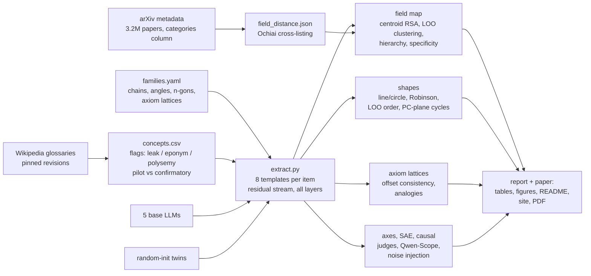

# Geometry of representations of mathematics in LLMs

**Do LLMs organize mathematics geometrically, the way they put days of the week on a circle?**

[Engels et al. (2024)](https://arxiv.org/abs/2405.14860) found that LLMs represent days of the week and months on *circles*. Others found:
- a "math/code lobe" among sparse-autoencoder features ([Li et al. 2024](https://arxiv.org/abs/2410.19750));
- a 3D spiral for the periodic table ([Lei & Cooper 2025](https://arxiv.org/abs/2502.10871));
- a helix for numbers ([Kantamneni & Tegmark 2025](https://arxiv.org/abs/2502.00873)).

As far as our literature search found, nobody had asked this of **abstract mathematics itself**. This repo does, with a preregistered study of five open base models.

**Links:**
- 📄 Paper: [`paper/paper.pdf`](paper/paper.pdf)
- 🧭 Interactive explorer: <https://burnycoder.github.io/geometry-of-representations-of-mathematics-in-llms/>
- 📝 Plain-language summary: [`reports/summary.md`](reports/summary.md)
- 🔒 Preregistration: [`docs/prereg.md`](docs/prereg.md), frozen as git tag `prereg-v1` before any activation was extracted
- 🤗 Data and activations: [dataset](https://huggingface.co/datasets/BurnyCoder/geometry-of-mathematics-in-llms) · [collection](https://huggingface.co/collections/BurnyCoder/geometry-of-mathematics-in-llms-6ae31ee0d9b29a69547607cc)

## Highlights

**Positive results.** Each model is compared with its random-init twin: the same architecture and tokenizer, with no learning.
- **Math fields form a map.** Field centroids from 17 fields correlate with how often mathematicians cross-list papers between those fields on arXiv. This holds in all five models (Qwen3.5-2B/0.8B, Qwen2.5-1.5B, Qwen2.5-Math-1.5B, Gemma-4-E2B), and every random-init twin is near zero or below. The map is also tree-like, consistent with a five-branch super-tree of mathematics.
- **Class-inclusion chains are ordered**, e.g. rng ⊃ ring ⊃ integral domain ⊃ … ⊃ field, and T0 ⊃ T1 ⊃ Hausdorff ⊃ … ⊃ Hilbert. This replicates in all five models.
- **Axioms act as directions.** In the lattice magma → semigroup → monoid → group → abelian group, "add associativity" and "add commutativity" are consistent vectors: same-axiom differences are parallel. They survive multiple-comparison correction and replicate in all five models. The twins show much weaker offsets or none; Gemma's twin has weak lexical offsets for two axioms. "Add identity" and "add divisibility" point the same way but more weakly.
- **Concrete ↔ abstract is the top principal axis** of math-concept space in Qwen3.5-2B; pure ↔ applied is the second. Abstraction is rated by three LLM judges from other model families.

**Negative and null results:**
- **Angles are not a circle.** "330 degrees" sits next to "300 degrees", not next to "0 degrees", in all five models. Their geometry tracks the bare numerals. This falsifies one of our preregistered predictions.
- **A trillion tokens of math pretraining did not sharpen the map.** Qwen2.5-Math vs its base shows no detectable difference (H-A3).
- **The map is not special to mathematics.** Biology, chemistry, geology and astronomy topics cluster at least as strongly once the number of fields is matched.
- **The causal test was inconclusive.** Noise in the chain subspace barely hurt task accuracy beyond random-subspace noise.
- **The positive control (days and months as circles) failed our preregistered full-space criterion.** It replicates only with a post-hoc 2-D principal-component test, the way Engels et al. visualize it. Both outcomes are reported.

**Methods finding.** Before touching LLM data, we simulated partial regression on distance matrices. When the nuisance matrix is only a proxy of a confounder, it rejects true nulls far too often. That is why every primary test here is a paired contrast against a random-init twin, with concept-bootstrap CIs.

## Results

<!-- RESULTS:START -->
*This block is auto-generated by `python run.py paper` from `results/*/*.json`. Full tables: [`reports/mvp_results.md`](reports/mvp_results.md), [`reports/robustness_results.md`](reports/robustness_results.md), [`reports/gemma_results.md`](reports/gemma_results.md). Summary for non-specialists: [`reports/summary.md`](reports/summary.md). Paper: [`paper/paper.pdf`](paper/paper.pdf). Interactive explorer: <https://burnycoder.github.io/geometry-of-representations-of-mathematics-in-llms/>.*

**Headline: every model vs its random-init twin, at the preregistered layer (relative depth 0.5).**

The columns are:
- **Field ρ:** Spearman correlation between the field-centroid RDM and arXiv cross-listing distance.
- **LOO acc:** leave-one-out field accuracy over 17 fields (chance ≈ 0.06).
- **Axiom offsets:** the mean cosine of same-axiom difference vectors in the group-like lattice (the random-pair null is ≈ 0).

| Model | Field ρ trained | Field ρ twin | Δ 95% CI | LOO acc trained / twin | Ring-chain Robinson (twin) | Assoc. / identity / divisible / commutative offsets (twin: commutative) | Angles closure (circle < 2) |
|---|---|---|---|---|---|---|---|
| Qwen3.5-2B (confirmatory) | 0.387 | -0.118 | [0.28, 0.58] | 0.47 / 0.09 | 0.52 (0.30) | 0.43 / 0.24 / 0.29 / 0.53 (0.01) | 2.11 |
| Qwen3.5-0.8B | 0.369 | -0.182 | [0.30, 0.59] | 0.43 / 0.16 | 0.50 (0.42) | 0.47 / 0.22 / 0.26 / 0.57 (0.02) | 2.59 |
| Qwen2.5-1.5B | 0.406 | -0.093 | [0.32, 0.57] | 0.57 / 0.22 | 0.54 (0.35) | 0.38 / 0.27 / 0.25 / 0.41 (0.16) | 2.15 |
| Qwen2.5-Math-1.5B | 0.390 | -0.087 | [0.30, 0.54] | 0.59 / 0.21 | 0.56 (0.41) | 0.35 / 0.27 / 0.30 / 0.45 (0.15) | 1.84 |
| Gemma-4-E2B | 0.436 | -0.021 | [0.29, 0.60] | 0.42 / 0.20 | 0.50 (0.28) | 0.56 / 0.19 / 0.35 / 0.74 (0.02) | 2.03 |

**Math-training ablation (H-A3).** Field ρ is 0.390 for Qwen2.5-Math vs 0.406 for its base. The paired Δ 95% CI is [-0.059, 0.017]: no detectable effect.

**Abstraction axis (H-A4, Qwen3.5-2B).** After partialling out frequency and token count:
- PC1 correlates with LLM-judge abstraction at ρ = 0.49 (twin 0.06).
- PC2 correlates with pure/applied at ρ = -0.41.

**Methods check.** Partial RDM regression rejects a true null 52% of the time when the nuisance is a noisy proxy of a confounder. That is why the primary tests are paired twin contrasts.

| Field maps: arXiv ground truth vs trained model vs random-init twin |
|---|
|  |

| Shape families: PCA at the preregistered layer, trained (top) vs twin (bottom) |
|---|
|  |

| Group-like axiom lattice: same-colour arrows add the same axiom |
|---|
|  |

| Field map vs depth |
|---|
|  |

<!-- RESULTS:END -->

## How it works



**Pipeline phases** (`python run.py <phase> --config configs/<cfg>.yaml`):

| Phase | What it does | Output |
|---|---|---|
| `calibration` | Simulates the type-I error and power of distance-matrix tests (why we use twin contrasts) | `results/<cfg>/calibration.json` |
| `concepts` | Fetches each Wikipedia glossary at a pinned revision, cleans the terms, flags field leaks, eponyms and polysemous words, keeps ≤ 30 primary concepts per field, and makes a 20/80 pilot/confirmatory split | `data/concepts.csv` |
| `arxiv` | Streams the `categories` column of the arXiv metadata and computes field-to-field cross-listing distances | `data/field_distance.json` |
| `extract` | Runs every item through 8 templates for the trained model and its random-init twin. Stores the residual stream at the concept's last token (and the token mean) for every layer, and logs every prompt plus the greedy next token | `artifacts/acts/<model>/*.npz`, `logs/*_prompts.jsonl` |
| `map`, `shapes`, `lattice` | Preregistered statistics at relative depth 0.5, plus layer curves | `results/<cfg>/*.json` |
| `posthoc` | Labelled post-hoc analyses: all-but-the-top sweep, PC-plane cycles, matched clustering | `results/<cfg>/posthoc.json` |
| `judges`, `axes` | LLM-judge abstraction ratings; principal axes vs abstraction and pure/applied | `data/judge_ratings.csv`, `results/<cfg>/axes.json` |
| `causal`, `sae`, `compare` | Gated noise-injection test; Qwen-Scope SAE codes; paired model contrast (H-A3) | `results/<cfg>/*.json` |
| `report` | Tables, figures and explorer data for one config | `reports/<cfg>_results.md`, `reports/figures/`, `site/data.json` |
| `paper` | README results block, `reports/summary.md`, `paper/paper.md` and PDF, with every number resolved from the results JSON | |

**Configs.**
- `mvp` (confirmatory): Qwen3.5-2B-Base, plus the judges, causal and SAE phases.
- `robustness`: Qwen3.5-0.8B, Qwen2.5-1.5B, Qwen2.5-Math-1.5B.
- `gemma`: Gemma-4-E2B. Its 2.35B-parameter per-layer-embedding table stays in CPU RAM.

## Install and run

Requirements: Python 3.12 through [uv](https://docs.astral.sh/uv/); an NVIDIA GPU with ≥ 8 GB, using CUDA 13 wheels per the [uv PyTorch guide](https://docs.astral.sh/uv/guides/integration/pytorch/); about 30 GB of disk for models and activations; pandoc with xelatex for the PDF.

```bash
git clone https://github.com/BurnyCoder/geometry-of-representations-of-mathematics-in-llms
```

```bash
cd geometry-of-representations-of-mathematics-in-llms && uv sync
```

```bash
cp .env.example .env
```

Then set `HF_HOME` and `MATHGEOM_ARTIFACTS` in `.env` to a drive with space.

```bash
uv run pytest
```

```bash
uv run python run.py all --config configs/mvp.yaml
```

Repeat with `configs/robustness.yaml` and `configs/gemma.yaml`, then build the README block, summary and paper:

```bash
uv run python run.py paper --config configs/mvp.yaml
```

**Runtime** on an RTX 5070 Laptop (8 GB):
- Extraction: about 35 minutes per model pair for Qwen3.5 (hybrid linear attention falls back to the PyTorch implementation), about 15 minutes for Qwen2.5, about 35 minutes for Gemma.
- Analysis: about 1 hour per config, dominated by the shape negative control.

## Repository layout

| Path | Contents |
|---|---|
| `run.py` | Single entry point that calls named phases |
| `src/mathgeom/data/` | Glossary fetching/parsing, arXiv field distances, leakage flags, concept table, LLM judges |
| `src/mathgeom/prompts/templates.py` | Field-neutral, field-revealing, family and no-domain templates |
| `src/mathgeom/models/load.py` | Trained and random-init loading (transformers 5.x), Gemma PLE-on-CPU placement |
| `src/mathgeom/extract.py` | Residual-stream extraction with prompt logging |
| `src/mathgeom/geometry/` | Centering, all-but-the-top, RDMs; shape statistics; offset/analogy statistics |
| `src/mathgeom/stats/` | Freedman–Lane RDM regression and bootstrap |
| `src/mathgeom/analyses/` | Field map, shapes, lattices, causal test, SAE, calibration simulations |
| `src/mathgeom/report/` | Tables and figures, the explorer export, and the paper/summary/README builder (placeholders resolved from results) |
| `configs/` | `fields.yaml` (field ↔ glossary ↔ arXiv ↔ branch), `families.yaml` (ground truth with sources), run configs |
| `docs/` | `prereg.md`, `deviations.md` (every post-hoc change), `data_card.md` |
| `reports/` | Per-config results (generated), `summary.md` (generated), `experiments.md` (learnings: what was tried and why) |
| `paper/` | `template.md`, the generated `paper.md` and `paper.pdf` |
| `site/` | Static Plotly explorer, deployed to GitHub Pages |
| `tests/` | Synthetic shape recovery, type-I calibration, leakage, extraction equivalence |

## Technologies

PyTorch 2.14 (CUDA 13), Hugging Face `transformers` 5.x and `huggingface_hub`, NumPy/SciPy/scikit-learn/statsmodels, pandas/pyarrow, BeautifulSoup with the MediaWiki API, wordfreq, matplotlib, Plotly (explorer), pandoc and xelatex (paper), uv, GitHub Actions/Pages.

## Related work this builds on

- Engels et al. 2024, *Not All Language Model Features Are (One-Dimensionally) Linear*, [arXiv:2405.14860](https://arxiv.org/abs/2405.14860).
- Li et al. 2024, *The Geometry of Concepts*, [arXiv:2410.19750](https://arxiv.org/abs/2410.19750).
- Karkada et al. 2026, *Symmetry in language statistics shapes the geometry of model representations*, [arXiv:2602.15029](https://arxiv.org/abs/2602.15029).
- Park et al. 2024, [arXiv:2406.01506](https://arxiv.org/abs/2406.01506), and the critique by Golechha et al. (ICLR 2025).
- Tiblias et al. 2025, *Shape Happens* (SMDS), [arXiv:2510.01025](https://arxiv.org/abs/2510.01025).
- Lei & Cooper 2025, [arXiv:2502.10871](https://arxiv.org/abs/2502.10871).
- Kantamneni & Tegmark 2025, [arXiv:2502.00873](https://arxiv.org/abs/2502.00873).
- Mu & Viswanath 2018, *All-but-the-Top*, [arXiv:1702.01417](https://arxiv.org/abs/1702.01417).
- Guillot & Rousset 2013, [doi:10.1111/2041-210X.12018](https://doi.org/10.1111/2041-210X.12018).
- Anderson & Legendre 1999, [doi:10.1080/00949659908811970](https://doi.org/10.1080/00949659908811970).
- Qwen2.5-Math report, [arXiv:2409.12122](https://arxiv.org/abs/2409.12122).
- Qwen-Scope, [arXiv:2605.11887](https://arxiv.org/abs/2605.11887).

## Data and licences

- Wikipedia text: CC BY-SA 4.0.
- arXiv metadata snapshot: CC0.
- Models: Apache-2.0.
- Qwen-Scope SAEs: Qwen licence, research use.
- Judge models: Apache-2.0 / MIT.

The dataset card is in [`docs/data_card.md`](docs/data_card.md).
