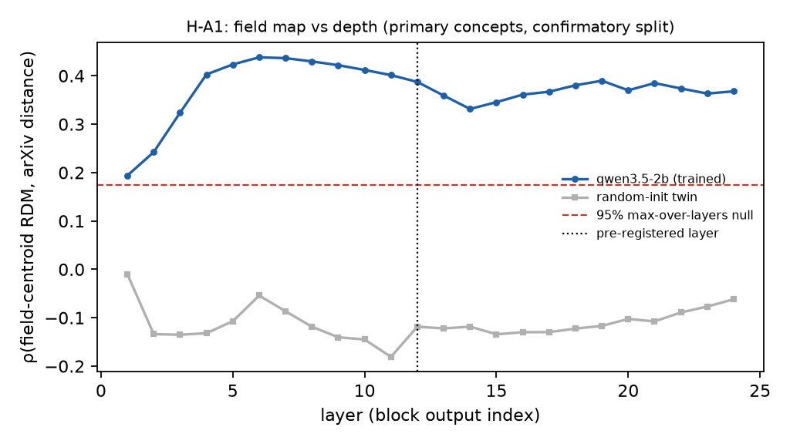
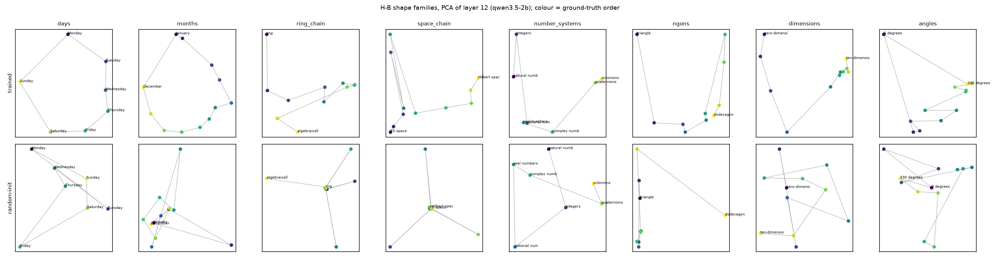
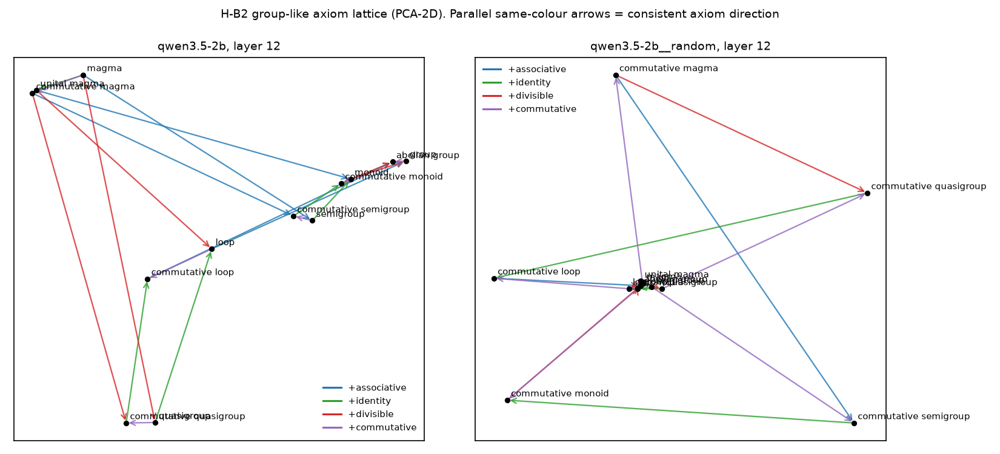

# 1 Introduction

Interpretability research has found that LLMs encode some concepts as low-dimensional geometric objects rather than isolated directions:
- circles for days and months, which the models causally use for modular arithmetic ([Engels et al., 2024](https://arxiv.org/abs/2405.14860));
- a helix for numbers ([Kantamneni & Tegmark, 2025](https://arxiv.org/abs/2502.00873));
- a spiral for the periodic table ([Lei & Cooper, 2025](https://arxiv.org/abs/2502.10871));
- linear "crystals" of analogies among sparse-autoencoder features ([Li et al., 2024](https://arxiv.org/abs/2410.19750)).

[Karkada et al. (2026)](https://arxiv.org/abs/2602.15029) explain such shapes with symmetries of co-occurrence statistics: cyclic latents give circles, and ordered latents give 1-D curved manifolds.

Mathematics is an unusually good test bed for these ideas, because its concepts carry *exact* external structure. Fields relate through shared methods. Algebraic structures form inclusion chains. Structures are defined by axiom sets, so they sit on the vertices of a hypercube. As far as our literature search found, nobody has tested whether LLM representations of abstract mathematical concepts reflect any of this. The closest result is the "math/code lobe" of [Li et al. (2024)](https://arxiv.org/abs/2410.19750), which does not resolve fields or structures.

**Contributions.**

1. A preregistered test (`docs/prereg.md`, git tag `prereg-v1`) of three geometric hypotheses about mathematics in LLMs, with random-init twins, leakage flags, permutation nulls and paired bootstrap contrasts.
2. Evidence that field-level geometry tracks how mathematicians cross-list papers, replicated across five models from two families and unchanged by heavy math pretraining.
3. Evidence that axioms of group-like structures act as consistent directions (parallelograms). This is strongest for associativity and commutativity. We also find that class-inclusion chains are ordered.
4. Two negative results: angles are not circular, and math pretraining does not sharpen the map. There is also one methodological negative: partial RDM regression is miscalibrated under realistic confounding.

# 2 Related work

**Feature geometry.**
- *Low-dimensional and circular features:* [Engels et al. (2024)](https://arxiv.org/abs/2405.14860), [Kantamneni & Tegmark (2025)](https://arxiv.org/abs/2502.00873), [Gurnee & Tegmark (2023)](https://arxiv.org/abs/2310.02207).
- *Manifolds:* [Modell et al. (2025)](https://arxiv.org/abs/2505.18235), and supervised MDS for discovering them ([Tiblias et al., 2025](https://arxiv.org/abs/2510.01025)).
- *A statistical account:* [Karkada et al. (2026)](https://arxiv.org/abs/2602.15029).

**Hierarchy and categories.** [Park et al. (2024)](https://arxiv.org/abs/2406.01506) proposed orthogonality between hierarchical concepts. [Golechha et al. (ICLR 2025)](https://www.greaterwrong.com/posts/eczwWrmX5XNEo7JsS/intricacies-of-feature-geometry-in-large-language-models) showed that the same geometry appears for random concepts and random unembeddings after whitening. We therefore avoid whitening and compare every statistic with an untrained twin.

**Science concepts.** [Lei & Cooper (2025)](https://arxiv.org/abs/2502.10871) found a periodic-table spiral. Mathematical "world models" in LLMs have been reported as local and fragile ([ICML 2025](https://icml.cc/virtual/2025/49128)).

**Statistics.** Partial Mantel tests are known to be anticonservative ([Guillot & Rousset, 2013](https://doi.org/10.1111/2041-210X.12018)). We test Freedman–Lane permutation ([Anderson & Legendre, 1999](https://doi.org/10.1080/00949659908811970)) in our setting (Section 3.5).

# 3 Methods

## 3.1 Concepts and fields

**Field map (H-A).**
- **Source.** Concepts come from Wikipedia "Glossary of …" pages for 17 mathematical fields, plus "List of numerical analysis topics", at pinned revisions. Four non-math control fields (biology, chemistry, geology, astronomy) go through the identical pipeline.
- **Cleaning.** Terms keep 1–4 alphabetic words. Fragments, prefixes and adverbs are dropped.
- **Flags.** These exclude a concept from the *primary* set:
  - `leak_own`: the name contains its field's root word, e.g. "topological space";
  - `eponym`: a proper name, detected by mid-sentence capitalization on the same page;
  - `polysemous`: a single everyday word with wordfreq Zipf ≥ 4.
- **Sampling.** At most 30 primary concepts per field.
- **Split.** A 20% pilot split was used only for debugging. All statistics below use the 80% confirmatory split: 398 primary math concepts across 17 fields.

## 3.2 Ground-truth field distance

MSC2020 is flat above its two-digit codes, so we measure field relatedness from practice instead. For fields A and B, with S_A the set of arXiv papers listing any of A's categories, the distance is 1 − |S_A∩S_B|/√(|S_A||S_B|), i.e. one minus the Ochiai similarity. This is computed over the CC0 arXiv metadata snapshot (3,224,635 papers, pinned commit).

## 3.3 Concept families

Every family lists its ground truth and source in `configs/families.yaml`.

**Ordered families:**
- days and months, as positive controls;
- a ring chain (11 items);
- a space chain of separation axioms through normed, Banach and Hilbert spaces (11 items);
- number systems (7 items, exploratory);
- n-gons (3–12) and n-dimensional spaces (0–10), each with a number-word reference;
- angles 0°–330°, with a digit reference.

**Group-like axiom lattice.** Thirteen structures with bits (associative, identity, divisible, commutative), from the [Magma group-like table](https://en.wikipedia.org/wiki/Magma_(algebra)). The self-distributive lattice (shelf, rack, spindle, quandle, kei) is exploratory.

## 3.4 Models and representations

| Model | Role |
|---|---|
| `Qwen/Qwen3.5-2B-Base` (Feb 2026) | **Confirmatory**; official Qwen-Scope SAEs |
| `Qwen3.5-0.8B-Base` | Scale |
| `Qwen2.5-1.5B` vs `Qwen2.5-Math-1.5B` | Same base, +1T math tokens ([Qwen2.5-Math report, Fig. 2](https://arxiv.org/abs/2409.12122)) |
| `google/gemma-4-E2B` | Second model family |

Each model has a random-init twin with weights redrawn using seed 0.

- **Read point.** Each item is embedded in 8 templates ending with the concept, e.g. "In mathematics, the notion of *X*". Templates name the domain ("mathematics" or "science") but never a sub-field. The representation is the residual stream at the concept's last token, averaged over templates.
- **Preprocessing.** Mean-centering, with no whitening.
- **Distances.** Cosine distance for the field map. Euclidean distance for families: cosine distance on a small, centered, collinear family is degenerate, which our synthetic tests showed.
- **Layer.** The primary layer is fixed in advance at relative depth 0.5.

## 3.5 Statistics: why paired twin contrasts

Before analysing any LLM data, we simulated regression on distance matrices with Freedman–Lane permutation:

| Scenario | Rejection rate at α=0.05 (± SE) | n simulations |
|---|---|---|
| concept level, nuisance correctly specified (null) | 0.065 ± 0.017 | 200 |
| concept level, item-level noise / nonlinear link (null) | 0.220 ± 0.029 | 200 |
| field level, representation unrelated to fields (null) | 0.020 ± 0.010 | 200 |
| field level, nuisance = noisy proxy of a confounder (null) | 0.525 ± 0.035 | 200 |
| field level, true field geometry present (power) | 0.995 ± 0.005 | 200 |

The test is calibrated when the nuisance distance matrix *is* the confounder. It rejects far too often when the nuisance only approximates the confounder, which is exactly the situation for lexical form and frequency. We therefore made **paired contrasts against the random-init twin** the primary tests. The twin measures form-only similarity on the same concepts. Uncertainty comes from a stratified concept bootstrap (2,000 resamples) with identical resamples for both models.

- **Field map.** We use field-level RSA, i.e. the Spearman ρ between the centroid RDM and the arXiv distance, with a Mantel permutation over field labels (10,000 permutations) and a max-over-layers null for layer curves.
- **Families.** Every statistic is unsupervised or leave-one-out, and is tested against an order-permutation null. With n ≤ 13 items in more than 1,000 dimensions, a supervised fit can impose any order. As a negative control, 100 random 11-item lists of math concepts must be rejected at about 5%.

# 4 Results

## 4.1 H-A1: a map of mathematical fields

| Model | Concept set | n concepts / fields | ρ_field trained (perm p) [95% CI] | ρ random-init | ρ layer-0 | Δ trained − random-init [95% CI] | LOO field acc trained / random / layer-0 (chance) | split-half reliability |
|---|---|---|---|---|---|---|---|---|
| qwen3.5-2b | math_primary | 398 / 17 | 0.387 (p=<0.0001) [0.262, 0.420] | -0.118 | 0.024 | +0.506 [0.277, 0.576] | 0.472 / 0.090 / 0.279 (0.059) | 0.999 |
| qwen3.5-2b | math_all | 526 / 17 | 0.426 (p=<0.0001) [0.303, 0.448] | -0.035 | 0.115 | +0.461 [0.231, 0.548] | 0.485 / 0.108 / 0.308 (0.059) | 0.999 |

**The trained model's field geometry tracks arXiv relatedness, and the random-init twin's does not.** For primary concepts at the preregistered layer, ρ = 0.387 with Mantel p = 0.0001. The twin gives ρ = -0.118 and layer-0 embeddings give ρ = 0.024. The difference from the twin has 95% CI [0.277, 0.576].

**Layer profile.** The map emerges in the first blocks and peaks at layer 6. It stays above the 95% max-over-layers null (0.17) at every layer.

**Clustering.** Leave-one-out nearest-centroid field accuracy is 0.472, against 0.090 for the twin and 0.059 chance.

**Reliability.** Split-half template reliability of the field RDM is 0.999.

**Not a rogue-dimension artifact (post-hoc).** The preregistered all-but-the-top variant removes the top d/100 = 20 principal components, and it reverses the correlation (ρ = -0.22). A post-hoc sweep explains why:

| Model | k=0 | k=1 | k=2 | k=3 | k=5 | k=10 | k=20 | k=40 | top-5 PC explained variance | field η² on PC1–10 |
|---|---|---|---|---|---|---|---|---|---|---|
| qwen3.5-2b | 0.387 | 0.466 | 0.351 | 0.312 | 0.178 | 0.021 | -0.218 | -0.341 | 0.066, 0.050, 0.037, 0.035, 0.028 | 0.20, 0.47, 0.22, 0.10, 0.14, 0.13, 0.13, 0.20, 0.27, 0.34 |
| qwen3.5-2b__random | -0.118 | -0.140 | -0.133 | -0.136 | -0.107 | -0.074 | -0.160 | -0.164 | 0.013, 0.012, 0.012, 0.012, 0.012 | 0.04, 0.02, 0.04, 0.06, 0.05, 0.03, 0.02, 0.03, 0.08, 0.06 |

- Removing the top component *raises* ρ to 0.47.
- No component dominates.
- Field identity is spread over the top ~10 components, which carry far more field variance (η²) than the twin's.

So the map lives in the dominant semantic subspace, and removing 20 components removes the map itself.

**H-A2: hierarchy.** Field geometry is more tree-like with respect to a five-branch super-tree than shuffled trees (p = 0.0035). Trained ρ = 0.312, twin ρ = 0.077, and the paired difference CI is [0.080, 0.375].

**Specificity.** The non-math control fields (biology, chemistry, geology, astronomy) are also clustered by the trained model and not by its twin:

| Model | Domain | n / fields | LOO acc trained [CI] | random-init | layer-0 | chance | Δ trained − random-init [CI] |
|---|---|---|---|---|---|---|---|
| qwen3.5-2b | math | 398 / 17 | 0.472 [0.427, 0.520] | 0.090 | 0.279 | 0.059 | +0.382 [0.329, 0.435] |
| qwen3.5-2b | control | 97 / 4 | 0.814 [0.732, 0.887] | 0.268 | 0.474 | 0.250 | +0.546 [0.423, 0.660] |

The pre-registered comparison confounds domain with the number of fields: 17 for math, 4 for the control. We therefore ran a post-hoc matched comparison over 200 random 4-field subsets of the math fields:
- **Math subsets:** mean leave-one-out accuracy 0.729 (95% range 0.573–0.854).
- **Control fields:** 0.814.
- **Overlap:** 0.12 of the math subsets reach or exceed the control value.

Mathematical fields are therefore organized about as strongly as general science topics, and not more. The field map is an instance of topical organization, not something specific to mathematics.

## 4.2 Robustness: scale, model family, math training

| Model | Concept set | n concepts / fields | ρ_field trained (perm p) [95% CI] | ρ random-init | ρ layer-0 | Δ trained − random-init [95% CI] | LOO field acc trained / random / layer-0 (chance) | split-half reliability |
|---|---|---|---|---|---|---|---|---|
| qwen3.5-0.8b | math_primary | 398 / 17 | 0.369 (p=<0.0001) [0.243, 0.402] | -0.182 | 0.059 | +0.551 [0.300, 0.588] | 0.430 / 0.163 / 0.284 (0.059) | 0.998 |
| qwen3.5-0.8b | math_all | 526 / 17 | 0.402 (p=0.0002) [0.272, 0.429] | -0.035 | 0.160 | +0.436 [0.243, 0.530] | 0.437 / 0.173 / 0.314 (0.059) | 0.998 |
| qwen2.5-1.5b | math_primary | 398 / 17 | 0.406 (p=0.0002) [0.288, 0.436] | -0.093 | 0.044 | +0.499 [0.318, 0.565] | 0.565 / 0.219 / 0.289 (0.059) | 0.998 |
| qwen2.5-1.5b | math_all | 526 / 17 | 0.432 (p=<0.0001) [0.310, 0.453] | 0.033 | 0.118 | +0.399 [0.256, 0.505] | 0.529 / 0.202 / 0.310 (0.059) | 0.999 |
| qwen2.5-math-1.5b | math_primary | 398 / 17 | 0.390 (p=<0.0001) [0.264, 0.416] | -0.087 | 0.021 | +0.477 [0.297, 0.540] | 0.588 / 0.211 / 0.307 (0.059) | 0.999 |
| qwen2.5-math-1.5b | math_all | 526 / 17 | 0.406 (p=0.0002) [0.289, 0.428] | 0.059 | 0.141 | +0.348 [0.226, 0.468] | 0.568 / 0.200 / 0.325 (0.059) | 0.999 |

| Model | Concept set | n concepts / fields | ρ_field trained (perm p) [95% CI] | ρ random-init | ρ layer-0 | Δ trained − random-init [95% CI] | LOO field acc trained / random / layer-0 (chance) | split-half reliability |
|---|---|---|---|---|---|---|---|---|
| gemma-4-e2b | math_primary | 398 / 17 | 0.436 (p=<0.0001) [0.315, 0.477] | -0.021 | 0.091 | +0.457 [0.290, 0.598] | 0.417 / 0.196 / 0.307 (0.059) | 0.993 |
| gemma-4-e2b | math_all | 526 / 17 | 0.464 (p=<0.0001) [0.342, 0.501] | 0.085 | 0.183 | +0.379 [0.252, 0.543] | 0.399 / 0.215 / 0.312 (0.059) | 0.991 |

**H-A3 (math training): null.** Qwen2.5-Math-1.5B is Qwen2.5-1.5B plus 1T tokens of math. Its field map is no stronger than its base's: ρ = 0.390 vs 0.406, and the paired CI of the difference is [-0.059, 0.017].

## 4.3 H-B: shapes of ordered families

| Family | Expected | Model | line ρ | circle ρ | closure (d first-last / adjacent) | closure_far† (null 5%) | Robinson (p) | PCA order \|ρ\| (p) | LOO order ρ (p) |
|---|---|---|---|---|---|---|---|---|---|
| days | circle | qwen3.5-2b | 0.78 | 0.65 | 1.19 | 0.99 (0.76) | 0.77 (0.0010) | 0.54 (0.2284) | -0.14 (0.0731) |
| days | circle | qwen3.5-2b__random | -0.04 | -0.07 | 0.99 | 1.02 (0.96) | 0.34 (0.5002) | 0.18 (0.7106) | -0.93 (0.1993) |
| months | circle | qwen3.5-2b | 0.79 | 0.70 | 1.23 | 0.96 (0.76) | 0.66 (0.0005) | 0.55 (0.0730) | 0.77 (0.0066) |
| months | circle | qwen3.5-2b__random | -0.10 | -0.06 | 0.99 | 0.97 (0.94) | 0.30 (0.6962) | 0.32 (0.3048) | -0.78 (0.6013) |
| ring_chain | line | qwen3.5-2b | 0.48 | 0.38 | 1.63 | 1.04 (0.63) | 0.52 (0.0105) | 0.46 (0.1619) | 0.65 (0.0133) |
| ring_chain | line | qwen3.5-2b__random | -0.03 | -0.01 | 1.17 | 1.84 (0.53) | 0.30 (0.6667) | 0.50 (0.1234) | -0.45 (0.2292) |
| space_chain | line | qwen3.5-2b | 0.67 | 0.40 | 1.79 | 1.42 (0.57) | 0.65 (0.0005) | 0.83 (0.0025) | 0.87 (0.0033) |
| space_chain | line | qwen3.5-2b__random | -0.04 | 0.03 | 0.66 | 0.99 (0.54) | 0.33 (0.4993) | 0.56 (0.0770) | -0.41 (0.2625) |
| number_systems | line | qwen3.5-2b | 0.77 | 0.36 | 1.67 | 1.66 (0.56) | 0.74 (0.0045) | 0.96 (0.0020) | 0.71 (0.0066) |
| number_systems | line | qwen3.5-2b__random | 0.11 | 0.16 | 1.01 | 1.01 (0.93) | 0.26 (0.7856) | 0.39 (0.3773) | -0.82 (0.3887) |
| ngons | number_reference | qwen3.5-2b | 0.56 | 0.28 | 1.94 | 1.06 (0.54) | 0.64 (0.0010) | 0.87 (0.0030) | 0.90 (0.0033) |
| ngons | number_reference | qwen3.5-2b__random | 0.42 | 0.14 | 1.65 | 1.76 (0.57) | 0.42 (0.1159) | 0.19 (0.6007) | -0.89 (0.9236) |
| dimensions | number_reference | qwen3.5-2b | 0.66 | 0.37 | 2.17 | 1.02 (0.31) | 0.75 (0.0005) | 0.95 (0.0010) | 0.72 (0.0033) |
| dimensions | number_reference | qwen3.5-2b__random | -0.17 | -0.15 | 1.01 | 1.01 (0.93) | 0.32 (0.6117) | 0.00 (1.0000) | -0.75 (0.6578) |
| angles | circle | qwen3.5-2b | 0.56 | 0.29 | 2.11 | 1.01 (0.39) | 0.65 (0.0005) | 0.90 (0.0005) | 0.76 (0.0033) |
| angles | circle | qwen3.5-2b__random | -0.01 | 0.22 | 0.80 | 1.01 (0.77) | 0.26 (0.8581) | 0.08 (0.8076) | -0.49 (0.3754) |

**Positive control.** With our preregistered full-space statistics, days and months show significant circle-template correlation and closure ratios near 1. They nevertheless fail "circle ρ > line ρ" at layer 12. Following the prereg, we debugged before interpreting further. In the top-2 principal-component plane, where Engels et al. visualized their circles, days and months form *perfect* cycles in the trained model and none in the twin:

| Family | qwen3.5-2b | qwen3.5-2b__random |
|---|---|---|
| days | 1.00 (p=0.0080) | 0.14 (p=0.9581) |
| months | 1.00 (p=0.0020) | 0.08 (p=0.9102) |
| ring_chain | 0.36 (p=0.0559) | 0.18 (p=0.5429) |
| space_chain | 0.45 (p=0.0100) | 0.09 (p=0.9182) |
| number_systems | 0.29 (p=0.6188) | 0.43 (p=0.2016) |
| ngons | 0.50 (p=0.0100) | 0.30 (p=0.2116) |
| dimensions | 0.55 (p=0.0040) | 0.18 (p=0.5549) |
| angles | 0.33 (p=0.0559) | 0.17 (p=0.5469) |

This statistic is post-hoc. We conclude that the pipeline works, and that the full-space template criterion was insensitive because variance outside the circle plane dominates.

**Chains.** The ring and space chains are ordered beyond permutation nulls and beyond the twin: Robinson scores 0.52 and 0.65, against about 1/3 for chance and for the twin. Random concept lists are rejected at the nominal rate:

| Model | Robinson reject rate | PCA-order reject rate | line-ρ reject rate | n lists |
|---|---|---|---|---|
| qwen3.5-2b | 0.04 | 0.04 | 0.04 | 100 |
| qwen3.5-2b__random | 0.04 | 0.04 | 0.05 | 100 |

**Angles: preregistered prediction falsified.** Angles are not circular: closure ratio 2.11 and no cycle in the PC plane. Their geometry closely matches that of the bare digits 0–330 (ρ = 0.84). At this scale, "330 degrees" sits next to "300 degrees", not next to "0 degrees".

| Family | Model | ρ(family RDM, reference RDM) | template β beyond reference (p) |
|---|---|---|---|
| ngons vs number_words_3_12 | qwen3.5-2b | 0.59 | +0.223 (0.3089) |
| ngons vs number_words_3_12 | qwen3.5-2b__random | 0.11 | +0.411 (0.0066) |
| dimensions vs number_words_0_10 | qwen3.5-2b | 0.76 | +0.260 (0.0204) |
| dimensions vs number_words_0_10 | qwen3.5-2b__random | -0.58 | -0.153 (0.9104) |
| angles vs digits_0_330 | qwen3.5-2b | 0.84 | +0.054 (0.1858) |
| angles vs digits_0_330 | qwen3.5-2b__random | 0.22 | +0.227 (0.0104) |

## 4.4 H-B2: axioms as directions

| Lattice | Model | axiom-RDM β (p) | lexical β | offset consistency per axiom: obs / null95 (p) | analogy top-1 (chance) | mean rank (chance) |
|---|---|---|---|---|---|---|
| group_like | qwen3.5-2b | +0.492 (0.0002) | +0.236 | associative: 0.43/0.23 (0.0035); identity: 0.24/0.22 (0.0425); divisible: 0.29/0.22 (0.0275); commutative: 0.53/0.20 (0.0010) | 0.56 (0.10) | 2.5 (5.5) |
| self_distributive | qwen3.5-2b | +0.123 (0.3393) | -0.446 | invertible: 0.48/0.78 (0.2039); idempotent: 0.17/0.78 (0.4268) | 1.00 (0.50) | 1.0 (1.5) |
| gender control | qwen3.5-2b | — | — | gender: 0.28/0.09 | king:queen rank 1 | — |
| group_like | qwen3.5-2b__random | +0.302 (0.0010) | -0.403 | associative: 0.02/0.16 (0.3678); identity: 0.04/0.16 (0.3068); divisible: 0.01/0.16 (0.4338); commutative: 0.01/0.14 (0.4048) | 0.31 (0.10) | 3.6 (5.5) |
| self_distributive | qwen3.5-2b__random | +0.316 (0.1284) | -0.275 | invertible: -0.01/0.56 (0.5207); idempotent: 0.01/0.56 (0.4493) | 1.00 (0.50) | 1.0 (1.5) |
| gender control | qwen3.5-2b__random | — | — | gender: 0.00/0.07 | king:queen rank 15 | — |

For every group-like axiom, difference vectors between structures that differ only in that axiom are more parallel than random pairs (raw p < .05):

| Axiom | Consistency | Null 95th percentile | p |
|---|---|---|---|
| Associativity | 0.43 | 0.23 | 0.0035 |
| Identity | 0.24 | 0.22 | 0.0425 |
| Divisibility | 0.29 | 0.22 | 0.0275 |
| Commutativity | 0.53 | 0.20 | 0.0010 |

In this model's random-init twin, all four consistencies are ≈ 0.

**Analogies.** Analogy completion is top-1 for 0.56 of 45 parallelograms (chance 0.10). The twin reaches 0.31, so part of the analogy accuracy is lexical (shared "commutative" tokens); offset consistency is not.

**Caveats.** The gender-offset positive control passes. Multiplicity across the preregistered confirmatory tests is handled by Holm correction:

| Test | Model | p | Holm-adjusted p | reject at α=0.05 |
|---|---|---|---|---|
| H-A1 Δρ trained − random-init ≤ 0 (bootstrap) | qwen3.5-2b | <0.0001 | <0.0001 | yes |
| H-B ring chain Robinson | qwen3.5-2b | 0.0105 | 0.0315 | yes |
| H-B space chain Robinson | qwen3.5-2b | 0.0005 | 0.0030 | yes |
| H-B2 associative offset consistency | qwen3.5-2b | 0.0035 | 0.0140 | yes |
| H-B2 identity offset consistency | qwen3.5-2b | 0.0425 | 0.0550 | no |
| H-B2 divisible offset consistency | qwen3.5-2b | 0.0275 | 0.0550 | no |
| H-B2 commutative offset consistency | qwen3.5-2b | 0.0010 | 0.0050 | yes |
| H-B angles circle prediction (decision rule: closure 2.11 < 2 and circle ρ 0.29 > line ρ 0.56) | qwen3.5-2b | — | — | not met (prediction falsified) |

- **After correction:** associativity and commutativity remain significant; identity and divisibility do not.
- **Across the replication models (Appendix A):** all four offsets are positive in every model. They are near zero in the Qwen twins and weaker in Gemma's twin, which has small lexical offsets for associativity and divisibility. Divisibility reaches raw p < .05 in all five models, identity in three.
- **Our reading:** strong evidence for associativity and commutativity directions, and suggestive evidence for divisibility and identity.

## 4.5 Secondary analyses

### H-A4: concrete ↔ abstract and pure ↔ applied are the main axes

**Ratings.** Three judge LLMs rated every math concept's abstraction from 1 to 7: IBM Granite-4.0-micro, SmolLM3-3B and Phi-4-mini-instruct, none from a model family we probe. We read each rating as the expectation over next-token digit probabilities.
- Rank agreement is moderate (mean pairwise Spearman 0.63).
- Absolute agreement is low (ICC(2,1) = 0.24; ICC(2,k) = 0.49), because the judges use the scale with different offsets.
- The ratings have face validity. The least abstract concepts include "trivial group", "bar chart" and "dot plot"; the most abstract include étale cohomology, Artin stacks and generalized cohomology theories.

**Axes.** We first residualized on word frequency and token count. The top principal component of the math-concept cloud then correlates with abstraction (ρ = 0.49), and the second with the pure/applied label (ρ = -0.41). In the twin these correlations are 0.06 and 0.14. A 5-fold cross-validated linear readout predicts abstraction with ρ = 0.74, against -0.06 in the twin.

**Interpretation.** In this model, concrete ↔ abstract is the single largest axis of variation among mathematical concepts. That is a correlational, model-rated finding: abstraction ratings come from LLM judges, not humans.

### Causal test of chain geometry: inconclusive

The preregistered gate requires baseline accuracy ≥ 0.70 on "which is more general, a A or a B?".
- **Ring chain:** it failed the gate (accuracy 0.691), so no intervention was run.
- **Space chain:** it passed (0.864).

At noise scale s = 4, noise injected into the chain's 2-D subspace lowered accuracy to 0.791. Noise in random 2-D subspaces gave a mean of 0.822. At s = 1 there was no difference. The direction matches the prediction, but the effect is small and five random draws cannot establish significance. We report it as inconclusive.

### SAE features (exploratory)

At block 11, we encoded the template-averaged residuals with the official Qwen-Scope TopK SAE (k = 50).
- **Graded map:** the SAE code preserves the field map only weakly (ρ = 0.15, against 0.39 for the dense residual).
- **Clustering:** field clustering is largely preserved (LOO accuracy 0.43).
- **Field-selective features exist.** For example, a game-theory feature fires on most game-theory concepts and almost no others (`results/mvp/sae.json`).
- **Feature sets:** 2445 features fire only on math concepts, 871 only on control concepts, and 715 on both. The sample sizes are unequal, so this is only suggestive of the "math lobe" of [Li et al. (2024)](https://arxiv.org/abs/2410.19750).

# 5 Discussion

**What the geometry is.** Relatedness between fields is encoded at the level of field centroids, in the dominant principal components, from the first few layers onward. It is equally strong in models with very different pretraining mixtures. Combined with the null effect of math continued pretraining, this suggests the map is learned from general co-occurrence statistics, as [Karkada et al. (2026)](https://arxiv.org/abs/2602.15029) predict. It does not seem to require math-specific training. The control fields cluster about as strongly once the number of fields is matched. That supports this reading: the "map of mathematics" is one instance of a general topical map.

**Axioms as directions.** Axioms of group-like structures behave like the man→woman offset. Whether the model uses these directions in reasoning, for example to decide that a monoid with inverses is a group, needs causal tests; see §6 and the causal results.

**Angles.** "330 degrees" is not near "0 degrees". This mirrors the finding of [Kantamneni & Tegmark (2025)](https://arxiv.org/abs/2502.00873) that numbers lie on a helix whose dominant axis is linear. A model this size appears to encode degrees by their numerals rather than by their angular meaning.

# 6 Limitations

- **Concept sample.** Glossary terms are a convenience sample, and some junk survives cleaning. Field labels come from one glossary per term.
- **Ground truth.** Ochiai cross-listing is one operationalization of field relatedness.
- **Read point.** A single read-out: last token, averaged over templates. Template wording affects absolute values, though split-half reliability is high.
- **Model size.** Models are ≤ 2.3B active parameters, because of the 8 GB GPU.
- **Positive control.** It passed only under a post-hoc statistic.
- **Family size.** Families are small (n = 7–13), so shape claims rest on permutation tests with limited resolution.
- **Correlation, not mechanism.** All tests except §4.5 are correlational.

# 7 Conclusion

Mathematical fields form a map in LLM residual streams that tracks how mathematicians cross-list their papers. Axioms of algebraic structures act as consistent directions, most clearly associativity and commutativity, and class-inclusion chains are ordered. All of this is absent, or much weaker, in untrained twins. Angles are not circles, and heavy math pretraining does not sharpen the field map.

# References

See the inline links. Code, data, preregistration and every number: <https://github.com/BurnyCoder/geometry-of-representations-of-mathematics-in-llms>. Interactive explorer: <https://burnycoder.github.io/geometry-of-representations-of-mathematics-in-llms/>. Data and activations: <https://huggingface.co/datasets/BurnyCoder/geometry-of-mathematics-in-llms>.

# Appendix A: Replication of shapes and lattices

**Qwen3.5-0.8B, Qwen2.5-1.5B and Qwen2.5-Math-1.5B**, each with its twin:

| Family | Expected | Model | line ρ | circle ρ | closure (d first-last / adjacent) | closure_far† (null 5%) | Robinson (p) | PCA order \|ρ\| (p) | LOO order ρ (p) |
|---|---|---|---|---|---|---|---|---|---|
| days | circle | qwen3.5-0.8b | 0.85 | 0.63 | 1.29 | 1.06 (0.79) | 0.77 (0.0010) | 0.75 (0.0735) | -1.00 (1.0000) |
| days | circle | qwen3.5-0.8b__random | 0.20 | 0.07 | 1.01 | 1.04 (0.93) | 0.40 (0.3758) | 0.93 (0.0095) | -0.75 (0.1728) |
| days | circle | qwen2.5-1.5b | 0.77 | 0.66 | 1.22 | 0.99 (0.73) | 0.69 (0.0020) | 0.54 (0.2219) | 0.68 (0.0664) |
| days | circle | qwen2.5-1.5b__random | 0.10 | -0.11 | 1.02 | 1.01 (0.93) | 0.43 (0.2259) | 0.54 (0.2324) | -0.82 (0.4950) |
| days | circle | qwen2.5-math-1.5b | 0.73 | 0.58 | 1.18 | 1.01 (0.76) | 0.71 (0.0010) | 0.54 (0.2219) | 0.36 (0.1229) |
| days | circle | qwen2.5-math-1.5b__random | 0.16 | -0.14 | 1.02 | 1.01 (0.94) | 0.37 (0.3973) | 0.46 (0.2889) | -0.93 (0.7708) |
| months | circle | qwen3.5-0.8b | 0.79 | 0.70 | 1.23 | 0.97 (0.77) | 0.67 (0.0005) | 0.64 (0.0345) | -0.20 (0.0033) |
| months | circle | qwen3.5-0.8b__random | 0.06 | -0.03 | 1.02 | 1.02 (0.94) | 0.38 (0.2274) | 0.30 (0.3483) | -0.86 (0.9169) |
| months | circle | qwen2.5-1.5b | 0.71 | 0.56 | 1.25 | 1.07 (0.75) | 0.64 (0.0005) | 0.85 (0.0010) | 0.80 (0.0100) |
| months | circle | qwen2.5-1.5b__random | 0.07 | -0.02 | 1.02 | 0.97 (0.92) | 0.35 (0.4218) | 0.10 (0.7381) | -0.62 (0.7176) |
| months | circle | qwen2.5-math-1.5b | 0.71 | 0.53 | 1.21 | 0.99 (0.75) | 0.70 (0.0005) | 0.92 (0.0005) | 0.82 (0.0066) |
| months | circle | qwen2.5-math-1.5b__random | 0.04 | -0.01 | 1.02 | 0.97 (0.91) | 0.32 (0.5827) | 0.03 (0.9370) | -0.60 (0.7243) |
| ring_chain | line | qwen3.5-0.8b | 0.46 | 0.36 | 1.70 | 1.00 (0.58) | 0.50 (0.0170) | 0.45 (0.1764) | -0.09 (0.0764) |
| ring_chain | line | qwen3.5-0.8b__random | 0.18 | 0.11 | 1.29 | 1.36 (0.74) | 0.42 (0.1134) | 0.04 (0.9295) | 0.36 (0.0565) |
| ring_chain | line | qwen2.5-1.5b | 0.54 | 0.36 | 1.74 | 1.11 (0.56) | 0.54 (0.0025) | 0.21 (0.5517) | 0.87 (0.0033) |
| ring_chain | line | qwen2.5-1.5b__random | 0.30 | 0.31 | 1.06 | 1.03 (0.85) | 0.35 (0.4318) | 0.03 (0.9405) | 0.23 (0.0731) |
| ring_chain | line | qwen2.5-math-1.5b | 0.54 | 0.39 | 1.67 | 1.05 (0.62) | 0.56 (0.0030) | 0.41 (0.2189) | 0.89 (0.0033) |
| ring_chain | line | qwen2.5-math-1.5b__random | 0.34 | 0.30 | 1.09 | 1.05 (0.85) | 0.41 (0.1529) | 0.05 (0.8786) | 0.25 (0.0698) |
| space_chain | line | qwen3.5-0.8b | 0.65 | 0.33 | 1.72 | 1.67 (0.59) | 0.64 (0.0005) | 0.95 (0.0005) | 0.63 (0.0033) |
| space_chain | line | qwen3.5-0.8b__random | -0.04 | 0.04 | 0.91 | 1.06 (0.72) | 0.36 (0.3703) | 0.36 (0.2659) | 0.29 (0.0432) |
| space_chain | line | qwen2.5-1.5b | 0.69 | 0.38 | 1.83 | 1.68 (0.60) | 0.71 (0.0005) | 0.95 (0.0005) | 0.90 (0.0033) |
| space_chain | line | qwen2.5-1.5b__random | -0.12 | -0.06 | 0.95 | 1.10 (0.80) | 0.34 (0.4888) | 0.67 (0.0315) | 0.21 (0.1229) |
| space_chain | line | qwen2.5-math-1.5b | 0.67 | 0.40 | 1.71 | 1.51 (0.61) | 0.68 (0.0005) | 0.85 (0.0010) | 0.91 (0.0033) |
| space_chain | line | qwen2.5-math-1.5b__random | -0.10 | -0.07 | 0.97 | 1.08 (0.80) | 0.36 (0.3988) | 0.73 (0.0185) | 0.18 (0.1329) |
| number_systems | line | qwen3.5-0.8b | 0.81 | 0.40 | 1.73 | 1.72 (0.57) | 0.77 (0.0030) | 0.93 (0.0065) | 0.29 (0.0033) |
| number_systems | line | qwen3.5-0.8b__random | 0.31 | 0.14 | 1.10 | 1.25 (0.77) | 0.29 (0.6892) | 0.29 (0.5542) | -0.25 (0.1960) |
| number_systems | line | qwen2.5-1.5b | 0.66 | 0.33 | 1.42 | 1.57 (0.60) | 0.66 (0.0165) | 0.82 (0.0295) | 0.79 (0.0166) |
| number_systems | line | qwen2.5-1.5b__random | 0.34 | 0.14 | 1.13 | 1.37 (0.73) | 0.34 (0.4718) | 0.54 (0.2219) | -0.21 (0.2359) |
| number_systems | line | qwen2.5-math-1.5b | 0.71 | 0.33 | 1.42 | 1.55 (0.61) | 0.66 (0.0145) | 0.82 (0.0295) | 0.71 (0.0266) |
| number_systems | line | qwen2.5-math-1.5b__random | 0.36 | 0.24 | 1.13 | 1.38 (0.72) | 0.40 (0.2344) | 0.57 (0.1839) | -0.43 (0.3056) |
| ngons | number_reference | qwen3.5-0.8b | 0.54 | 0.30 | 1.88 | 1.05 (0.51) | 0.63 (0.0015) | 0.87 (0.0030) | 0.60 (0.0033) |
| ngons | number_reference | qwen3.5-0.8b__random | 0.36 | 0.07 | 1.36 | 1.17 (0.77) | 0.47 (0.0555) | 0.73 (0.0140) | -0.42 (0.3256) |
| ngons | number_reference | qwen2.5-1.5b | 0.54 | 0.27 | 1.81 | 1.01 (0.55) | 0.67 (0.0010) | 0.88 (0.0015) | 0.96 (0.0033) |
| ngons | number_reference | qwen2.5-1.5b__random | 0.33 | 0.10 | 1.20 | 1.12 (0.80) | 0.44 (0.0940) | 0.50 (0.1454) | -0.39 (0.3522) |
| ngons | number_reference | qwen2.5-math-1.5b | 0.53 | 0.23 | 1.71 | 1.05 (0.58) | 0.66 (0.0010) | 0.88 (0.0015) | 0.90 (0.0066) |
| ngons | number_reference | qwen2.5-math-1.5b__random | 0.35 | 0.11 | 1.22 | 1.12 (0.79) | 0.49 (0.0295) | 0.49 (0.1709) | -0.21 (0.2027) |
| dimensions | number_reference | qwen3.5-0.8b | 0.62 | 0.37 | 2.29 | 0.98 (0.27) | 0.63 (0.0010) | 0.93 (0.0005) | -0.71 (0.0066) |
| dimensions | number_reference | qwen3.5-0.8b__random | -0.17 | -0.03 | 0.97 | 0.93 (0.92) | 0.27 (0.8621) | 0.30 (0.3828) | -0.71 (0.6645) |
| dimensions | number_reference | qwen2.5-1.5b | 0.62 | 0.44 | 1.84 | 0.97 (0.31) | 0.59 (0.0005) | 0.82 (0.0030) | 0.80 (0.0100) |
| dimensions | number_reference | qwen2.5-1.5b__random | -0.21 | -0.07 | 0.81 | 0.82 (0.87) | 0.25 (0.8151) | 0.23 (0.4758) | -0.84 (0.9535) |
| dimensions | number_reference | qwen2.5-math-1.5b | 0.68 | 0.39 | 2.16 | 1.05 (0.32) | 0.83 (0.0005) | 0.96 (0.0005) | 0.87 (0.0033) |
| dimensions | number_reference | qwen2.5-math-1.5b__random | -0.21 | -0.07 | 0.80 | 0.81 (0.86) | 0.25 (0.8416) | 0.21 (0.5317) | -0.90 (0.9934) |
| angles | circle | qwen3.5-0.8b | 0.62 | 0.31 | 2.59 | 1.19 (0.33) | 0.73 (0.0005) | 0.93 (0.0005) | 0.56 (0.0033) |
| angles | circle | qwen3.5-0.8b__random | 0.10 | 0.15 | 1.01 | 1.13 (0.83) | 0.28 (0.7626) | 0.00 (1.0000) | -0.42 (0.4219) |
| angles | circle | qwen2.5-1.5b | 0.60 | 0.29 | 2.15 | 1.06 (0.42) | 0.72 (0.0005) | 0.94 (0.0005) | 0.90 (0.0033) |
| angles | circle | qwen2.5-1.5b__random | 0.15 | 0.31 | 1.16 | 1.17 (0.64) | 0.33 (0.5277) | 0.05 (0.8866) | 0.34 (0.1163) |
| angles | circle | qwen2.5-math-1.5b | 0.62 | 0.31 | 1.84 | 1.01 (0.44) | 0.71 (0.0005) | 0.94 (0.0005) | 0.92 (0.0033) |
| angles | circle | qwen2.5-math-1.5b__random | 0.17 | 0.34 | 1.16 | 1.16 (0.64) | 0.31 (0.6197) | 0.05 (0.8866) | 0.27 (0.1628) |

| Lattice | Model | axiom-RDM β (p) | lexical β | offset consistency per axiom: obs / null95 (p) | analogy top-1 (chance) | mean rank (chance) |
|---|---|---|---|---|---|---|
| group_like | qwen3.5-0.8b | +0.281 (0.0048) | +0.348 | associative: 0.47/0.24 (0.0035); identity: 0.22/0.24 (0.0570); divisible: 0.26/0.24 (0.0430); commutative: 0.57/0.20 (0.0010) | 0.51 (0.10) | 2.8 (5.5) |
| self_distributive | qwen3.5-0.8b | +0.241 (0.2915) | -0.252 | invertible: 0.42/0.74 (0.2639); idempotent: 0.16/0.74 (0.4338) | 1.00 (0.50) | 1.0 (1.5) |
| gender control | qwen3.5-0.8b | — | — | gender: 0.26/0.09 | king:queen rank 1 | — |
| group_like | qwen3.5-0.8b__random | +0.272 (0.0026) | -0.324 | associative: 0.06/0.17 (0.2359); identity: 0.07/0.16 (0.1929); divisible: 0.05/0.17 (0.2739); commutative: 0.02/0.14 (0.3693) | 0.38 (0.10) | 3.5 (5.5) |
| self_distributive | qwen3.5-0.8b__random | -0.037 (0.5965) | +0.534 | invertible: -0.00/0.56 (0.5127); idempotent: -0.02/0.56 (0.5197) | 1.00 (0.50) | 1.0 (1.5) |
| gender control | qwen3.5-0.8b__random | — | — | gender: -0.01/0.07 | king:queen rank 16 | — |
| group_like | qwen2.5-1.5b | +0.210 (0.0144) | +0.457 | associative: 0.38/0.22 (0.0055); identity: 0.27/0.22 (0.0310); divisible: 0.25/0.23 (0.0410); commutative: 0.41/0.19 (0.0025) | 0.47 (0.10) | 3.0 (5.5) |
| self_distributive | qwen2.5-1.5b | +0.388 (0.1418) | -0.414 | invertible: 0.43/0.75 (0.2604); idempotent: 0.15/0.75 (0.4128) | 1.00 (0.50) | 1.0 (1.5) |
| gender control | qwen2.5-1.5b | — | — | gender: 0.24/0.08 | king:queen rank 1 | — |
| group_like | qwen2.5-1.5b__random | +0.255 (0.0026) | +0.475 | associative: 0.12/0.17 (0.1204); identity: 0.10/0.17 (0.1354); divisible: 0.10/0.18 (0.1544); commutative: 0.16/0.15 (0.0470) | 0.47 (0.10) | 3.3 (5.5) |
| self_distributive | qwen2.5-1.5b__random | +0.191 (0.2392) | +0.345 | invertible: -0.02/0.61 (0.5617); idempotent: -0.03/0.61 (0.5902) | 0.00 (0.50) | 2.0 (1.5) |
| gender control | qwen2.5-1.5b__random | — | — | gender: 0.00/0.07 | king:queen rank 14 | — |
| group_like | qwen2.5-math-1.5b | +0.498 (0.0002) | +0.325 | associative: 0.35/0.22 (0.0090); identity: 0.27/0.22 (0.0265); divisible: 0.30/0.22 (0.0195); commutative: 0.45/0.20 (0.0010) | 0.53 (0.10) | 2.6 (5.5) |
| self_distributive | qwen2.5-math-1.5b | +0.433 (0.0812) | -0.661 | invertible: 0.40/0.80 (0.2814); idempotent: 0.03/0.80 (0.4923) | 1.00 (0.50) | 1.0 (1.5) |
| gender control | qwen2.5-math-1.5b | — | — | gender: 0.25/0.08 | king:queen rank 1 | — |
| group_like | qwen2.5-math-1.5b__random | +0.249 (0.0058) | +0.400 | associative: 0.09/0.17 (0.1574); identity: 0.09/0.17 (0.1494); divisible: 0.10/0.18 (0.1664); commutative: 0.15/0.15 (0.0495) | 0.44 (0.10) | 3.4 (5.5) |
| self_distributive | qwen2.5-math-1.5b__random | +0.258 (0.1436) | +0.323 | invertible: -0.01/0.61 (0.5402); idempotent: -0.01/0.61 (0.5212) | 0.00 (0.50) | 2.0 (1.5) |
| gender control | qwen2.5-math-1.5b__random | — | — | gender: -0.00/0.07 | king:queen rank 17 | — |

| Family | qwen3.5-0.8b | qwen3.5-0.8b__random | qwen2.5-1.5b | qwen2.5-1.5b__random | qwen2.5-math-1.5b | qwen2.5-math-1.5b__random |
|---|---|---|---|---|---|---|
| days | 1.00 (p=0.0080) | 0.43 (p=0.1876) | 1.00 (p=0.0040) | 0.29 (p=0.6168) | 1.00 (p=0.0140) | 0.29 (p=0.6048) |
| months | 0.75 (p=0.0020) | 0.17 (p=0.5269) | 1.00 (p=0.0020) | 0.08 (p=0.9242) | 1.00 (p=0.0020) | 0.17 (p=0.5409) |
| ring_chain | 0.36 (p=0.0539) | 0.36 (p=0.0599) | 0.18 (p=0.5509) | 0.18 (p=0.5030) | 0.45 (p=0.0200) | 0.18 (p=0.5828) |
| space_chain | 0.18 (p=0.5150) | 0.36 (p=0.0539) | 0.55 (p=0.0040) | 0.09 (p=0.9122) | 0.64 (p=0.0020) | 0.18 (p=0.5549) |
| number_systems | 0.29 (p=0.6188) | 0.29 (p=0.6367) | 0.29 (p=0.6567) | 0.57 (p=0.1357) | 0.43 (p=0.1776) | 0.29 (p=0.6028) |
| ngons | 0.40 (p=0.0599) | 0.30 (p=0.2116) | 0.40 (p=0.0539) | 0.20 (p=0.5110) | 0.40 (p=0.0599) | 0.10 (p=0.9261) |
| dimensions | 0.55 (p=0.0080) | 0.09 (p=0.8942) | 0.73 (p=0.0020) | 0.09 (p=0.9082) | 1.00 (p=0.0020) | 0.00 (p=1.0000) |
| angles | 0.33 (p=0.0559) | 0.08 (p=0.8922) | 0.33 (p=0.0579) | 0.25 (p=0.2076) | 0.25 (p=0.1836) | 0.25 (p=0.2136) |

**Gemma-4-E2B** with its twin:

| Family | Expected | Model | line ρ | circle ρ | closure (d first-last / adjacent) | closure_far† (null 5%) | Robinson (p) | PCA order \|ρ\| (p) | LOO order ρ (p) |
|---|---|---|---|---|---|---|---|---|---|
| days | circle | gemma-4-e2b | 0.72 | 0.58 | 1.65 | 1.02 (0.37) | 0.71 (0.0055) | 0.64 (0.1334) | 0.75 (0.0332) |
| days | circle | gemma-4-e2b__random | -0.23 | 0.00 | 0.96 | 0.96 (0.94) | 0.23 (0.8446) | 0.61 (0.1789) | -0.96 (0.9302) |
| months | circle | gemma-4-e2b | 0.61 | 0.36 | 1.99 | 0.97 (0.53) | 0.69 (0.0005) | 0.66 (0.0240) | 0.86 (0.0033) |
| months | circle | gemma-4-e2b__random | 0.27 | 0.05 | 1.02 | 1.05 (0.96) | 0.45 (0.0230) | 0.13 (0.6927) | -0.51 (0.2292) |
| ring_chain | line | gemma-4-e2b | 0.27 | 0.08 | 1.86 | 1.15 (0.53) | 0.50 (0.0100) | 0.42 (0.1999) | 0.43 (0.1030) |
| ring_chain | line | gemma-4-e2b__random | 0.37 | 0.40 | 1.45 | 0.98 (0.45) | 0.28 (0.7816) | 0.05 (0.8821) | 0.50 (0.0332) |
| space_chain | line | gemma-4-e2b | 0.55 | 0.27 | 1.39 | 1.21 (0.64) | 0.57 (0.0005) | 0.95 (0.0005) | 0.82 (0.0133) |
| space_chain | line | gemma-4-e2b__random | -0.06 | -0.00 | 1.00 | 0.97 (0.81) | 0.27 (0.7916) | 0.16 (0.6307) | -0.22 (0.2890) |
| number_systems | line | gemma-4-e2b | 0.92 | 0.54 | 1.94 | 1.56 (0.52) | 0.91 (0.0010) | 1.00 (0.0010) | 0.89 (0.0033) |
| number_systems | line | gemma-4-e2b__random | 0.24 | -0.09 | 1.36 | 2.39 (0.41) | 0.60 (0.0080) | 0.71 (0.0815) | 0.32 (0.1196) |
| ngons | number_reference | gemma-4-e2b | 0.50 | 0.21 | 1.90 | 1.00 (0.49) | 0.64 (0.0015) | 0.87 (0.0025) | 0.89 (0.0033) |
| ngons | number_reference | gemma-4-e2b__random | 0.19 | 0.05 | 1.23 | 1.01 (0.47) | 0.51 (0.0120) | 0.52 (0.1349) | 0.42 (0.0432) |
| dimensions | number_reference | gemma-4-e2b | 0.62 | 0.42 | 2.37 | 1.09 (0.24) | 0.65 (0.0010) | 0.91 (0.0010) | 0.86 (0.0033) |
| dimensions | number_reference | gemma-4-e2b__random | -0.25 | -0.02 | 0.79 | 0.69 (0.74) | 0.23 (0.9040) | 0.12 (0.7451) | -0.57 (0.6013) |
| angles | circle | gemma-4-e2b | 0.43 | 0.23 | 2.03 | 1.03 (0.37) | 0.54 (0.0010) | 0.48 (0.1184) | 0.87 (0.0033) |
| angles | circle | gemma-4-e2b__random | 0.25 | 0.46 | 1.14 | 0.94 (0.77) | 0.39 (0.1914) | 0.36 (0.2599) | 0.73 (0.0066) |

| Lattice | Model | axiom-RDM β (p) | lexical β | offset consistency per axiom: obs / null95 (p) | analogy top-1 (chance) | mean rank (chance) |
|---|---|---|---|---|---|---|
| group_like | gemma-4-e2b | +0.301 (0.0018) | +0.437 | associative: 0.56/0.26 (0.0020); identity: 0.19/0.25 (0.0900); divisible: 0.35/0.26 (0.0230); commutative: 0.74/0.22 (0.0005) | 0.56 (0.10) | 2.6 (5.5) |
| self_distributive | gemma-4-e2b | +0.080 (0.4149) | -0.084 | invertible: -0.11/0.84 (0.6112); idempotent: 0.23/0.84 (0.3468) | 0.00 (0.50) | 2.0 (1.5) |
| gender control | gemma-4-e2b | — | — | gender: 0.11/0.10 | king:queen rank 6 | — |
| group_like | gemma-4-e2b__random | +0.275 (0.0054) | -0.017 | associative: 0.22/0.21 (0.0475); identity: 0.14/0.20 (0.0980); divisible: 0.23/0.21 (0.0425); commutative: 0.02/0.19 (0.3683) | 0.47 (0.10) | 3.4 (5.5) |
| self_distributive | gemma-4-e2b__random | +0.087 (0.4553) | +0.146 | invertible: -0.05/0.55 (0.6337); idempotent: 0.00/0.55 (0.4763) | 1.00 (0.50) | 1.0 (1.5) |
| gender control | gemma-4-e2b__random | — | — | gender: -0.00/0.07 | king:queen rank 1 | — |

| Family | gemma-4-e2b | gemma-4-e2b__random |
|---|---|---|
| days | 1.00 (p=0.0080) | 0.00 (p=1.0000) |
| months | 0.25 (p=0.1796) | 0.17 (p=0.5349) |
| ring_chain | 0.18 (p=0.5729) | 0.18 (p=0.5609) |
| space_chain | 0.55 (p=0.0060) | 0.18 (p=0.5489) |
| number_systems | 0.57 (p=0.0818) | 0.14 (p=0.9301) |
| ngons | 0.30 (p=0.2176) | 0.10 (p=0.9182) |
| dimensions | 0.45 (p=0.0140) | 0.18 (p=0.5509) |
| angles | 0.25 (p=0.2176) | 0.17 (p=0.5549) |

Matched 4-field clustering in Gemma-4-E2B:
- math subsets: mean 0.663;
- control fields: 0.866.

# Appendix B: Deviations from the preregistration

See `docs/deviations.md`. Every post-hoc statistic in this paper is labelled post-hoc.

# AI statement

This codebase and paper were written by Claude Code (Anthropic's Claude, model Opus 5.5) acting as a coding and research agent. A human, Libor Burian, provided the exact specification that was executed. Human cleanup and rewriting are in progress.
