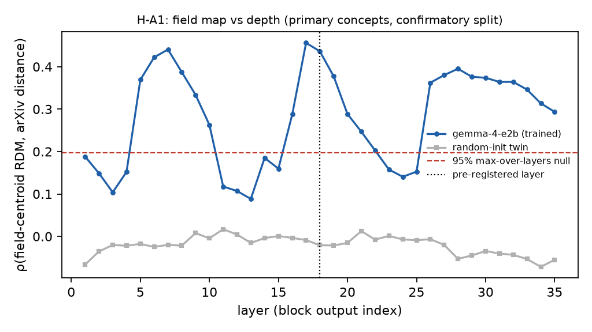
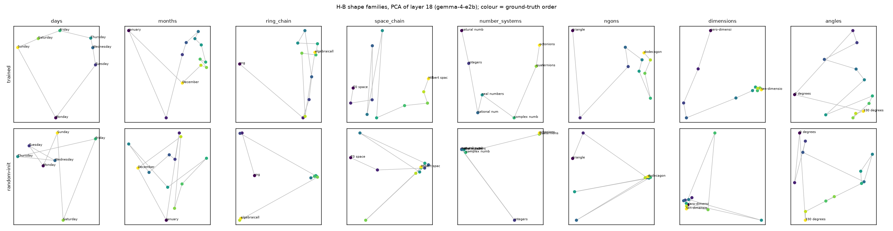
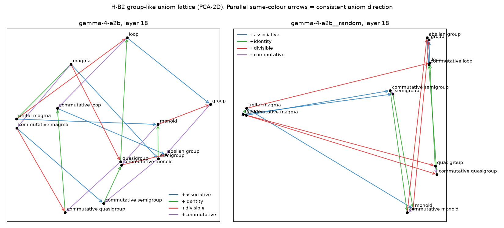

# Results: `gemma` run

Generated by `python run.py report --config configs/gemma.yaml` from `results/gemma/*.json`. Do not edit by hand.

## Method validation: calibration of partial RDM regression (Freedman–Lane), simulation study

*not run*

## H-A1 field map (field-centroid RSA vs arXiv cross-listing distance; LOO nearest-centroid field accuracy)

| Model | Concept set | n concepts / fields | ρ_field trained (perm p) [95% CI] | ρ random-init | ρ layer-0 | Δ trained − random-init [95% CI] | LOO field acc trained / random / layer-0 (chance) | split-half reliability |
|---|---|---|---|---|---|---|---|---|
| gemma-4-e2b | math_primary | 398 / 17 | 0.436 (p=<0.0001) [0.315, 0.477] | -0.021 | 0.091 | +0.457 [0.290, 0.598] | 0.417 / 0.196 / 0.307 (0.059) | 0.993 |
| gemma-4-e2b | math_all | 526 / 17 | 0.464 (p=<0.0001) [0.342, 0.501] | 0.085 | 0.183 | +0.379 [0.252, 0.543] | 0.399 / 0.215 / 0.312 (0.059) | 0.991 |

## POST-HOC: field-map ρ after removing the top-k principal components (all-but-the-top sweep)

| Model | k=0 | k=1 | k=2 | k=3 | k=5 | k=10 | k=20 | k=40 | top-5 PC explained variance | field η² on PC1–10 |
|---|---|---|---|---|---|---|---|---|---|---|
| gemma-4-e2b | 0.436 | 0.309 | 0.448 | 0.167 | 0.090 | -0.105 | -0.122 | -0.294 | 0.151, 0.110, 0.050, 0.045, 0.043 | 0.45, 0.20, 0.32, 0.17, 0.20, 0.20, 0.19, 0.18, 0.24, 0.21 |
| gemma-4-e2b__random | -0.021 | -0.097 | -0.085 | -0.100 | -0.054 | -0.066 | -0.147 | -0.086 | 0.021, 0.019, 0.013, 0.013, 0.011 | 0.15, 0.27, 0.09, 0.04, 0.09, 0.08, 0.10, 0.04, 0.06, 0.06 |

## POST-HOC: cyclic order in the top-2-PC plane at the pre-registered layer (1 = perfect cycle; positive-control debug)

| Family | gemma-4-e2b | gemma-4-e2b__random |
|---|---|---|
| days | 1.00 (p=0.0080) | 0.00 (p=1.0000) |
| months | 0.25 (p=0.1796) | 0.17 (p=0.5349) |
| ring_chain | 0.18 (p=0.5729) | 0.18 (p=0.5609) |
| space_chain | 0.55 (p=0.0060) | 0.18 (p=0.5489) |
| number_systems | 0.57 (p=0.0818) | 0.14 (p=0.9301) |
| ngons | 0.30 (p=0.2176) | 0.10 (p=0.9182) |
| dimensions | 0.45 (p=0.0140) | 0.18 (p=0.5509) |
| angles | 0.25 (p=0.2176) | 0.17 (p=0.5549) |

## Multiplicity: Holm correction over the 8 pre-registered confirmatory tests (bootstrap p for H-A1 is the fraction of resamples with Δ ≤ 0; 0 means < 1/2000)

| Test | Model | p | Holm-adjusted p | reject at α=0.05 |
|---|---|---|---|---|
| H-A1 Δρ trained − random-init ≤ 0 (bootstrap) | gemma-4-e2b | <0.0001 | <0.0001 | yes |
| H-B ring chain Robinson | gemma-4-e2b | 0.0100 | 0.0300 | yes |
| H-B space chain Robinson | gemma-4-e2b | 0.0005 | 0.0030 | yes |
| H-B2 associative offset consistency | gemma-4-e2b | 0.0020 | 0.0080 | yes |
| H-B2 identity offset consistency | gemma-4-e2b | 0.0900 | 0.0900 | no |
| H-B2 divisible offset consistency | gemma-4-e2b | 0.0230 | 0.0460 | yes |
| H-B2 commutative offset consistency | gemma-4-e2b | 0.0005 | 0.0030 | yes |
| H-B angles circle prediction (decision rule: closure 2.03 < 2 and circle ρ 0.23 > line ρ 0.43) | gemma-4-e2b | — | — | not met (prediction falsified) |

## H-A1c clustering specificity: math fields vs non-math control fields

| Model | Domain | n / fields | LOO acc trained [CI] | random-init | layer-0 | chance | Δ trained − random-init [CI] |
|---|---|---|---|---|---|---|---|
| gemma-4-e2b | math | 398 / 17 | 0.417 [0.374, 0.462] | 0.196 | 0.307 | 0.059 | +0.221 [0.171, 0.274] |
| gemma-4-e2b | control | 97 / 4 | 0.866 [0.804, 0.928] | 0.216 | 0.649 | 0.250 | +0.649 [0.546, 0.742] |

## H-B shape families (primary layer; permutation p-values; † = post-hoc statistic, see docs/deviations.md)

| Family | Expected | Model | line ρ | circle ρ | closure (d first-last / adjacent) | closure_far† (null 5%) | Robinson (p) | PCA order \|ρ\| (p) | LOO order ρ (p) |
|---|---|---|---|---|---|---|---|---|---|
| days | circle | gemma-4-e2b | 0.72 | 0.58 | 1.65 | 1.02 (0.37) | 0.71 (0.0055) | 0.64 (0.1334) | 0.75 (0.0332) |
| days | circle | gemma-4-e2b__random | -0.23 | 0.00 | 0.96 | 0.96 (0.94) | 0.23 (0.8446) | 0.61 (0.1789) | -0.96 (0.9302) |
| months | circle | gemma-4-e2b | 0.61 | 0.36 | 1.99 | 0.97 (0.53) | 0.69 (0.0005) | 0.66 (0.0240) | 0.86 (0.0033) |
| months | circle | gemma-4-e2b__random | 0.27 | 0.05 | 1.02 | 1.05 (0.96) | 0.45 (0.0230) | 0.13 (0.6927) | -0.51 (0.2292) |
| ring_chain | line | gemma-4-e2b | 0.27 | 0.08 | 1.86 | 1.15 (0.53) | 0.50 (0.0100) | 0.42 (0.1999) | 0.43 (0.1030) |
| ring_chain | line | gemma-4-e2b__random | 0.37 | 0.40 | 1.45 | 0.98 (0.45) | 0.28 (0.7816) | 0.05 (0.8821) | 0.50 (0.0332) |
| space_chain | line | gemma-4-e2b | 0.55 | 0.27 | 1.39 | 1.21 (0.64) | 0.57 (0.0005) | 0.95 (0.0005) | 0.82 (0.0133) |
| space_chain | line | gemma-4-e2b__random | -0.06 | -0.00 | 1.00 | 0.97 (0.81) | 0.27 (0.7916) | 0.16 (0.6307) | -0.22 (0.2890) |
| number_systems | line | gemma-4-e2b | 0.92 | 0.54 | 1.94 | 1.56 (0.52) | 0.91 (0.0010) | 1.00 (0.0010) | 0.89 (0.0033) |
| number_systems | line | gemma-4-e2b__random | 0.24 | -0.09 | 1.36 | 2.39 (0.41) | 0.60 (0.0080) | 0.71 (0.0815) | 0.32 (0.1196) |
| ngons | number_reference | gemma-4-e2b | 0.50 | 0.21 | 1.90 | 1.00 (0.49) | 0.64 (0.0015) | 0.87 (0.0025) | 0.89 (0.0033) |
| ngons | number_reference | gemma-4-e2b__random | 0.19 | 0.05 | 1.23 | 1.01 (0.47) | 0.51 (0.0120) | 0.52 (0.1349) | 0.42 (0.0432) |
| dimensions | number_reference | gemma-4-e2b | 0.62 | 0.42 | 2.37 | 1.09 (0.24) | 0.65 (0.0010) | 0.91 (0.0010) | 0.86 (0.0033) |
| dimensions | number_reference | gemma-4-e2b__random | -0.25 | -0.02 | 0.79 | 0.69 (0.74) | 0.23 (0.9040) | 0.12 (0.7451) | -0.57 (0.6013) |
| angles | circle | gemma-4-e2b | 0.43 | 0.23 | 2.03 | 1.03 (0.37) | 0.54 (0.0010) | 0.48 (0.1184) | 0.87 (0.0033) |
| angles | circle | gemma-4-e2b__random | 0.25 | 0.46 | 1.14 | 0.94 (0.77) | 0.39 (0.1914) | 0.36 (0.2599) | 0.73 (0.0066) |

## H-B negative control: random 11-item lists of math concepts (should reject ≈5%)

| Model | Robinson reject rate | PCA-order reject rate | line-ρ reject rate | n lists |
|---|---|---|---|---|
| gemma-4-e2b | 0.03 | 0.07 | 0.02 | 100 |
| gemma-4-e2b__random | 0.04 | 0.03 | 0.05 | 100 |

## H-B number-coded families: structure beyond the number reference

| Family | Model | ρ(family RDM, reference RDM) | template β beyond reference (p) |
|---|---|---|---|
| ngons vs number_words_3_12 | gemma-4-e2b | 0.38 | +0.483 (0.0484) |
| ngons vs number_words_3_12 | gemma-4-e2b__random | -0.06 | +0.189 (0.1364) |
| dimensions vs number_words_0_10 | gemma-4-e2b | 0.64 | +0.330 (0.0358) |
| dimensions vs number_words_0_10 | gemma-4-e2b__random | 0.57 | -0.106 (0.8146) |
| angles vs digits_0_330 | gemma-4-e2b | 0.74 | +0.135 (0.0286) |
| angles vs digits_0_330 | gemma-4-e2b__random | 0.66 | +0.242 (0.0020) |

## H-B2 axiom lattices (offset consistency = mean cosine of same-axiom difference vectors)

| Lattice | Model | axiom-RDM β (p) | lexical β | offset consistency per axiom: obs / null95 (p) | analogy top-1 (chance) | mean rank (chance) |
|---|---|---|---|---|---|---|
| group_like | gemma-4-e2b | +0.301 (0.0018) | +0.437 | associative: 0.56/0.26 (0.0020); identity: 0.19/0.25 (0.0900); divisible: 0.35/0.26 (0.0230); commutative: 0.74/0.22 (0.0005) | 0.56 (0.10) | 2.6 (5.5) |
| self_distributive | gemma-4-e2b | +0.080 (0.4149) | -0.084 | invertible: -0.11/0.84 (0.6112); idempotent: 0.23/0.84 (0.3468) | 0.00 (0.50) | 2.0 (1.5) |
| gender control | gemma-4-e2b | — | — | gender: 0.11/0.10 | king:queen rank 6 | — |
| group_like | gemma-4-e2b__random | +0.275 (0.0054) | -0.017 | associative: 0.22/0.21 (0.0475); identity: 0.14/0.20 (0.0980); divisible: 0.23/0.21 (0.0425); commutative: 0.02/0.19 (0.3683) | 0.47 (0.10) | 3.4 (5.5) |
| self_distributive | gemma-4-e2b__random | +0.087 (0.4553) | +0.146 | invertible: -0.05/0.55 (0.6337); idempotent: 0.00/0.55 (0.4763) | 1.00 (0.50) | 1.0 (1.5) |
| gender control | gemma-4-e2b__random | — | — | gender: -0.00/0.07 | king:queen rank 1 | — |

## H-A2 hierarchy as pre-registered: cophenetic correlation (UPGMA) vs super-tree; spectrum-matched Gaussian and Gromov δ (plan)

| Model | super-tree match (cophenetic ρ): trained / twin / layer-0 | shuffled-tree p (null95) | Δ trained − twin [95% CI] | cophenetic c trained / twin (Gaussian 95th pct) | relative Gromov δ trained / twin (Gaussian 5th pct) |
|---|---|---|---|---|---|
| gemma-4-e2b | 0.228 / 0.072 / 0.125 | 0.0215 (0.163) | [-0.080, 0.406] | 0.779 / 0.754 (0.870) | 0.275 / 0.067 (0.251) |

## H-B2 tests 4–5: axiom transfer to ring-like pairs; group objects (parent ranks = nearest-neighbour rank of [group, other parent])

| Model | commutativity transfer cos (null95, p) | identity transfer cos (p) | group-object parallelograms cos (null95, p) | parent ranks: topological / Lie / algebraic group |
|---|---|---|---|---|
| gemma-4-e2b | +0.129 (0.271, 0.2324) | -0.180 (0.9320) | +0.484 (0.303, 0.0085) | [41, 6] / [2, 10] / [7, 3] (of 113) |
| gemma-4-e2b__random | +0.003 (0.063, 0.4568) | +0.037 (0.2344) | -0.003 (0.141, 0.5337) | [2, 31] / [2, 6] / [2, 7] (of 113) |

## Figures

