# Results: `mvp` run

Generated by `python run.py report --config configs/mvp.yaml` from `results/mvp/*.json`. Do not edit by hand.

## Method validation: calibration of partial RDM regression (Freedman–Lane), simulation study

| Scenario | Rejection rate at α=0.05 (± SE) | n simulations |
|---|---|---|
| concept level, nuisance correctly specified (null) | 0.065 ± 0.017 | 200 |
| concept level, item-level noise / nonlinear link (null) | 0.220 ± 0.029 | 200 |
| field level, representation unrelated to fields (null) | 0.020 ± 0.010 | 200 |
| field level, nuisance = noisy proxy of a confounder (null) | 0.525 ± 0.035 | 200 |
| field level, true field geometry present (power) | 0.995 ± 0.005 | 200 |

## H-A1 field map (field-centroid RSA vs arXiv cross-listing distance; LOO nearest-centroid field accuracy)

| Model | Concept set | n concepts / fields | ρ_field trained (perm p) [95% CI] | ρ random-init | ρ layer-0 | Δ trained − random-init [95% CI] | LOO field acc trained / random / layer-0 (chance) | split-half reliability |
|---|---|---|---|---|---|---|---|---|
| qwen3.5-2b | math_primary | 398 / 17 | 0.387 (p=<0.0001) [0.262, 0.420] | -0.118 | 0.024 | +0.506 [0.277, 0.576] | 0.472 / 0.090 / 0.279 (0.059) | 0.999 |
| qwen3.5-2b | math_all | 526 / 17 | 0.426 (p=<0.0001) [0.303, 0.448] | -0.035 | 0.115 | +0.461 [0.231, 0.548] | 0.485 / 0.108 / 0.308 (0.059) | 0.999 |

## POST-HOC: field-map ρ after removing the top-k principal components (all-but-the-top sweep)

| Model | k=0 | k=1 | k=2 | k=3 | k=5 | k=10 | k=20 | k=40 | top-5 PC explained variance | field η² on PC1–10 |
|---|---|---|---|---|---|---|---|---|---|---|
| qwen3.5-2b | 0.387 | 0.466 | 0.351 | 0.312 | 0.178 | 0.021 | -0.218 | -0.341 | 0.066, 0.050, 0.037, 0.035, 0.028 | 0.20, 0.47, 0.22, 0.10, 0.14, 0.13, 0.13, 0.20, 0.27, 0.34 |
| qwen3.5-2b__random | -0.118 | -0.140 | -0.133 | -0.136 | -0.107 | -0.074 | -0.160 | -0.164 | 0.013, 0.012, 0.012, 0.012, 0.012 | 0.04, 0.02, 0.04, 0.06, 0.05, 0.03, 0.02, 0.03, 0.08, 0.06 |

## POST-HOC: cyclic order in the top-2-PC plane at the pre-registered layer (1 = perfect cycle; positive-control debug)

| Family | qwen3.5-2b | qwen3.5-2b__random |
|---|---|---|
| days | 1.00 (p=0.0080) | 0.14 (p=0.9581) |
| months | 1.00 (p=0.0020) | 0.08 (p=0.9102) |
| ring_chain | 0.36 (p=0.0559) | 0.18 (p=0.5429) |
| space_chain | 0.45 (p=0.0100) | 0.09 (p=0.9182) |
| number_systems | 0.29 (p=0.6188) | 0.43 (p=0.2016) |
| ngons | 0.50 (p=0.0100) | 0.30 (p=0.2116) |
| dimensions | 0.55 (p=0.0040) | 0.18 (p=0.5549) |
| angles | 0.33 (p=0.0559) | 0.17 (p=0.5469) |

## POST-HOC 4 (reports/prereg_addendum_3d.md): closed cycle in the best plane of PC1–5 at the pre-registered layer (score · plane · max-over-planes p; twin in brackets)

| Family | qwen3.5-2b |
|---|---|
| days | 1.00 · PC1–PC2 · p=0.0310 (twin 0.29) |
| months | 0.50 · PC2–PC3 · p=0.0220 (twin 0.25) |
| angles | 0.33 · PC3–PC5 · p=0.3447 (twin 0.33) |
| digits_0_330 | 0.33 · PC2–PC3 · p=0.3287 (twin 0.33) |

## Multiplicity: Holm correction over the 8 pre-registered confirmatory tests (bootstrap p for H-A1 is the fraction of resamples with Δ ≤ 0; 0 means < 1/2000)

| Test | Model | p | Holm-adjusted p | reject at α=0.05 |
|---|---|---|---|---|
| H-A1 Δρ trained − random-init ≤ 0 (bootstrap) | qwen3.5-2b | <0.0001 | <0.0001 | yes |
| H-B ring chain Robinson | qwen3.5-2b | 0.0105 | 0.0315 | yes |
| H-B space chain Robinson | qwen3.5-2b | 0.0005 | 0.0030 | yes |
| H-B2 associative offset consistency | qwen3.5-2b | 0.0035 | 0.0140 | yes |
| H-B2 identity offset consistency | qwen3.5-2b | 0.0425 | 0.0550 | no |
| H-B2 divisible offset consistency | qwen3.5-2b | 0.0275 | 0.0550 | no |
| H-B2 commutative offset consistency | qwen3.5-2b | 0.0010 | 0.0050 | yes |
| H-B angles circle prediction (decision rule: closure 2.11 < 2 and circle ρ 0.29 > line ρ 0.56) | qwen3.5-2b | — | — | not met (prediction falsified) |

## H-A1c clustering specificity: math fields vs non-math control fields

| Model | Domain | n / fields | LOO acc trained [CI] | random-init | layer-0 | chance | Δ trained − random-init [CI] |
|---|---|---|---|---|---|---|---|
| qwen3.5-2b | math | 398 / 17 | 0.472 [0.427, 0.520] | 0.090 | 0.279 | 0.059 | +0.382 [0.329, 0.435] |
| qwen3.5-2b | control | 97 / 4 | 0.814 [0.732, 0.887] | 0.268 | 0.474 | 0.250 | +0.546 [0.423, 0.660] |

## H-B shape families (primary layer; permutation p-values; † = post-hoc statistic, see docs/deviations.md)

| Family | Expected | Model | line ρ | circle ρ | closure (d first-last / adjacent) | closure_far† (null 5%) | Robinson (p) | PCA order \|ρ\| (p) | LOO order ρ (p) |
|---|---|---|---|---|---|---|---|---|---|
| days | circle | qwen3.5-2b | 0.78 | 0.65 | 1.19 | 0.99 (0.76) | 0.77 (0.0010) | 0.54 (0.2284) | -0.14 (0.0731) |
| days | circle | qwen3.5-2b__random | -0.04 | -0.07 | 0.99 | 1.02 (0.96) | 0.34 (0.5002) | 0.18 (0.7106) | -0.93 (0.1993) |
| months | circle | qwen3.5-2b | 0.79 | 0.70 | 1.23 | 0.96 (0.76) | 0.66 (0.0005) | 0.55 (0.0730) | 0.77 (0.0066) |
| months | circle | qwen3.5-2b__random | -0.10 | -0.06 | 0.99 | 0.97 (0.94) | 0.30 (0.6962) | 0.32 (0.3048) | -0.78 (0.6013) |
| ring_chain | line | qwen3.5-2b | 0.48 | 0.38 | 1.63 | 1.04 (0.63) | 0.52 (0.0105) | 0.46 (0.1619) | 0.65 (0.0133) |
| ring_chain | line | qwen3.5-2b__random | -0.03 | -0.01 | 1.17 | 1.84 (0.53) | 0.30 (0.6667) | 0.50 (0.1234) | -0.45 (0.2292) |
| space_chain | line | qwen3.5-2b | 0.67 | 0.40 | 1.79 | 1.42 (0.57) | 0.65 (0.0005) | 0.83 (0.0025) | 0.87 (0.0033) |
| space_chain | line | qwen3.5-2b__random | -0.04 | 0.03 | 0.66 | 0.99 (0.54) | 0.33 (0.4993) | 0.56 (0.0770) | -0.41 (0.2625) |
| number_systems | line | qwen3.5-2b | 0.77 | 0.36 | 1.67 | 1.66 (0.56) | 0.74 (0.0045) | 0.96 (0.0020) | 0.71 (0.0066) |
| number_systems | line | qwen3.5-2b__random | 0.11 | 0.16 | 1.01 | 1.01 (0.93) | 0.26 (0.7856) | 0.39 (0.3773) | -0.82 (0.3887) |
| ngons | number_reference | qwen3.5-2b | 0.56 | 0.28 | 1.94 | 1.06 (0.54) | 0.64 (0.0010) | 0.87 (0.0030) | 0.90 (0.0033) |
| ngons | number_reference | qwen3.5-2b__random | 0.42 | 0.14 | 1.65 | 1.76 (0.57) | 0.42 (0.1159) | 0.19 (0.6007) | -0.89 (0.9236) |
| dimensions | number_reference | qwen3.5-2b | 0.66 | 0.37 | 2.17 | 1.02 (0.31) | 0.75 (0.0005) | 0.95 (0.0010) | 0.72 (0.0033) |
| dimensions | number_reference | qwen3.5-2b__random | -0.17 | -0.15 | 1.01 | 1.01 (0.93) | 0.32 (0.6117) | 0.00 (1.0000) | -0.75 (0.6578) |
| angles | circle | qwen3.5-2b | 0.56 | 0.29 | 2.11 | 1.01 (0.39) | 0.65 (0.0005) | 0.90 (0.0005) | 0.76 (0.0033) |
| angles | circle | qwen3.5-2b__random | -0.01 | 0.22 | 0.80 | 1.01 (0.77) | 0.26 (0.8581) | 0.08 (0.8076) | -0.49 (0.3754) |

## H-B negative control: random 11-item lists of math concepts (should reject ≈5%)

| Model | Robinson reject rate | PCA-order reject rate | line-ρ reject rate | n lists |
|---|---|---|---|---|
| qwen3.5-2b | 0.04 | 0.04 | 0.04 | 100 |
| qwen3.5-2b__random | 0.04 | 0.04 | 0.05 | 100 |

## H-B number-coded families: structure beyond the number reference

| Family | Model | ρ(family RDM, reference RDM) | template β beyond reference (p) |
|---|---|---|---|
| ngons vs number_words_3_12 | qwen3.5-2b | 0.59 | +0.223 (0.3089) |
| ngons vs number_words_3_12 | qwen3.5-2b__random | 0.11 | +0.411 (0.0066) |
| dimensions vs number_words_0_10 | qwen3.5-2b | 0.76 | +0.260 (0.0204) |
| dimensions vs number_words_0_10 | qwen3.5-2b__random | -0.58 | -0.153 (0.9104) |
| angles vs digits_0_330 | qwen3.5-2b | 0.84 | +0.054 (0.1858) |
| angles vs digits_0_330 | qwen3.5-2b__random | 0.22 | +0.227 (0.0104) |

## H-B2 axiom lattices (offset consistency = mean cosine of same-axiom difference vectors)

| Lattice | Model | axiom-RDM β (p) | lexical β | offset consistency per axiom: obs / null95 (p) | analogy top-1 (chance) | mean rank (chance) |
|---|---|---|---|---|---|---|
| group_like | qwen3.5-2b | +0.492 (0.0002) | +0.236 | associative: 0.43/0.23 (0.0035); identity: 0.24/0.22 (0.0425); divisible: 0.29/0.22 (0.0275); commutative: 0.53/0.20 (0.0010) | 0.56 (0.10) | 2.5 (5.5) |
| self_distributive | qwen3.5-2b | +0.123 (0.3393) | -0.446 | invertible: 0.48/0.78 (0.2039); idempotent: 0.17/0.78 (0.4268) | 1.00 (0.50) | 1.0 (1.5) |
| gender control | qwen3.5-2b | — | — | gender: 0.28/0.09 | king:queen rank 1 | — |
| group_like | qwen3.5-2b__random | +0.302 (0.0010) | -0.403 | associative: 0.02/0.16 (0.3678); identity: 0.04/0.16 (0.3068); divisible: 0.01/0.16 (0.4338); commutative: 0.01/0.14 (0.4048) | 0.31 (0.10) | 3.6 (5.5) |
| self_distributive | qwen3.5-2b__random | +0.316 (0.1284) | -0.275 | invertible: -0.01/0.56 (0.5207); idempotent: 0.01/0.56 (0.4493) | 1.00 (0.50) | 1.0 (1.5) |
| gender control | qwen3.5-2b__random | — | — | gender: 0.00/0.07 | king:queen rank 15 | — |

## H-B frequency control (plan; second audit): chain order beyond Zipf frequency and token count

| Chain | Model | ρ(order, Zipf) | ρ(order, token count) | LOO order beyond covariates (null95, p) |
|---|---|---|---|---|
| ring_chain | qwen3.5-2b | -0.04 | +0.29 | +0.94 (0.65, 0.0033) |
| ring_chain | qwen3.5-2b__random | -0.04 | +0.29 | +0.13 (0.42, 0.2791) |
| space_chain | qwen3.5-2b | -0.10 | -0.05 | +0.81 (0.60, 0.0166) |
| space_chain | qwen3.5-2b__random | -0.10 | -0.05 | -0.04 (0.41, 0.5349) |
| number_systems | qwen3.5-2b | -0.57 | +0.80 | +0.21 (0.86, 0.3920) |
| number_systems | qwen3.5-2b__random | -0.57 | +0.80 | -0.21 (0.89, 0.5681) |

## H-B2 exploratory (second audit): flagged items and lattice-like identity transfer

| Model | associative quasigroup: d(·, group) / d(·, quasigroup) (3 nearest) | inverse semigroup: 3 nearest | identity direction → lattice-like pairs: cos (null95, p) |
|---|---|---|---|
| qwen3.5-2b | 2.81 (commutative quasigroup, quasigroup, commutative loop) | semigroup, commutative semigroup, monoid | +0.074 (0.157, 0.1359) |
| qwen3.5-2b__random | 1.11 (quasigroup, semigroup, monoid) | semigroup, quasigroup, loop | +0.054 (0.149, 0.1454) |

## H-B2 exploratory (second audit): offset variants and the partial-operation lattice

| Model | Variant | offset consistency per axiom: obs / null95 (p) |
|---|---|---|
| qwen3.5-2b | group-like, mean-pooled tokens | associative: 0.30 / 0.22 (0.0235); identity: 0.26 / 0.23 (0.0305); divisible: 0.21 / 0.24 (0.0750); commutative: 0.60 / 0.19 (0.0005) |
| qwen3.5-2b | group-like, token-count direction removed | associative: 0.44 / 0.23 (0.0035); identity: 0.26 / 0.22 (0.0360); divisible: 0.31 / 0.22 (0.0235); commutative: 0.46 / 0.20 (0.0010) |
| qwen3.5-2b | partial-operation lattice | total: 0.29 / 0.54 (0.1704); identity: 0.07 / 0.82 (0.4518); divisible: -0.22 / 0.80 (0.5817) |
| qwen3.5-2b__random | group-like, mean-pooled tokens | associative: 0.03 / 0.17 (0.3378); identity: 0.03 / 0.16 (0.3283); divisible: 0.01 / 0.17 (0.4058); commutative: 0.10 / 0.14 (0.1084) |
| qwen3.5-2b__random | group-like, token-count direction removed | associative: 0.02 / 0.16 (0.3633); identity: 0.04 / 0.16 (0.3068); divisible: 0.01 / 0.16 (0.4278); commutative: -0.02 / 0.14 (0.5487) |
| qwen3.5-2b__random | partial-operation lattice | total: -0.03 / 0.38 (0.5272); identity: -0.08 / 0.55 (0.6872); divisible: -0.07 / 0.55 (0.6707) |

## H-A2 hierarchy as pre-registered: cophenetic correlation (UPGMA) vs super-tree; spectrum-matched Gaussian and Gromov δ (plan)

| Model | super-tree match (cophenetic ρ): trained / twin / layer-0 | shuffled-tree p (null95) | Δ trained − twin [95% CI] | cophenetic c trained / twin (Gaussian 95th pct) | relative Gromov δ trained / twin (Gaussian 5th pct) |
|---|---|---|---|---|---|
| qwen3.5-2b | 0.237 / -0.033 / 0.171 | 0.0200 (0.164) | [-0.079, 0.348] | 0.760 / 0.590 (0.774) | 0.243 / 0.059 (0.302) |

## Baselines: field map from fastText and Qwen3-Embedding vs the LLM (paired bootstrap); infini-gram covariate

| Model | concept set | n | field ρ: LLM / Qwen3-Embedding / fastText | Δ LLM − Qwen3-Emb [CI] | Δ LLM − fastText [CI] | LOO acc: LLM / Qwen3-Emb / fastText |
|---|---|---|---|---|---|---|
| qwen3.5-2b | all_primary | 398 | 0.387 / 0.454 / — | [-0.125, 0.045] | — | 0.472 / 0.487 / — |
| qwen3.5-2b | fasttext_covered | 367 | 0.401 / 0.490 / 0.190 | [-0.148, 0.034] | [0.074, 0.302] | 0.485 / 0.477 / 0.322 |

infini-gram (v4_dolma-v1_7_llama): Spearman ρ(wordfreq Zipf, log count) = 0.316; concepts with zero count: 0.2%.

## Secondary: SMDS line vs discrete-circle fits, each vs label-shuffled refits

| Family | Model | SMDS line score (null95, p) | SMDS discrete-circle score (null95, p) | preferred (vs null) |
|---|---|---|---|---|
| days | qwen3.5-2b | 0.966 (0.970, 0.1569) | 0.891 (0.889, 0.0196) | discrete_circular |
| days | qwen3.5-2b__random | 1.000 (1.000, 0.4902) | 0.895 (0.895, 0.5686) | none |
| months | qwen3.5-2b | 0.961 (0.941, 0.0196) | 0.869 (0.862, 0.0196) | euclidean |
| months | qwen3.5-2b__random | 1.000 (1.000, 0.8431) | 0.870 (0.870, 0.9608) | none |
| ring_chain | qwen3.5-2b | 0.964 (0.945, 0.0196) | 0.877 (0.874, 0.0196) | euclidean |
| ring_chain | qwen3.5-2b__random | 1.000 (1.000, 0.6471) | 0.886 (0.886, 0.2745) | none |
| space_chain | qwen3.5-2b | 0.926 (0.887, 0.0196) | 0.853 (0.851, 0.0588) | euclidean |
| space_chain | qwen3.5-2b__random | 1.000 (1.000, 0.1373) | 0.886 (0.886, 0.5294) | none |
| number_systems | qwen3.5-2b | 0.959 (0.956, 0.0392) | 0.885 (0.887, 0.2157) | euclidean |
| number_systems | qwen3.5-2b__random | 1.000 (1.000, 0.7451) | 0.895 (0.895, 0.9412) | none |
| ngons | qwen3.5-2b | 0.928 (0.914, 0.0588) | 0.843 (0.843, 0.0784) | none |
| ngons | qwen3.5-2b__random | 1.000 (1.000, 0.6078) | 0.867 (0.867, 0.2157) | none |
| dimensions | qwen3.5-2b | 0.800 (0.684, 0.0196) | 0.721 (0.668, 0.0196) | euclidean |
| dimensions | qwen3.5-2b__random | 1.000 (1.000, 0.2941) | 0.886 (0.886, 0.8824) | none |
| angles | qwen3.5-2b | 0.856 (0.659, 0.0196) | 0.744 (0.673, 0.0196) | euclidean |
| angles | qwen3.5-2b__random | 1.000 (1.000, 0.9608) | 0.870 (0.870, 0.7451) | none |

## H-B2 tests 4–5: axiom transfer to ring-like pairs; group objects (parent ranks = nearest-neighbour rank of [group, other parent])

| Model | commutativity transfer cos (null95, p) | identity transfer cos (p) | group-object parallelograms cos (null95, p) | parent ranks: topological / Lie / algebraic group |
|---|---|---|---|---|
| qwen3.5-2b | +0.198 (0.198, 0.0510) | +0.015 (0.3983) | +0.398 (0.235, 0.0045) | [5, 8] / [3, 7] / [3, 6] (of 113) |
| qwen3.5-2b__random | -0.017 (0.167, 0.7126) | +0.001 (0.4743) | +0.006 (0.031, 0.3768) | [2, 44] / [1, 18] / [3, 71] (of 113) |

## H-A4 judges: agreement of LLM abstraction raters

| Judges | n concepts | mean pairwise Spearman | ICC(2,1) | ICC(2,k) |
|---|---|---|---|---|
| ibm-granite/granite-4.0-micro, HuggingFaceTB/SmolLM3-3B, microsoft/Phi-4-mini-instruct | 655 | 0.629 | 0.241 | 0.488 |

## H-A4 judge validation: mean rating vs Mathlib import depth; Mathlib coverage per field (plan; second audit)

| Matched concepts (curated YAML / CamelCase) | median import depth | ρ(mean judge rating, depth) [95% CI] (p) | ρ partialling Zipf | ρ per judge |
|---|---|---|---|---|
| 39 of 655 (22 / 17) | 72 | +0.373 [0.071, 0.616] (0.0194) | +0.312 | granite-4.0-micro: +0.28; SmolLM3-3B: +0.05; Phi-4-mini-instruct: +0.54 |

| Field | Mathlib coverage (fraction of concepts matched) |
|---|---|
| algebraic_geometry | 0.025 |
| algebraic_topology | 0.025 |
| category_theory | 0.075 |
| commutative_algebra | 0.075 |
| differential_geometry | 0.000 |
| functional_analysis | 0.000 |
| game_theory | 0.038 |
| general_topology | 0.100 |
| graph_theory | 0.000 |
| group_theory | 0.139 |
| lie_representation_theory | 0.051 |
| number_theory | 0.050 |
| numerical_analysis | 0.000 |
| probability_statistics | 0.025 |
| real_complex_analysis | 0.150 |
| ring_module_theory | 0.250 |
| set_theory_logic | 0.000 |

## H-A4 axes: top PCs vs pure/applied and abstraction (residualized on frequency, token count)

| Model | PC | explained var | ρ with applied (p) | ρ with abstraction (p) |
|---|---|---|---|---|
| qwen3.5-2b | 1 | 0.066 | -0.013 (0.7934) | +0.494 (<0.0001) |
| qwen3.5-2b | 2 | 0.050 | -0.411 (<0.0001) | +0.266 (<0.0001) |
| qwen3.5-2b | 3 | 0.037 | +0.038 (0.4480) | +0.202 (<0.0001) |
| qwen3.5-2b | 4 | 0.035 | -0.182 (0.0003) | +0.029 (0.5659) |
| qwen3.5-2b | 5 | 0.029 | +0.065 (0.1981) | -0.241 (<0.0001) |
| qwen3.5-2b | 5-fold CV ridge readout of abstraction | | | ρ = +0.736 |
| qwen3.5-2b | 1 (+ infini-gram covariate) | | +0.014 | +0.443 |
| qwen3.5-2b | 2 (+ infini-gram covariate) | | -0.406 | +0.261 |
| qwen3.5-2b__random | 1 | 0.013 | -0.007 (0.8853) | +0.065 (0.1967) |
| qwen3.5-2b__random | 2 | 0.012 | +0.141 (0.0048) | +0.037 (0.4658) |
| qwen3.5-2b__random | 3 | 0.012 | +0.112 (0.0261) | -0.064 (0.2048) |
| qwen3.5-2b__random | 4 | 0.012 | +0.059 (0.2404) | +0.090 (0.0725) |
| qwen3.5-2b__random | 5 | 0.012 | -0.102 (0.0427) | +0.001 (0.9833) |
| qwen3.5-2b__random | 5-fold CV ridge readout of abstraction | | | ρ = -0.062 |
| qwen3.5-2b__random | 1 (+ infini-gram covariate) | | -0.000 | +0.066 |
| qwen3.5-2b__random | 2 (+ infini-gram covariate) | | +0.145 | +0.021 |

## H-B causal test (gated on baseline accuracy ≥ 0.70)

| Model | Chain | baseline acc (gate) | noise scale | acc, chain-subspace noise | acc, random-subspace noise (mean of 5) |
|---|---|---|---|---|---|
| qwen3.5-2b | ring_chain | 0.691 (0.7) — gate not passed | — | — | — |
| qwen3.5-2b | space_chain | 0.864 (0.7) | 1.0 | 0.864 | 0.847 |
| qwen3.5-2b | space_chain | 0.864 (0.7) | 2.0 | 0.836 | 0.856 |
| qwen3.5-2b | space_chain | 0.864 (0.7) | 4.0 | 0.791 | 0.822 |

## Exploratory: Qwen-Scope SAE codes

| Model | SAE block | ρ field map (SAE code) | LOO acc math / control | features math-only / shared / control-only |
|---|---|---|---|---|
| qwen3.5-2b | 11 | 0.146 | 0.430 / 0.619 | 2445 / 715 / 871 |

## Figures

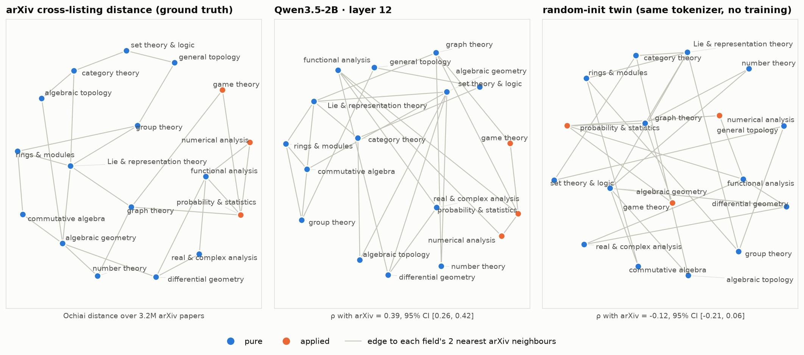

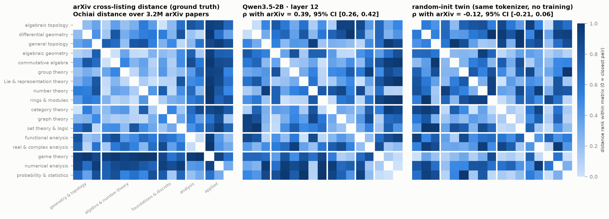

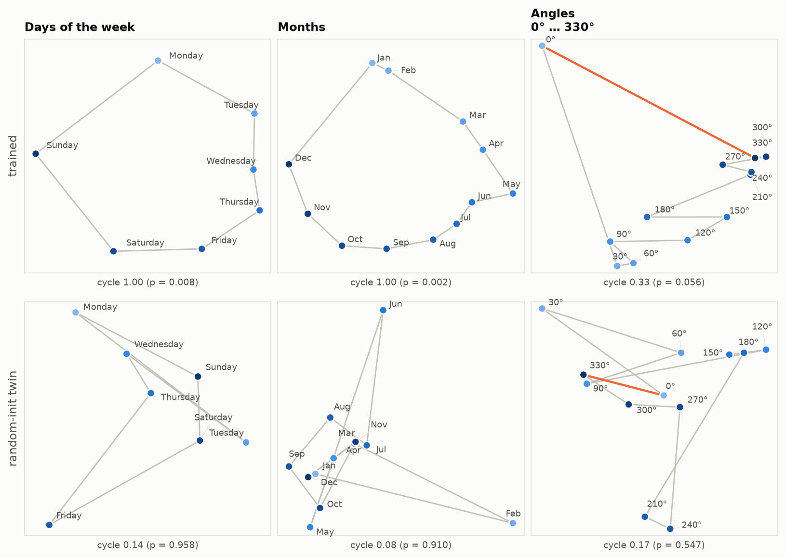

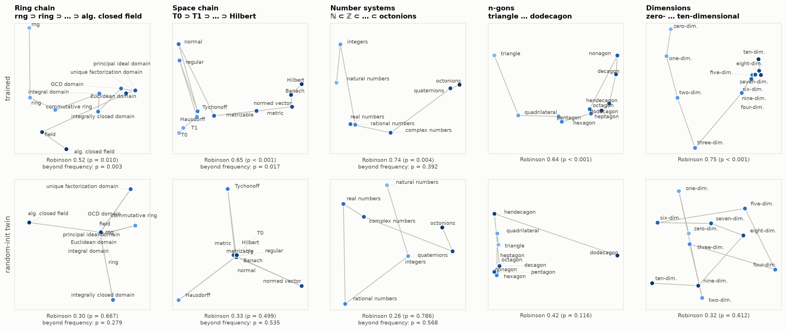

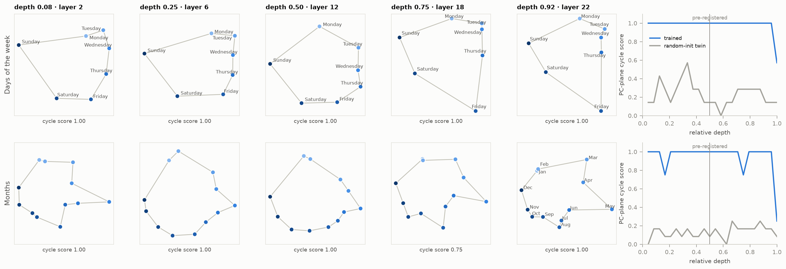

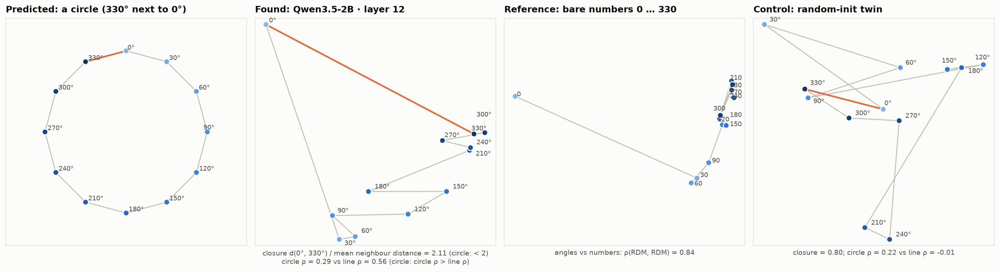

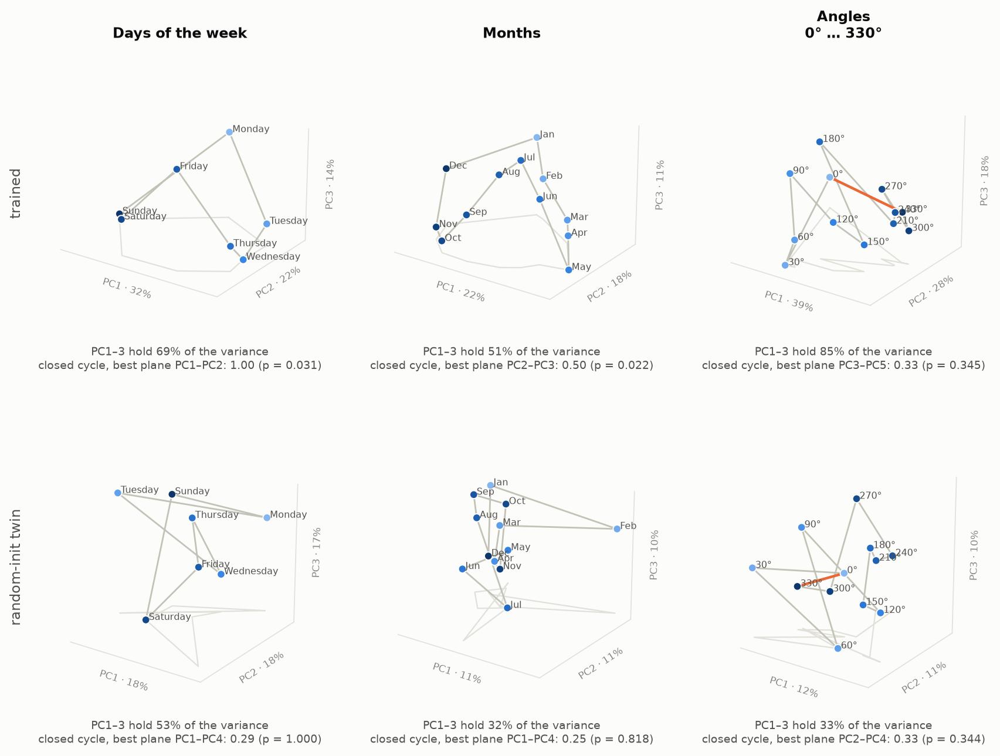

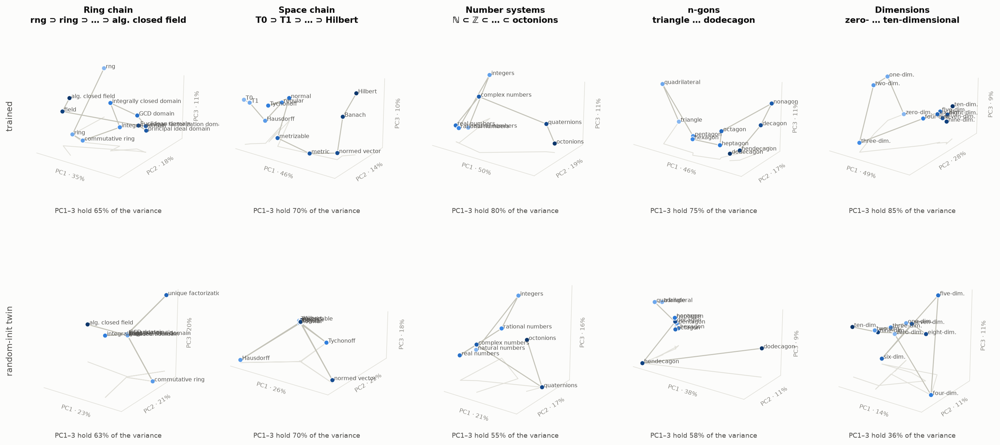

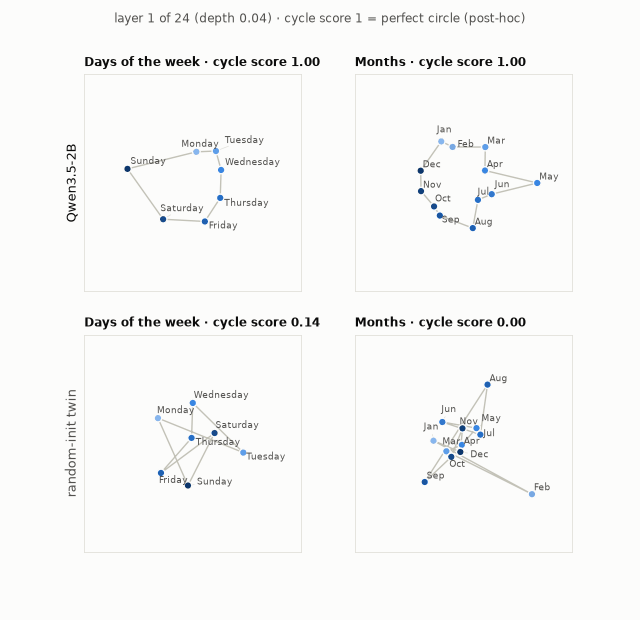

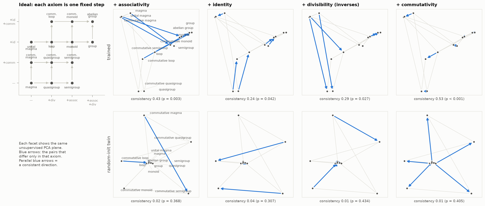

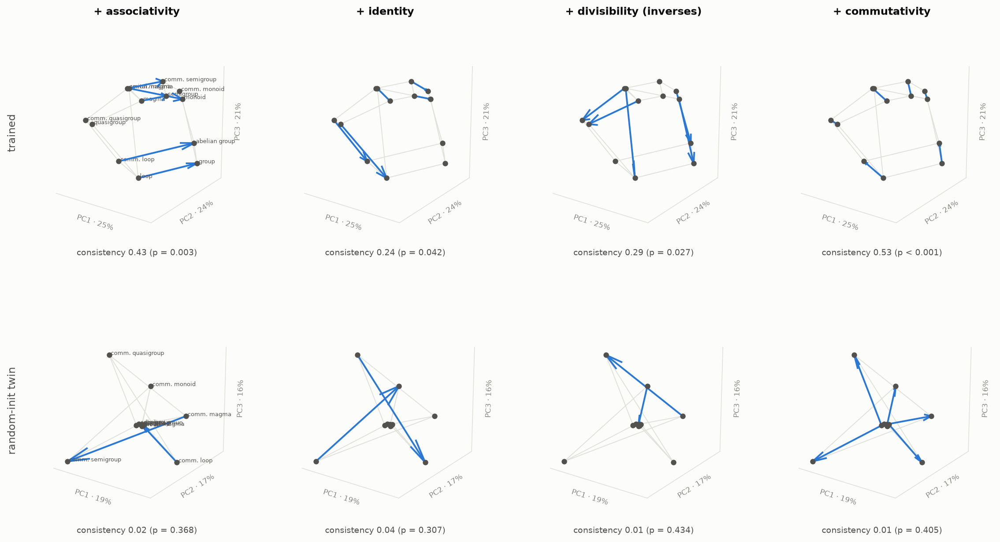

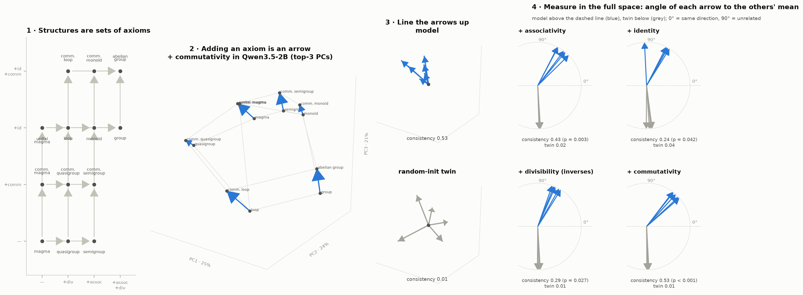

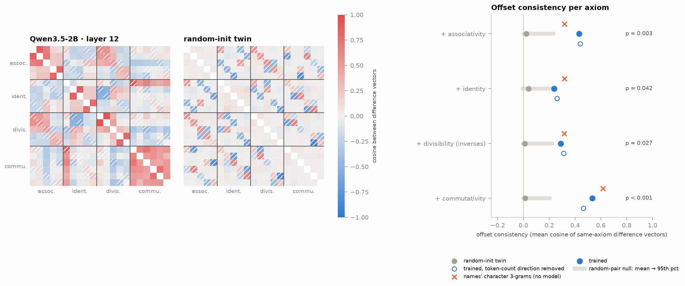

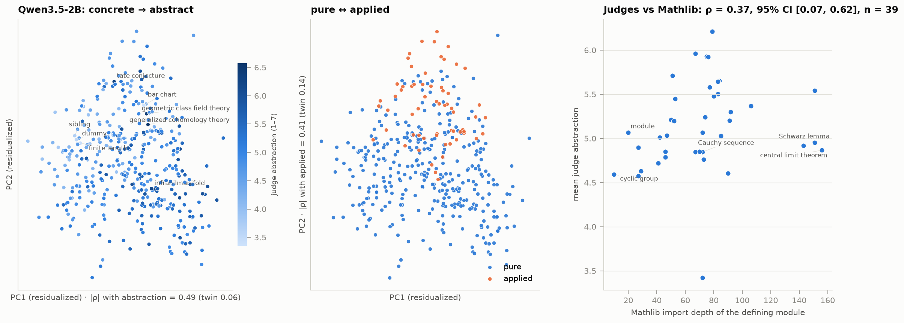
