# Results: `mvp_variants` run

Generated by `python run.py report --config configs/mvp_variants.yaml` from `results/mvp_variants/*.json`. Do not edit by hand.

## Method validation: calibration of partial RDM regression (Freedman–Lane), simulation study

*not run*

## H-A1 field map (field-centroid RSA vs arXiv cross-listing distance; LOO nearest-centroid field accuracy)

| Model | Concept set | n concepts / fields | ρ_field trained (perm p) [95% CI] | ρ random-init | ρ layer-0 | Δ trained − random-init [95% CI] | LOO field acc trained / random / layer-0 (chance) | split-half reliability |
|---|---|---|---|---|---|---|---|---|
| qwen3.5-2b | math_primary | 398 / 17 | 0.410 (p=0.0001) [0.304, 0.441] | -0.174 | 0.024 | +0.584 [0.335, 0.621] | 0.633 / 0.332 / 0.279 (0.059) | 0.998 |
| qwen3.5-2b | math_all | 526 / 17 | 0.429 (p=0.0001) [0.334, 0.458] | -0.056 | 0.115 | +0.485 [0.270, 0.573] | 0.624 / 0.354 / 0.308 (0.059) | 0.998 |

## POST-HOC: field-map ρ after removing the top-k principal components (all-but-the-top sweep)

| Model | k=0 | k=1 | k=2 | k=3 | k=5 | k=10 | k=20 | k=40 | top-5 PC explained variance | field η² on PC1–10 |
|---|---|---|---|---|---|---|---|---|---|---|
| qwen3.5-2b | 0.410 | 0.457 | 0.314 | 0.311 | 0.251 | 0.088 | -0.173 | -0.382 | 0.063, 0.044, 0.038, 0.034, 0.029 | 0.31, 0.48, 0.12, 0.17, 0.19, 0.19, 0.12, 0.27, 0.30, 0.27 |
| qwen3.5-2b__random | -0.174 | -0.170 | -0.158 | -0.146 | -0.164 | -0.084 | -0.123 | -0.147 | 0.013, 0.012, 0.012, 0.012, 0.012 | 0.04, 0.05, 0.03, 0.05, 0.05, 0.03, 0.03, 0.05, 0.08, 0.09 |

## POST-HOC: cyclic order in the top-2-PC plane at the pre-registered layer (1 = every item's angular neighbour is its true successor; an open arc also scores 1; positive-control debug)

| Family | qwen3.5-2b | qwen3.5-2b__random |
|---|---|---|
| days | 1.00 (p=0.0080) | 0.14 (p=0.9341) |
| months | 0.33 (p=0.0599) | 0.25 (p=0.1996) |
| ring_chain | 0.18 (p=0.5170) | 0.09 (p=0.9222) |
| space_chain | 0.27 (p=0.2116) | 0.18 (p=0.5269) |
| number_systems | 0.29 (p=0.6188) | 0.14 (p=0.9281) |
| ngons | 0.40 (p=0.0599) | 0.20 (p=0.5389) |
| dimensions | 0.45 (p=0.0060) | 0.18 (p=0.5609) |
| angles | 0.25 (p=0.1936) | 0.17 (p=0.5529) |

## POST-HOC 4 (reports/prereg_addendum_3d.md): closed cycle in the best plane of PC1–5 at the pre-registered layer (score · plane · max-over-planes p; twin in brackets)

*not run*

## Multiplicity: Holm correction over the 7 p-valued pre-registered confirmatory tests; the 8th, angles, is a decision rule without a p (H-A1 bootstrap p = (1 + #resamples with Δ ≤ 0)/(1 + 2000); chain p = max(Robinson p, LOO order p))

| Test | Model | p | Holm-adjusted p | reject at α=0.05 |
|---|---|---|---|---|
| H-A1 Δρ trained − random-init ≤ 0 (bootstrap) | qwen3.5-2b | 0.0005 | 0.0035 | yes |
| H-B ring chain (Robinson and LOO order) | qwen3.5-2b | 0.1030 | 0.2729 | no |
| H-B space chain (Robinson and LOO order) | qwen3.5-2b | 0.0210 | 0.1049 | no |
| H-B2 associative offset consistency | qwen3.5-2b | 0.0215 | 0.1049 | no |
| H-B2 identity offset consistency | qwen3.5-2b | 0.0910 | 0.2729 | no |
| H-B2 divisible offset consistency | qwen3.5-2b | 0.1239 | 0.2729 | no |
| H-B2 commutative offset consistency | qwen3.5-2b | 0.0020 | 0.0120 | yes |
| H-B angles circle prediction (decision rule: closure 1.97 < 2 and circle ρ 0.27 > line ρ 0.51) | qwen3.5-2b | — | — | not met (prediction falsified) |

## H-A1c clustering specificity: math fields vs non-math control fields

| Model | Domain | n / fields | LOO acc trained [CI] | random-init | layer-0 | chance | Δ trained − random-init [CI] |
|---|---|---|---|---|---|---|---|
| qwen3.5-2b | math | 398 / 17 | 0.633 [0.590, 0.676] | 0.332 | 0.279 | 0.059 | +0.302 [0.239, 0.364] |
| qwen3.5-2b | control | 97 / 4 | 0.835 [0.763, 0.897] | 0.464 | 0.474 | 0.250 | +0.371 [0.247, 0.495] |

## H-B shape families (primary layer; permutation p-values; † = post-hoc statistic, see docs/deviations.md)

| Family | Expected | Model | line ρ | circle ρ | closure (d first-last / adjacent) | closure_far† (null 5%) | Robinson (p) | PCA order \|ρ\| (p) | LOO order ρ (p) |
|---|---|---|---|---|---|---|---|---|---|
| days | circle | qwen3.5-2b | 0.75 | 0.48 | 1.29 | 1.16 (0.77) | 0.83 (0.0015) | 0.79 (0.0495) | 0.11 (0.0100) |
| days | circle | qwen3.5-2b__random | 0.04 | -0.22 | 1.02 | 1.02 (0.96) | 0.34 (0.4573) | 0.18 (0.7011) | -0.96 (0.8571) |
| months | circle | qwen3.5-2b | 0.27 | 0.48 | 0.96 | 0.94 (0.75) | 0.45 (0.0340) | 0.49 (0.1144) | 0.50 (0.0199) |
| months | circle | qwen3.5-2b__random | 0.17 | 0.06 | 1.03 | 1.02 (0.96) | 0.37 (0.2464) | 0.08 (0.8161) | -0.60 (0.1395) |
| ring_chain | line | qwen3.5-2b | 0.38 | 0.30 | 1.50 | 1.06 (0.58) | 0.48 (0.0205) | 0.21 (0.5477) | 0.25 (0.1030) |
| ring_chain | line | qwen3.5-2b__random | -0.07 | -0.02 | 1.15 | 1.74 (0.56) | 0.31 (0.6232) | 0.30 (0.3873) | -0.66 (0.5814) |
| space_chain | line | qwen3.5-2b | 0.32 | 0.19 | 1.12 | 1.35 (0.57) | 0.48 (0.0210) | 0.55 (0.0810) | 0.79 (0.0033) |
| space_chain | line | qwen3.5-2b__random | -0.01 | 0.01 | 0.72 | 1.06 (0.57) | 0.41 (0.2254) | 0.40 (0.2384) | -0.39 (0.2027) |
| number_systems | line | qwen3.5-2b | 0.78 | 0.37 | 1.57 | 1.80 (0.56) | 0.77 (0.0035) | 0.96 (0.0020) | 0.71 (0.0033) |
| number_systems | line | qwen3.5-2b__random | 0.19 | 0.05 | 1.05 | 1.11 (0.87) | 0.29 (0.6792) | 0.39 (0.3668) | -0.79 (0.3953) |
| ngons | number_reference | qwen3.5-2b | 0.54 | 0.26 | 1.82 | 1.12 (0.56) | 0.63 (0.0015) | 0.88 (0.0020) | 0.92 (0.0033) |
| ngons | number_reference | qwen3.5-2b__random | 0.40 | 0.12 | 1.66 | 1.86 (0.56) | 0.45 (0.0885) | 0.01 (1.0000) | -0.55 (0.3156) |
| dimensions | number_reference | qwen3.5-2b | 0.57 | 0.34 | 1.86 | 1.05 (0.37) | 0.62 (0.0015) | 0.85 (0.0020) | 0.57 (0.0066) |
| dimensions | number_reference | qwen3.5-2b__random | -0.20 | -0.16 | 1.00 | 1.01 (0.94) | 0.25 (0.9125) | 0.00 (1.0000) | -0.95 (0.9967) |
| angles | circle | qwen3.5-2b | 0.51 | 0.27 | 1.97 | 0.96 (0.45) | 0.61 (0.0005) | 0.79 (0.0040) | 0.71 (0.0033) |
| angles | circle | qwen3.5-2b__random | -0.02 | 0.21 | 0.81 | 0.99 (0.78) | 0.27 (0.8446) | 0.08 (0.8056) | -0.51 (0.3920) |

## H-B negative control: random 11-item lists of math concepts (should reject ≈5%)

| Model | Robinson reject rate | PCA-order reject rate | line-ρ reject rate | n lists |
|---|---|---|---|---|
| qwen3.5-2b | 0.02 | 0.02 | 0.03 | 100 |
| qwen3.5-2b__random | 0.03 | 0.06 | 0.07 | 100 |

## H-B number-coded families: structure beyond the number reference

| Family | Model | ρ(family RDM, reference RDM) | template β beyond reference (p) |
|---|---|---|---|
| ngons vs number_words_3_12 | qwen3.5-2b | 0.65 | -0.140 (0.6973) |
| ngons vs number_words_3_12 | qwen3.5-2b__random | 0.23 | +0.364 (0.0050) |
| dimensions vs number_words_0_10 | qwen3.5-2b | 0.70 | +0.123 (0.2480) |
| dimensions vs number_words_0_10 | qwen3.5-2b__random | -0.13 | -0.193 (0.9024) |
| angles vs digits_0_330 | qwen3.5-2b | 0.88 | -0.006 (0.5385) |
| angles vs digits_0_330 | qwen3.5-2b__random | 0.32 | +0.217 (0.0112) |

## H-B2 axiom lattices (offset consistency = mean cosine of same-axiom difference vectors)

| Lattice | Model | axiom-RDM β (p) | lexical β | offset consistency per axiom: obs / null95 (p) | analogy top-1 (chance) | mean rank (chance) |
|---|---|---|---|---|---|---|
| group_like | qwen3.5-2b | +0.177 (0.0394) | +0.379 | associative: 0.31/0.22 (0.0215); identity: 0.16/0.22 (0.0910); divisible: 0.14/0.24 (0.1239); commutative: 0.47/0.20 (0.0020) | 0.53 (0.10) | 3.0 (5.5) |
| self_distributive | qwen3.5-2b | +0.047 (0.4345) | -0.189 | invertible: 0.20/0.82 (0.3773); idempotent: 0.26/0.82 (0.3438) | 1.00 (0.50) | 1.0 (1.5) |
| gender control | qwen3.5-2b | — | — | gender: 0.26/0.08 | king:queen rank 1 | — |
| group_like | qwen3.5-2b__random | +0.290 (0.0012) | -0.404 | associative: 0.03/0.16 (0.3333); identity: 0.04/0.16 (0.3153); divisible: 0.03/0.16 (0.3423); commutative: 0.01/0.14 (0.4128) | 0.33 (0.10) | 3.8 (5.5) |
| self_distributive | qwen3.5-2b__random | -0.257 (0.7832) | +0.489 | invertible: -0.05/0.54 (0.6167); idempotent: -0.02/0.54 (0.5632) | 1.00 (0.50) | 1.0 (1.5) |
| gender control | qwen3.5-2b__random | — | — | gender: 0.00/0.07 | king:queen rank 14 | — |

## H-B frequency control (plan; second audit): chain order beyond Zipf frequency and token count

| Chain | Model | ρ(order, Zipf) | ρ(order, token count) | LOO order beyond covariates (null95, p) |
|---|---|---|---|---|
| ring_chain | qwen3.5-2b | -0.04 | +0.29 | +0.72 (0.64, 0.0299) |
| ring_chain | qwen3.5-2b__random | -0.04 | +0.29 | +0.34 (0.40, 0.0930) |
| space_chain | qwen3.5-2b | -0.10 | -0.05 | +0.79 (0.66, 0.0100) |
| space_chain | qwen3.5-2b__random | -0.10 | -0.05 | -0.15 (0.45, 0.7010) |
| number_systems | qwen3.5-2b | -0.57 | +0.80 | +0.32 (0.86, 0.3289) |
| number_systems | qwen3.5-2b__random | -0.57 | +0.80 | -0.07 (0.86, 0.5282) |

## H-B2 exploratory (second audit): flagged items and lattice-like identity transfer

| Model | associative quasigroup: d(·, group) / d(·, quasigroup) (3 nearest) | inverse semigroup: 3 nearest | identity direction → lattice-like pairs: cos (null95, p) |
|---|---|---|---|
| qwen3.5-2b | 2.71 (commutative quasigroup, quasigroup, commutative semigroup) | semigroup, commutative semigroup, commutative monoid | +0.026 (0.175, 0.3233) |
| qwen3.5-2b__random | 1.09 (quasigroup, semigroup, monoid) | semigroup, loop, quasigroup | +0.050 (0.144, 0.1509) |

## H-B2 exploratory (second audit): offset variants and the partial-operation lattice

| Model | Variant | offset consistency per axiom: obs / null95 (p) |
|---|---|---|
| qwen3.5-2b | group-like, mean-pooled tokens | associative: 0.20 / 0.21 (0.0555); identity: 0.22 / 0.21 (0.0445); divisible: 0.14 / 0.24 (0.1199); commutative: 0.46 / 0.18 (0.0010) |
| qwen3.5-2b | group-like, token-count direction removed | associative: 0.31 / 0.21 (0.0145); identity: 0.20 / 0.21 (0.0560); divisible: 0.19 / 0.21 (0.0665); commutative: 0.31 / 0.19 (0.0085) |
| qwen3.5-2b | partial-operation lattice | total: 0.10 / 0.55 (0.3213); identity: 0.09 / 0.78 (0.4698); divisible: -0.37 / 0.74 (0.7121) |
| qwen3.5-2b__random | group-like, mean-pooled tokens | associative: 0.02 / 0.17 (0.3533); identity: 0.03 / 0.16 (0.3273); divisible: 0.04 / 0.17 (0.3133); commutative: 0.11 / 0.14 (0.0910) |
| qwen3.5-2b__random | group-like, token-count direction removed | associative: 0.03 / 0.17 (0.3338); identity: 0.04 / 0.16 (0.3178); divisible: 0.03 / 0.16 (0.3433); commutative: -0.02 / 0.14 (0.5802) |
| qwen3.5-2b__random | partial-operation lattice | total: -0.01 / 0.39 (0.4783); identity: -0.03 / 0.58 (0.5847); divisible: -0.04 / 0.59 (0.5977) |

## H-B2 tests 4–5: axiom transfer to ring-like pairs; group objects (parent ranks = nearest-neighbour rank of [group, other parent])

| Model | commutativity transfer cos (null95, p) | identity transfer cos (p) | group-object parallelograms cos (null95, p) | parent ranks: topological / Lie / algebraic group |
|---|---|---|---|---|
| qwen3.5-2b | +0.087 (0.306, 0.3198) | +0.055 (0.2289) | +0.474 (0.227, 0.0005) | [30, 5] / [11, 4] / [22, 4] (of 113) |
| qwen3.5-2b__random | +0.000 (0.167, 0.5057) | -0.028 (0.8376) | +0.019 (0.031, 0.1519) | [1, 70] / [1, 3] / [3, 64] (of 113) |

## Figures

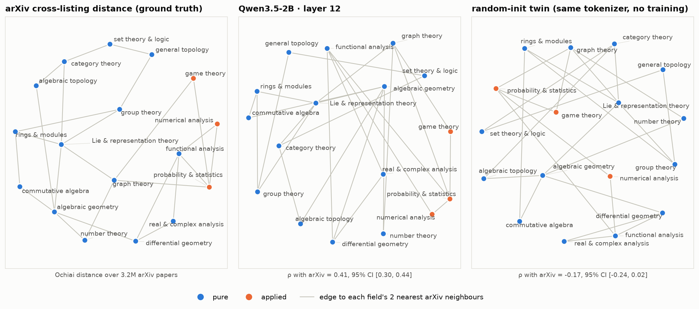

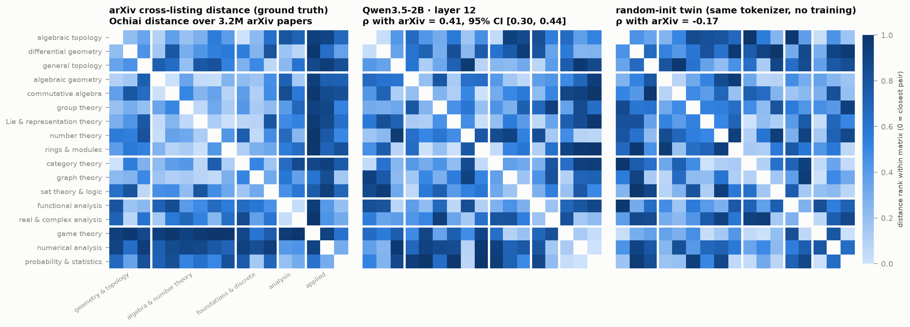

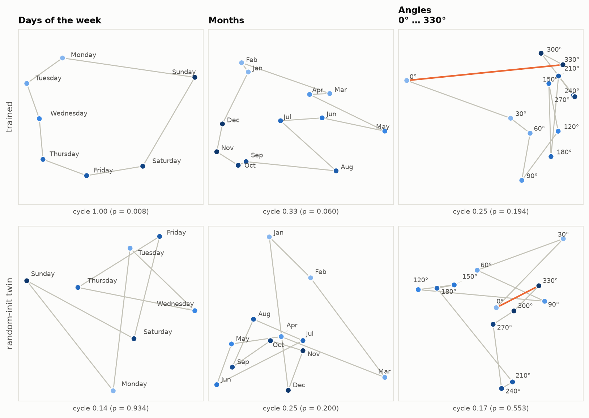

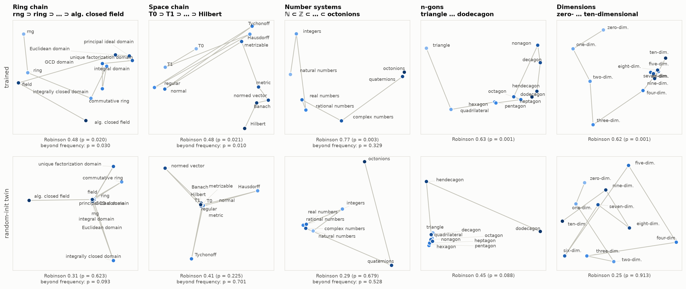

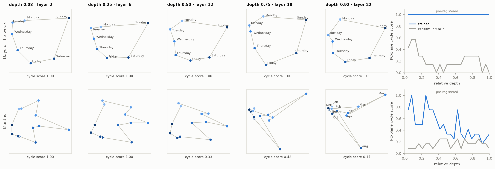

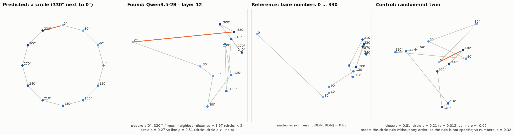

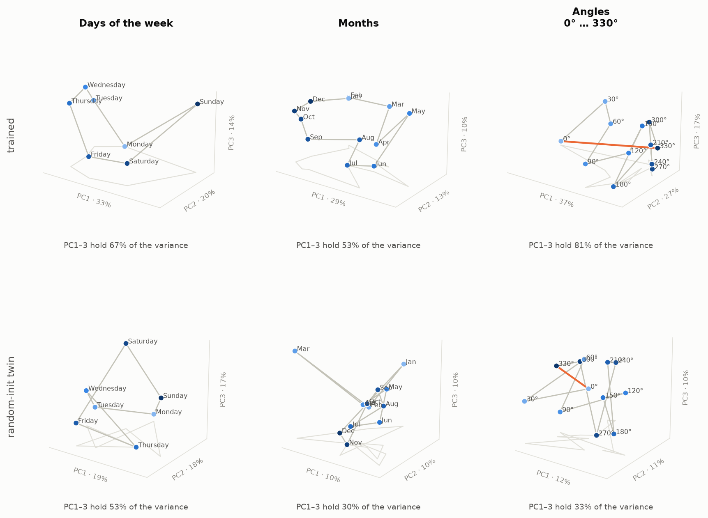

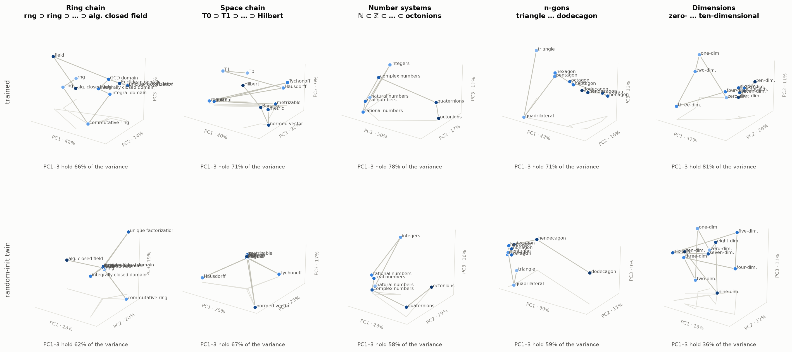

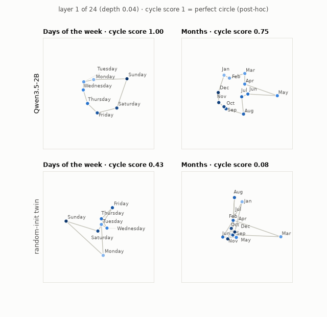

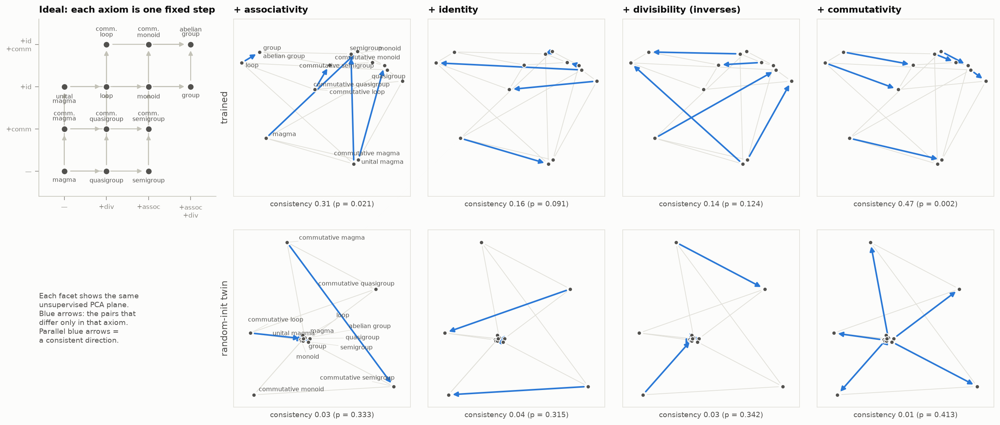

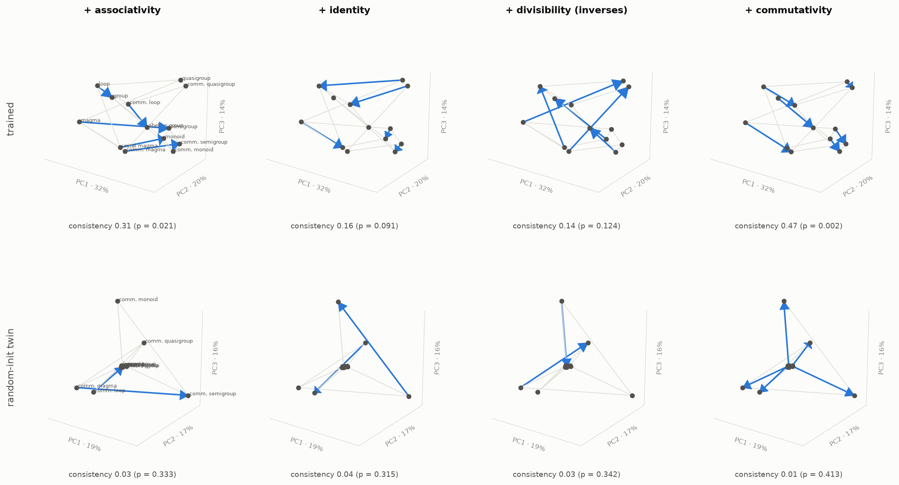

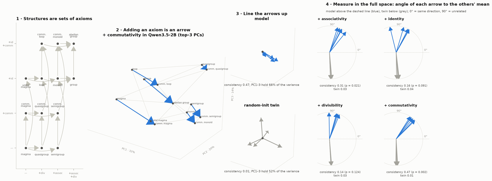

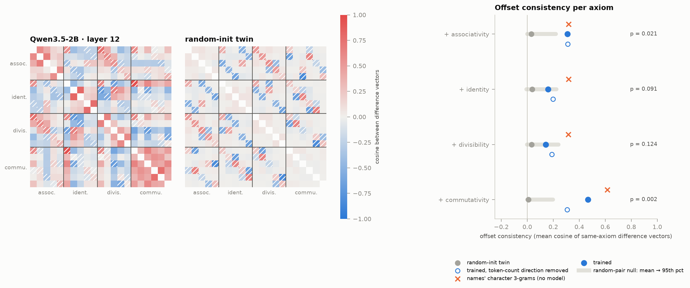
